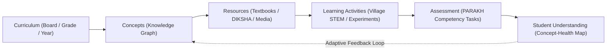
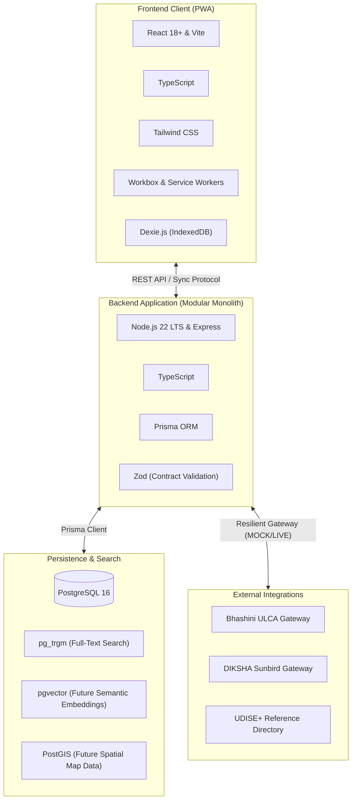
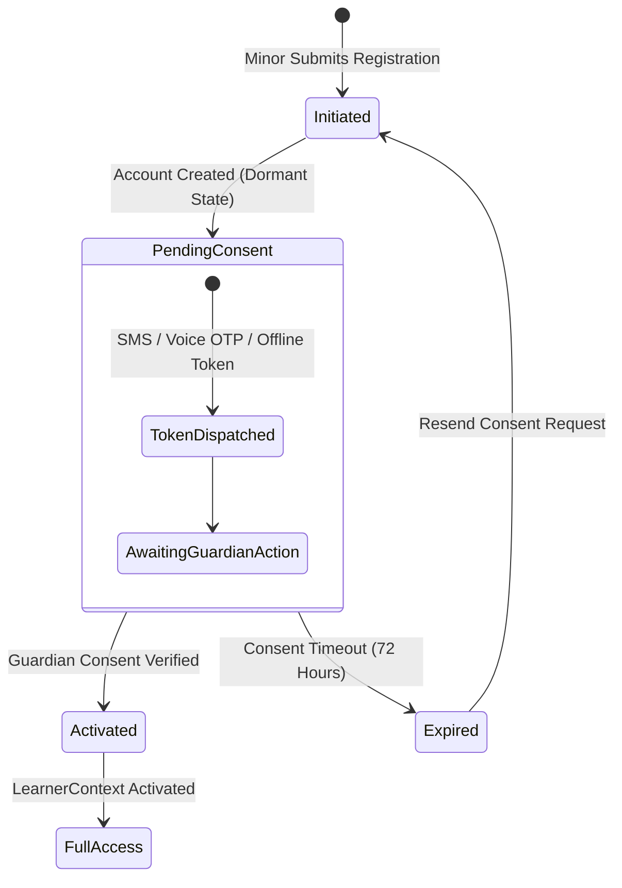

# GAONLAB — PROJECT CONTEXT & ARCHITECTURAL MASTER REFERENCE

> **Persistent Source of Truth for GaonLab Engineering, Architecture, and Agent Workflows**  
> *Last Updated: Academic Year 2026–27 Planning Cycle*  
> *Repository: `GaonLabs`*

---

## 1. Executive Summary & Product Identity

### 1.1 What is GaonLab?
**GaonLab** is a personalised, offline-first STEM (Science, Technology, Engineering, and Mathematics) education ecosystem designed specifically for school students in rural, semi-urban, and underserved communities. 

GaonLab is fundamentally **not** a generic educational platform consisting of passive video lectures, repetitive multiple-choice quizzes, or an intrusive chatbot. Instead, GaonLab transforms the student's physical surroundings—their village, farmland, local flora, fauna, tools, and rural infrastructure—into a living scientific laboratory.

### 1.2 Core Product Objectives
1. **Bridge Curriculum with Experiential Reality:** Connect formal state and national curriculum benchmarks directly to physical experimentation, indigenous knowledge, and contextual rural applications.
2. **Offline-First Accessibility:** Provide an uninterrupted, full-fidelity learning experience on low-cost Android hardware operating under severe or zero internet connectivity.
3. **Respect & Align with Public Digital Infrastructure:** Integrate and augment Indian national and state educational digital public goods (NDEAR, DIKSHA, APAAR, BHASHINI, PARAKH, UDISE+, KTBS, DSERT) rather than attempting to replace or duplicate them.
4. **Socratic, Inquiry-Driven Learning:** Replace passive memorization with active inquiry, guided reasoning, variable experimentation, and collaborative problem-solving.
5. **Safeguard Rural Children:** Embed child privacy, verifiable parental consent, and data protection aligned with the Digital Personal Data Protection (DPDP) Act 2023 without introducing exclusionary friction.

### 1.3 The Central Educational Pipeline
Every educational interaction within GaonLab is anchored in a continuous, bidirectional learning chain:

$$\text{Curriculum} \longrightarrow \text{Concepts} \longrightarrow \text{Resources} \longrightarrow \text{Learning Activities} \longrightarrow \text{Assessment} \longrightarrow \text{Student Understanding}$$



---

## 2. Target User Segments

GaonLab accommodates diverse learner profiles and institutional stakeholders through a single, unified architecture:

### 2.1 Learner Categories
| Category | Grade Span | Cognitive & Practical Focus | Initial Scope Status |
| :--- | :--- | :--- | :--- |
| **Primary** | Grades 1–5 | Foundational numeracy, observational nature studies, tactile curiosity. | Future Expansion |
| **Middle** | **Grades 6–8** | **Core scientific principles, contextual mathematics, guided experiments, village mechanics.** | **Primary Target for Base Implementation** |
| **Secondary** | Grades 9–10 | Formal physics/chemistry/biology disciplines, algebraic modeling, competitive foundations. | Planned Phase 2 |
| **Higher Secondary** | Grades 11–12 | Specialized science streams, laboratory simulations, career and entrance pathways. | Planned Phase 3 |
| **Post-School** | Polytechnic / Diploma / Vocational | Applied engineering, agricultural mechanics, rural technology, vocational certifications. | Long-Term Roadmap |

### 2.2 Learner Registration Types
1. **Independent Learners:** Self-registered students studying outside of a participating school network or supplementing their schooling autonomously. School affiliation, UDISE code, or APAAR ID is **strictly optional**.
2. **School-Associated Learners:** Students who registered independently and subsequently linked their account to an accredited school via an invite code, teacher link, or school UDISE code.
3. **School-Provisioned Learners:** Students onboarded in bulk or rostered directly by an institutional school partner or state department deployment.

### 2.3 Non-Learner Stakeholders
- **Guardians:** Parents or legal guardians responsible for providing informed consent for learners under 18, tracking holistic progress, and receiving offline-friendly updates via SMS/voice/app.
- **Teachers:** Educators utilizing GaonLab for classroom demonstrations, assigning localized Lab Without Walls experiments, and diagnosing class-wide concept health gaps.
- **School Administrators:** Headmasters and institutional managers monitoring school-level curriculum completion, resource availability, and community mission participation.
- **GaonLab Platform Administrators:** System maintainers managing curriculum versions, verifying textbook ingestion pipelines, monitoring government gateway adapters, and maintaining platform health.

---

## 3. Complete 26-Feature Product Scope

GaonLab’s architecture supports 26 distinct, interconnected features spanning five foundational pillars. The platform roadmap executes these incrementally without discarding any capability from the long-term design.

```mermaid
mindmap
  root((GaonLab Ecosystem))
    Student Identity & Resources
      (1) Student Onboarding & Profiles
      (2) Grade-card Uploads & History
      (3) Personal Resource Library
      (4) Offline Multilingual Engine
      (5) Scientific Discovery Feed
      (6) Contextual PDF Reader
    Learning & AI
      (7) Post-Lesson Quizzes & Tests
      (8) Socratic AI Assistant
      (9) Multilingual Support EN-HI-KN
      (10) Universal Offline Operations
    Contextual STEM
      (11) Village STEM Learning
      (12) Local Biodiversity Explorer
      (13) Contextual Mathematics
      (14) AI Teacher Assistant
    Gamification & Experiments
      (15) Connected Gamified Environment
      (16) STEM Lens Object Vision
      (17) What If Variable Sandbox
      (18) Lab Without Walls
      (19) Weekly Collaborative Missions
      (20) Concept-Health Knowledge Map
      (21) STEM Village Builder
      (22) Physics Playground
      (23) Evolution World Simulator
      (24) STEM Treasure Hunt
      (25) Science Boss Battles
    Opportunities
      (26) Mentorship, Contests & Scholarships
```

### Complete Feature Scope Matrix
| # | Feature Name | Pillar | Description | Architectural Phase |
| :-: | :--- | :--- | :--- | :--- |
| **1** | **Student Onboarding & Profiling** | Identity & Resources | Multi-dimensional onboarding capturing board, grade, language, interests, career aspirations, and school association. | **Base Foundation** |
| **2** | **Grade-Card & Academic History** | Identity & Resources | Upload, OCR extraction, and tracking of historical academic performance and institutional report cards. | Planned Stage 2 |
| **3** | **Personal Resource Library** | Identity & Resources | Central offline-cached repository for prescribed textbooks, official PDFs, revision notes, and worksheets. | **Base Foundation** (Skeleton) |
| **4** | **Offline Multilingual Platform** | Identity & Resources | System-wide capability to render, navigate, and study STEM content completely offline in low-connectivity settings. | **Base Foundation** (PWA/Cache) |
| **5** | **Discovery Feed** | Identity & Resources | Curated feed highlighting contemporary scientific discoveries, regional innovators, agricultural tech, and research profiles. | Planned Stage 3 |
| **6** | **Contextual PDF Reader** | Identity & Resources | Embedded document reader allowing passage highlighting that triggers contextual video explanations and concept breakdowns. | Planned Stage 3 |
| **7** | **Post-Lesson Assessments** | Learning & AI | Formative quizzes, diagnostic tests, and mastery checkpoints mapped to chapter learning outcomes. | Planned Stage 2 |
| **8** | **Socratic AI Assistant** | Learning & AI | Age-appropriate pedagogical tutor that guides learners using hints, analogies, and questions rather than giving direct answers. | Planned Stage 4 |
| **9** | **Multilingual Engine (EN, HI, KN)** | Learning & AI | Full platform localization supporting English, Hindi, and Kannada using Bhashini ULCA standards. | **Base Foundation** (Schema/i18n) |
| **10** | **Universal Offline Sync** | Learning & AI | Intelligent background delta sync, conflict resolution, and local outbox queue for all learning interactions. | **Base Foundation** (Core Outbox) |
| **11** | **Village STEM Learning** | Contextual STEM | Curriculum concepts taught through village objects (bullock carts, tube wells, bio-gas plants, seed drills). | Planned Stage 3 |
| **12** | **Local Biodiversity Explorer** | Contextual STEM | Field notebook and observational tool for documenting local flora, fauna, medicinal plants, and soil types. | Planned Stage 4 |
| **13** | **Contextual Mathematics** | Contextual STEM | Math problem sets grounded in real-world rural scenarios: crop yields, mandi market pricing, solar pump discharge rates. | Planned Stage 3 |
| **14** | **AI Teacher Copilot** | Contextual STEM | Assistant for village schoolteachers generating bilingual lesson plans, local experiment guides, and diagnostic remedial tasks. | Planned Stage 4 |
| **15** | **Connected Gamified Ecosystem** | Gamification & Play | Progression system featuring skill badges, curiosity streaks, mastery tiers, and community recognition. | Planned Stage 3 |
| **16** | **STEM Lens** | Gamification & Play | Mobile camera tool identifying scientific mechanisms, geometrical shapes, and biological species in daily objects. | Future Stage 5 (Vision AI) |
| **17** | **What If? Variable Sandbox** | Gamification & Play | Interactive simulations allowing students to manipulate variables (gravity, friction, rainfall, nutrients) and observe effects. | Planned Stage 4 |
| **18** | **Lab Without Walls** | Gamification & Play | Guided hands-on physical experiments constructed entirely using free, scrap, or locally accessible village materials. | Planned Stage 3 |
| **19** | **Collaborative Weekly Missions** | Gamification & Play | Inter-school team challenges connecting rural classrooms to solve joint environmental or engineering problems. | Planned Stage 5 |
| **20** | **Concept-Health Map** | Gamification & Play | Visual knowledge graph exposing student mastery, decaying recall, and missing prerequisite foundational concepts. | **Base Foundation** (Graph Model) |
| **21** | **STEM Village Builder** | Gamification & Play | Simulation game where students build and optimize a virtual village utilizing real geographic, water, and energy data. | Future Stage 5 (Phaser/GIS) |
| **22** | **Physics Playground** | Gamification & Play | 2D rigid-body sandbox to construct physical machines using levers, pulleys, gears, inclined planes, and springs. | Future Stage 5 (Matter.js) |
| **23** | **Evolution World** | Gamification & Play | Ecological simulator modeling species adaptation, environmental pollution, and community conservation interventions. | Future Stage 5 |
| **24** | **STEM Treasure Hunt** | Gamification & Play | Real-world observational scavenger hunts in and around schools, identifying mathematical symmetry, plant adaptations, etc. | Planned Stage 4 |
| **25** | **Science Boss Battles** | Gamification & Play | Multi-stage challenge encounters where defeating a crisis requires applying cumulative science concepts. | Planned Stage 4 |
| **26** | **Opportunities Gateway** | Opportunities | Curated bridge matching students to regional science fairs, Olympiads, mentorship programs, scholarships, and internships. | Planned Stage 4 |

---

## 4. Initial Curriculum Scope & Academic Rigour

### 4.1 Scope Boundaries for Base Launch
- **Academic Year:** `2026–27`
- **Target Grades:** `Grade 6`, `Grade 7`, `Grade 8` (Middle School)
- **Target Subjects:** `Mathematics`, `Science`
- **Initial Education Boards:**
  1. **CBSE** (Central Board of Secondary Education)
  2. **Karnataka State Board** (Karnataka School Examination and Assessment Board / DSERT)

### 4.2 Educational Authority Distinction Matrix
To prevent architectural confusion between publishers, frameworks, and boards, GaonLab enforces strict ontological distinctions:

| Educational Dimension | Definition | CBSE Instance | Karnataka State Board Instance |
| :--- | :--- | :--- | :--- |
| **Education Board** | Examining and accrediting authority. | CBSE (Central Board of Secondary Education) | KSEAB (Karnataka School Examination & Assessment Board) |
| **Curriculum Framework** | Pedagogical policies and learning standards. | NCF-SE 2023 / NEP 2020 | Karnataka State Curriculum Framework (KCF) / DSERT |
| **Curriculum Authority** | Institution designing the syllabus. | NCERT / CBSE Academic Unit | DSERT (Dept of State Educational Research & Training) |
| **Textbook Publisher** | Body producing official textbooks. | NCERT (*Curiosity*, *Ganita Prakash*, etc.) | KTBS (Karnataka Textbook Society) |
| **Assessment Authority** | Body setting standardized evaluations. | CBSE Examination Division / PARAKH | KSEAB Assessment Wing |
| **Textbook Edition** | Physical publication version & print year. | NCERT 2024–2026 revised print editions | KTBS 2024–2026 revised print editions |
| **Medium of Instruction** | Language of educational delivery. | English, Hindi | Kannada, English, Hindi |

### 4.3 Official Source Verification Registry
GaonLab maintains rigorous sourcing. Guessed or unverified chapters will **never** be injected into the curriculum database.

| Source Entity | Official URL | Role in GaonLab | Ingestion Status |
| :--- | :--- | :--- | :--- |
| **NCERT Textbooks** | `https://ncert.nic.in/textbook.php` | Prescribed CBSE middle school textbooks | Verified Official Source |
| **NCERT Curriculum** | `https://ncert.gov.in/` | Learning outcomes and syllabus structure | Verified Official Source |
| **Karnataka KTBS** | `https://textbooks.karnataka.gov.in/` | State board textbooks (Kannada/English) | Verified Official Source |
| **Karnataka DSERT** | `https://schooleducation.karnataka.gov.in/` | State learning outcomes and teacher resources | Verified Official Source |
| **Karnataka SATS** | `https://sts.karnataka.gov.in/SATS/` | State student identification and tracking | Designed for Integration |
| **DIKSHA** | `https://diksha.gov.in/` | National repository of QR-energized content | Verified Integration Model |
| **ePathshala** | `https://epathshala.nic.in/` | Digital textbooks and audio-visual assets | Verified Reference Source |

---

## 5. Technology Stack & Architectural Decision Record

### 5.1 Repository Baseline Evaluation
Inspection of the repository confirms it is currently in a pristine, greenfield state with a single initial commit (`README.md`). There is no legacy code, conflicting framework, or technical debt present. 

The proposed modern, lightweight stack is adopted with zero friction.

### 5.2 Chosen Technology Stack


| Layer | Technology | Selection Justification |
| :--- | :--- | :--- |
| **Frontend Framework** | **React 18+ with Vite** | Rapid build times, extensive ecosystem, robust PWA packaging capabilities. |
| **Client Language** | **TypeScript** | Strict compile-time typing, shared data contracts with backend, reduced runtime bugs. |
| **Styling** | **Tailwind CSS** | Highly performant utility-first styling, zero runtime overhead, responsive design for budget devices. |
| **Client Offline Storage** | **Dexie.js (IndexedDB)** | High-capacity indexed browser database for textbook snapshots, manifest caches, and sync queues. |
| **PWA & Caching** | **Workbox / Service Workers** | Reliable asset caching, offline fallback pages, background sync orchestration. |
| **Backend Runtime** | **Node.js 22 LTS & Express** | Asynchronous I/O efficiency, lightweight footprint, ubiquitous developer tooling. |
| **Backend Language** | **TypeScript** | Strong typing across modular boundaries, end-to-end type safety from database to UI. |
| **Database & ORM** | **PostgreSQL 16 + Prisma ORM** | ACID transactions, native JSONB support, declarative schema modeling, seamless migration workflow. |
| **Future Search / Vectors** | **PostgreSQL Full-Text + `pgvector`** | Integrated semantic retrieval and keyword matching without adding external cluster dependencies. |
| **Future Spatial Mapping** | **PostGIS + MapLibre GL** | High-performance open-source vector map rendering for STEM Village Builder and Treasure Hunt. |
| **Future Interactive Gaming** | **Phaser 3 + Matter.js** | HTML5 canvas-based 2D gaming and physics simulation running smoothly on mobile web views. |

---

## 6. Foundational Architecture Principles

1. **Modular Monolith, Not Microservices:**  
   The backend is structured as a single deployable unit divided into strictly isolated, domain-bounded modules. Each module encapsulates its internal database models, business logic, and exposes only an explicit public service interface. No distributed network hops or premature Kubernetes clusters.

2. **Autonomous Modules with Logical Data Ownership:**  
   Cross-module database foreign keys that enforce hard database-level cascades across domains are avoided. Modules communicate synchronously via clean service contracts for composition, or asynchronously via an internal event bus for side effects.

3. **Universal `LearnerContext` Token:**  
   Downstream learning and gamification modules must never query raw identity or auth tables directly. Instead, they consume a standardized, privacy-preserving `LearnerContext` resolved dynamically per request or cached locally in IndexedDB.

4. **Curriculum Resolution as an Indispensable Pipeline:**  
   The central pipeline `resolveStudentCurriculum(learnerId)` serves as the single authority determining the exact board, framework, textbooks, chapters, and concepts applicable to a student's active enrollment.

5. **Resilient Government Integration Gateway:**  
   Every external government adapter (DIKSHA, Bhashini, UDISE+, SATS) must implement a strict multi-mode interface (`LIVE`, `CACHED`, `MOCK`, `OFF`). Downstream features must operate seamlessly in `CACHED` or `MOCK` mode when government APIs are unreachable or offline.

---

## 7. Child Privacy, Legal Compliance & Guardian Consent

### 7.1 Compliance with DPDP Act 2023
The Indian Digital Personal Data Protection Act (DPDP) 2023 mandates that processing the personal data of any child (under 18 years) requires verifiable parental/guardian consent, strictly prohibits targeted tracking or behavioral advertising, and enforces rigorous data minimization.

### 7.2 Separation of Registration vs. Activation


- **Account Registration:** A student under 18 can initiate signup, select their grade and board, and configure basic preferences. At this stage, the account is marked `PENDING_CONSENT`.
- **Account Activation:** Processing personal data, persisting performance history, public forum interaction, and collaborative missions remain locked until verifiable guardian consent is recorded.
- **Guardian Verification Mechanics:**
  - Phone OTP alone **does not** prove adulthood or legal guardianship.
  - GaonLab implements an explicit Guardian Consent Protocol:
    1. Guardian phone number provided by student.
    2. Interactive bilingual consent prompt sent via SMS/WhatsApp/IVR specifying exactly what data is collected.
    3. Guardian confirms age eligibility (18+) and authorizes the student profile via a cryptographically signed one-time link or verification token.
    4. **Offline / Low-literacy Fallback:** In rural schools, verified teacher-attested batch consent or physical signed consent forms can be digitally attested by school administrators.
- **Strict No-Aadhaar Mandate:** Aadhaar numbers will **never** be collected, stored, or required for student registration. APAAR identifiers are strictly optional and stored as non-reversible hashes where provided.

---

## 8. Development Rules & Future Agent Guidelines

### 8.1 Critical Directives for Agents Working on GaonLab
1. **Inspect Before Acting:** Always inspect directory contents, existing configuration, and dependency files before modifying or generating code.
2. **Incremental Execution:** Build strictly according to the active stage defined in [BASE_SCOPE_AND_ROADMAP.md](file:///home/utkarsh-singh-parihar/Projects/GaonLabs/docs/BASE_SCOPE_AND_ROADMAP.md). Never attempt to generate the entire multi-stage platform in a single turn.
3. **Preserve Documentation Integrity:** Maintain all architectural files, comments, and schemas. Do not invent curriculum chapters or pretend that an unintegrated government API is live.
4. **Zero Secrets in Code:** Never commit API keys, database credentials, or private certificates. Use environment variables with comprehensive `.env.example` templates.
5. **Strict Typing & Module Boundaries:** Never bypass a module's public interface to directly query another module's internal database tables.
6. **All New Features Must Be Offline-Aware:** When implementing any new learning activity, always design its IndexedDB cache representation and its sync outbox payload upfront.

---

## 9. Current Implementation Status Tracker

| Milestone | Target Stage | Current Status | Description |
| :--- | :--- | :--- | :--- |
| **Architecture & Specifications** | **Stage 0** | **COMPLETED** | System architecture, product specs, base roadmap, and repo context created. |
| **Monolith Scaffolding & DB Models** | **Stage 1 & 1.1** | **COMPLETED** | Monorepo setup, Express backend, Prisma schema (33 models, 18 enums), 3 migrations applied, 22 unit/integration tests passing, guardian verification decoupled & gated, `/health` & `/ready` operational. |
| **Curriculum Database Ingestion** | **Stage 2** | **COMPLETED** | NCERT & KTBS 2026–27 verified ingestion (18 manifests, 12 textbooks, 18 editions, 261 chapters in English & Kannada for Grades 6–8 Math & Science), idempotent CLI seeder with `--dry-run`, 6 read-only REST API endpoints, full student resolution pipeline, 32 tests passing. |
| **Complete NCERT STEM Catalogue (Classes 1–12)** | **Stage 2.1** | **COMPLETED** | Expanded national reference STEM catalogue covering Classes 1 to 12 (101 manifests total: 83 NCERT, 12 KTBS, 6 CBSE; 57 canonical textbooks, 98 editions, 1,161 chapters [1,042 verified, 45 pending, 74 archived]; English, Hindi, Urdu, Kannada; multi-volume Physics, Chemistry, Math for Classes 11–12; Computer Science, IP, Biotechnology; national catalogue REST APIs; 47 tests passing). |
| **Identity & Guardian Consent Engine** | Stage 3 | Planned Next | Minor registration, guardian consent tokens, auth sessions, `LearnerContext` generator. |
| **Government Integration Gateway** | Stage 4 | Pending Stage 3 | Adapters for Bhashini, DIKSHA, and UDISE+ with full mock/cached resilience. |
| **Offline Sync Outbox & Client PWA** | Stage 5 | Pending Stage 4 | Workbox service worker, Dexie outbox, client-server sync protocol. |
| **Interactive STEM Learning Modules** | Stage 6+ | Future Roadmap | Village STEM, What-If simulations, Lab Without Walls, Gamified Sandboxes. |

---

## 10. Stage 1 & 2 Execution & Operational Commands

### 10.1 Running the Foundation & Ingesting Curriculum
```bash
# 1. Install all dependencies across workspaces
npm install

# 2. Start PostgreSQL (Docker Compose or Embedded utility)
# Option A: Docker Compose
docker compose -f infrastructure/docker-compose.yml up -d
# Option B: Local Embedded Postgres (Zero external dependencies)
npm run db:local:start

# 3. Generate Prisma client & validate schema
npm run db:generate --workspace=@gaonlab/api
npm run db:validate --workspace=@gaonlab/api

# 4. Run migrations
npm run db:migrate --workspace=@gaonlab/api

# 5. Ingest official school curriculum (Academic Year 2026–27)
# Dry-run validation mode:
npm run db:seed:curriculum -- --dry-run
# Live database ingestion (strictly idempotent):
npm run db:seed:curriculum

# 6. Build all packages and run tests
npm run build
npm run test

# 7. Start the API server
npm run dev
# Or production build:
npm start
```

### 10.2 Verified Endpoints
- `GET http://localhost:4000/health`: Liveness probe (process status, uptime, version).
- `GET http://localhost:4000/ready`: Readiness probe (verifies live PostgreSQL connectivity and latency).
- `GET http://localhost:4000/`: API service index.
- `GET http://localhost:4000/api/v1/curriculum/boards`: Registered education boards.
- `GET http://localhost:4000/api/v1/curriculum/boards/:boardId/grades`: Grades per education board.
- `GET http://localhost:4000/api/v1/curriculum/grades/:gradeId/subjects`: Subjects per grade.
- `GET http://localhost:4000/api/v1/curriculum/catalogue`: Filterable catalogue.
- `GET http://localhost:4000/api/v1/curriculum/publishers`: Registered textbook publishers.
- `GET http://localhost:4000/api/v1/curriculum/national-catalogue`: NCERT National Reference Catalogue query.
- `GET http://localhost:4000/api/v1/curriculum/textbooks/:textbookId`: Canonical textbook details and editions.
- `GET http://localhost:4000/api/v1/curriculum/editions/:editionId/chapters`: Chapters ordered for edition.
- `GET http://localhost:4000/api/v1/curriculum/resolve/:learnerId`: Resolved curriculum for active student enrollment.
- `GET http://localhost:4000/api/v1/features/catalogue`: Dynamic feature module catalogue with flag evaluation.
- `GET http://localhost:4000/api/v1/stem-lens/status`: STEM Lens module status (Owned by Robin).
- `GET http://localhost:4000/api/v1/village-builder/status`: STEM Village Builder module status (Owned by Prashanth).
- `GET http://localhost:4000/api/v1/reader/books/:editionId`: Smart Reader book details and chapter access modes.
- `GET http://localhost:4000/api/v1/reader/chapters/:chapterId`: Chapter reading resource and permission verification.
- `GET http://localhost:4000/api/v1/reader/documents/:documentId`: In-app authorized companion document metadata.
- `GET http://localhost:4000/api/v1/reader/chapters/:chapterId/explanations`: Pre-compiled STEM contextual visual explanations.
- `POST http://localhost:4000/api/v1/reader/explain`: Natural language keyword matcher for selected text visual explanations.
- `GET http://localhost:4000/api/v1/topics`: Filterable Explore STEM topics catalogue across Classes 1–12.
- `GET http://localhost:4000/api/v1/topics/:topicId`: Full topic metadata, lesson overview, and official references.
- `GET http://localhost:4000/api/v1/topics/:topicId/lesson`: Structured original in-app STEM lesson content.
- `GET http://localhost:4000/api/v1/topics/:topicId/video`: Narrated video metadata, duration, resolution, and caption tracks.
- `GET http://localhost:4000/api/v1/topics/:topicId/resources`: Official curriculum links (NCERT/KTBS) and fair-use disclaimers.
- `POST http://localhost:4000/api/v1/topics/match`: Smart Reader selection matcher connecting textbook text to topics and videos.
- `GET http://localhost:4000/api/v1/videos/stream/:videoId`: HTTP 206 partial content MP4 video streaming.
- `GET http://localhost:4000/api/v1/videos/captions/:filename`: WebVTT closed caption serving.
- `GET http://localhost:4000/api/v1/experiments`: Filterable Experiment Studio catalogue (simulation type, board, grade).
- `GET http://localhost:4000/api/v1/experiments/:id/manifest`: Full validated declarative JSON experiment manifest.
- `POST http://localhost:4000/api/v1/experiments/:id/sessions`: Start or resume interactive experiment session.
- `GET http://localhost:4000/api/v1/experiments/sessions/:id`: Retrieve session state, observations, and manifest.
- `POST http://localhost:4000/api/v1/experiments/sessions/:id/events`: Ingest lifecycle events with idempotent clientEventId deduplication.
- `POST http://localhost:4000/api/v1/experiments/sessions/:id/complete`: Finalize experiment session with score and reflection notes.

### 10.3 Student Frontend Applications (`apps/web`)
- **Framework**: React 18, Vite 5, TypeScript 5, Tailwind CSS 3, Lucide React icons.
- **Port**: `http://localhost:5173` (with `/api` proxied to port 4000).
- **Core Pages Implemented**:
  1. Welcome Landing Page (`/`): Product intro, quick 1-click demo launchers, feature pillars.
  2. Student Registration (`/signup`): Board, grade, medium, subjects, live curriculum availability check.
  3. Student Sign In (`/signin`): Demo credential selector, autofill, isolated session management.
  4. Personalised Dashboard (`/app/dashboard`): Student academic pill card, language switcher, My Learning overview, prescribed textbooks, verified chapter outline, and prominent Explore STEM featured banners.
  5. Textbook Library (`/app/library`): Filterable curriculum catalogue by board, class, subject, and medium with live search.
  6. Book Details & Chapter Index (`/app/books/:editionId`): Complete verified chapter outline, official portal references, and in-app authorized guide launchers.
  7. In-App Smart PDF Reader (`/app/reader/:documentId`): Offline-ready Mozilla PDF.js v3.11.174 reader, responsive single/multi-column canvas, text selection, persistent IndexedDB highlights/underlines/notes, and floating toolbar.
  8. Contextual STEM Explainer: Interactive visual physics simulations (`MICROSCOPIC_INTERLOCKING`, `BLOCK_PULL`, `FRICTION_SURFACES`, `BALL_BEARING`) and seamless linkage to Explore STEM concept videos.
  9. Explore STEM Hub (`/app/explore`): Multi-subject, multi-standard (Classes 1–12) topic catalogue with instant search, format toggles, and availability badges.
  10. Topic Detail Page (`/app/explore/topics/:topicId`): Three-tier exploration (Read In-App Lesson, Watch Narrated Animated Video, and Official Curriculum Resources).
  11. STEM Lens Placeholder (`/app/stem-lens`): Integration contract placeholder owned by Robin.
  12. STEM Village Builder Placeholder (`/app/village-builder`): Integration contract placeholder owned by Prashanth.
  13. Experiment Studio Catalogue (`/app/experiments`): Filterable experiential STEM lab directory supporting CBSE, KTBS, Chemistry, and Physics.
  14. Experiment Specification (`/app/experiments/:id`): Overview, safety validation, learning objectives, apparatus breakdown.
  15. Interactive Virtual Lab Bench (`/app/experiments/:id/lab`): Live laboratory simulation hosting Chemistry (pH equilibria, indicators, color transitions) and Physics (Coulomb friction, force vectors, live velocity-time graph) across a 7-phase inquiry lifecycle.
- **Automated Video Generation Engine (`tools/video-generator/`)**:
  - Python 3.12, Pillow, gTTS, offline synthetic fallback, imageio-ffmpeg.
  - Multi-script font support: Noto Sans (Latin) and Noto Sans Kannada for high-fidelity regional language typography.
  - Generates HD 1280x720 24fps H.264/AAC MP4 animations and WebVTT captions via memory-efficient raw stdin piping.
  - Pre-generated demonstration topics: Class 3 Mathematics (*Fun with Shapes* - English), Class 8 Science (*Exploring Forces & Friction* - English), Class 11 Physics (*Rotational Motion* - English), and Class 7 Science (*ಉಷ್ಣ ಮತ್ತು ತಾಪಮಾನ ವರ್ಗಾವಣೆ / Heat Transfer* - Kannada).
- **Demo Fixtures**:
  - Asha Rao: CBSE Class 8, English Medium (*Ganita Prakash 8*, *Curiosity 8*, authorized *Forces and Friction* learning guide, Class 8 friction explainer video).
  - Kavya Hegde: Karnataka State Board Class 7, Kannada Medium (*KTBS Ganitha 7*, *KTBS Vijnana 7*, verified KTBS chapter sequences, authentic Kannada lessons for Heat, Integers, Motion & Time, Lines & Angles, and 104-second animated Kannada Heat video with subtitles).
- **Integration Reference**: See [`docs/FEATURE_MODULE_INTEGRATION.md`](file:///home/utkarsh-singh-parihar/Projects/GaonLabs/docs/FEATURE_MODULE_INTEGRATION.md), [`docs/SMART_READER.md`](file:///home/utkarsh-singh-parihar/Projects/GaonLabs/docs/SMART_READER.md), and [`docs/EXPLORE_STEM_AND_VIDEO_ENGINE.md`](file:///home/utkarsh-singh-parihar/Projects/GaonLabs/docs/EXPLORE_STEM_AND_VIDEO_ENGINE.md).

---

*This document is maintained as the primary context for all developers, system architects, and AI pair-programming agents contributing to GaonLab.*
