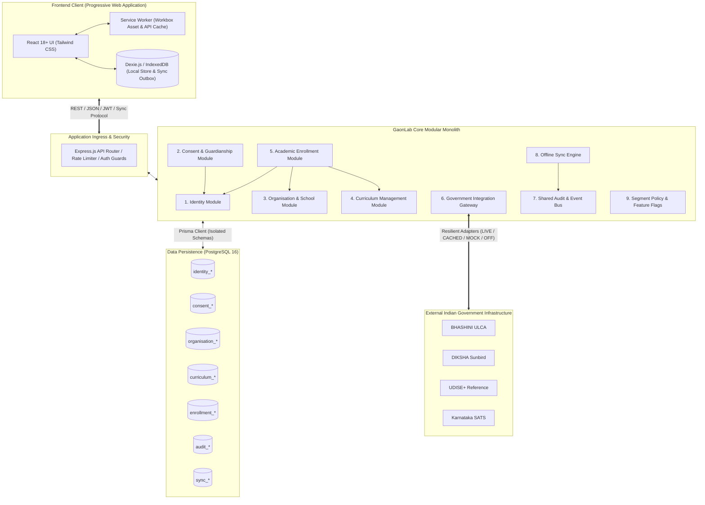
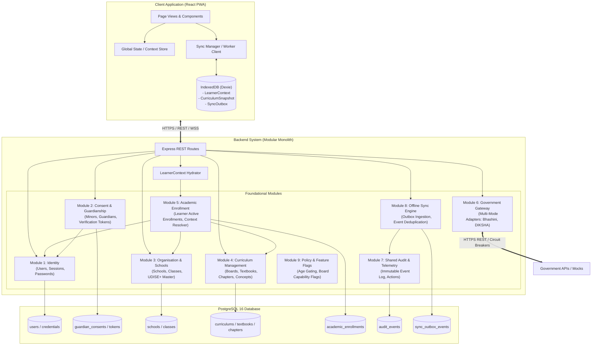
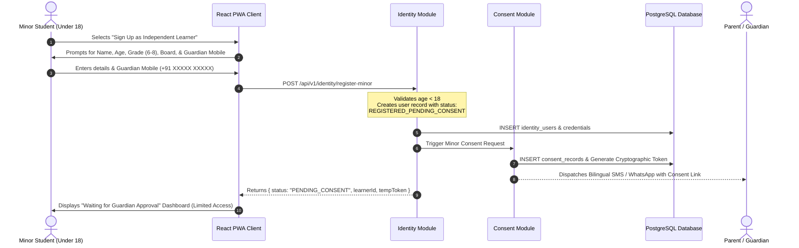
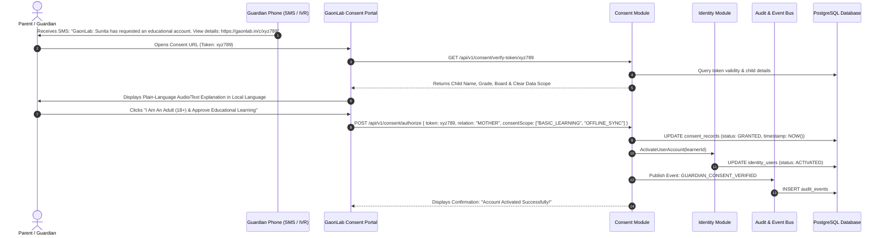
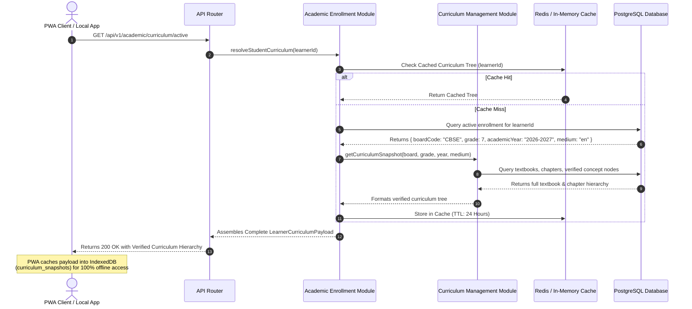
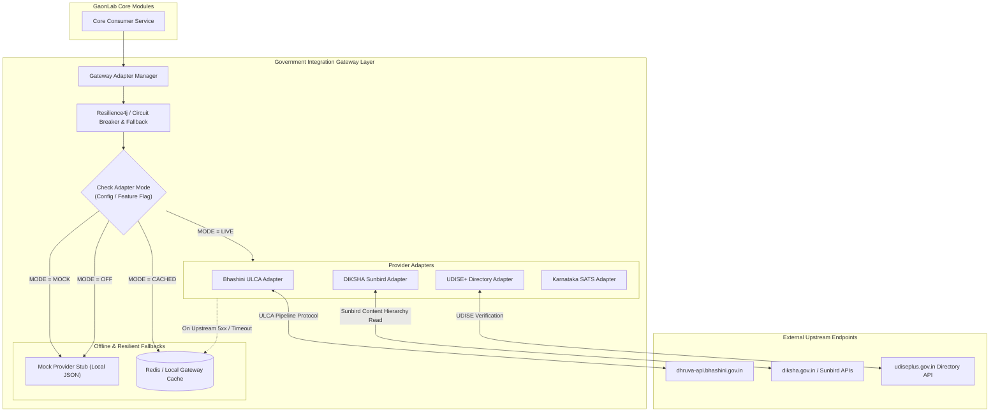
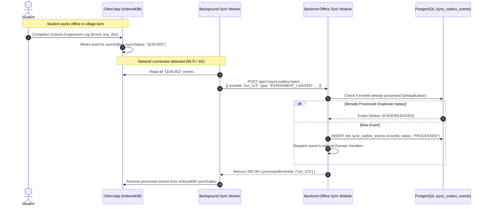
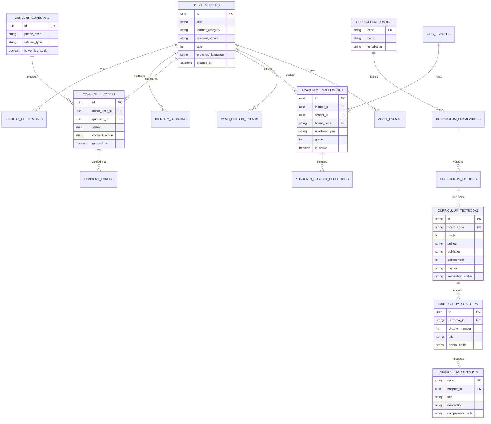

# GAONLAB — BASE SYSTEM TECHNICAL ARCHITECTURE

> **Definitive Architectural Specification for Foundational Modules, Data Pipelines, and System Boundaries**  
> *Target Audience: Principal Engineers, System Architects, Backend/Frontend Developers*  
> *Version: 1.0 (Foundation Stage)*  
> *Academic Year: 2026–27*

---

## 1. Architectural Philosophy & System Boundaries

### 1.1 Architectural Rationale: The Modular Monolith
GaonLab adopts a **Modular Monolith** architecture for its foundational and expansion phases. 



#### Why Not Microservices?
1. **Elimination of Distributed Failure Modes:** Rural school educational networks have high latency. Introducing internal network latency, distributed transactions, and RPC failure points would degrade reliability.
2. **Atomic Consistency Where Needed:** Domain operations—such as enrolling a learner and generating their active curriculum binding—can be executed within an ACID database transaction.
3. **Simplified Deployment & Resource Footprint:** A single Node.js container with PostgreSQL can easily be hosted on cost-effective infrastructure or edge servers in rural block resource centers.
4. **Refactoring Safety:** Monolithic type systems allow TypeScript to enforce interface contracts at compile time across module boundaries without fragile protocol buffer or schema registry overhead.

### 1.2 Module Boundary Rules
To prevent the monolith from devolving into an unmaintainable "spaghetti codebase", the following rules are strictly enforced:
- **No Direct Cross-Module Database Access:** Module A must never query or mutate tables owned by Module B. All interactions occur via the target module’s exported TypeScript Public Service contract.
- **Foreign Key Soft Boundaries:** Foreign keys across module boundaries are stored as UUID values without database-level hard cascading deletes (`ON DELETE CASCADE` across domain tables is forbidden).
- **Synchronous vs. Asynchronous Communication:**
  - **Synchronous Services:** Used for read composition (e.g., the Academic Enrollment module querying Identity and Curriculum to construct `LearnerContext`).
  - **Asynchronous Events:** Used for side-effects (e.g., logging audit trails, dispatching SMS notifications, invalidating offline caches).

---

## 2. Diagram 1: Overall System Architecture

The following diagram details the internal structural decomposition of the frontend, backend modules, database schemas, and integration gateways:



---

## 3. The Nine Foundational Modules

### 3.1 Module 1: Identity Module
- **Domain Responsibility:** Manages core user entities, authentication credentials, role assignments, profile basics, and session tokens.
- **Account State Machine:**
  - `REGISTERED_PENDING_CONSENT`: Account created for a minor; cannot access collaborative features or process personal performance data.
  - `ACTIVATED`: Guardian consent verified; full access granted.
  - `SUSPENDED`: Temporarily halted by platform admin or guardian request.
  - `DEACTIVATED`: Soft-deleted upon user/guardian request.
- **Key Tables:** `identity_users`, `identity_credentials`, `identity_sessions`, `identity_roles`.
- **Public Service Contract:** `IdentityService.createUser()`, `IdentityService.authenticate()`, `IdentityService.getProfile(userId)`, `IdentityService.updateStatus(userId, status)`.

### 3.2 Module 2: Consent and Guardianship Module
- **Domain Responsibility:** Manages legal guardian records, relationship types (parent, legal guardian, institutional warden), consent authorization tokens, DPDP audit trails, and multi-factor verification workflows.
- **Design Philosophy:** Avoids intrusive data collection. Adulthood verification is handled via cryptographic one-time authorization tokens dispatched via SMS/WhatsApp/Voice IVR or authorized teacher-attested bulk consent for rural boarding schools.
- **Key Tables:** `consent_guardians`, `consent_records`, `consent_tokens`, `consent_audit_log`.
- **Public Service Contract:** `ConsentService.createMinorConsentRequest(minorId, guardianPhone, relation)`, `ConsentService.verifyGuardianToken(token, guardianDetails)`, `ConsentService.getConsentStatus(learnerId)`.

### 3.3 Module 3: Organisation and School Management
- **Domain Responsibility:** Manages educational institutions, administrative affiliations, classes, academic batches, and teacher associations.
- **Key Attributes:**
  - Supports national 11-digit **UDISE+** codes as reference data.
  - Accommodates independent learning: a school ID is **strictly optional** across all student entities.
- **Key Tables:** `org_schools`, `org_academic_sessions`, `org_classes`, `org_teacher_allocations`.
- **Public Service Contract:** `SchoolService.lookupSchoolByUdise(udiseCode)`, `SchoolService.getSchoolDetails(schoolId)`, `SchoolService.listClasses(schoolId)`.

### 3.4 Module 4: Curriculum Management
- **Domain Responsibility:** Master catalog of educational boards, curriculum frameworks, academic years, grades, subjects, official textbook editions, chapters, and atomic concept knowledge graph nodes.
- **Integrity Rule:** Ingested textbooks and chapters maintain a strict `verificationStatus`: `VERIFIED_OFFICIAL`, `COMMUNITY_VERIFIED`, or `PENDING_VERIFICATION`. Guessed data is rejected.
- **Key Tables:** `curriculum_boards`, `curriculum_frameworks`, `curriculum_editions`, `curriculum_textbooks`, `curriculum_chapters`, `curriculum_concepts`, `curriculum_concept_dependencies`.
- **Public Service Contract:** `CurriculumService.getCurriculumTree(board, grade, year, subject)`, `CurriculumService.getChapterConcepts(chapterId)`, `CurriculumService.getConceptGraph(conceptId)`.

### 3.5 Module 5: Academic Enrollment (Composition Layer)
- **Domain Responsibility:** Acts as the compositional bridge between **Identity**, **School**, and **Curriculum**. Manages a learner’s active academic status for a specific academic year (e.g., 2026–27).
- **Core Functionality:** Powers the central `resolveStudentCurriculum(learnerId)` pipeline and generates the universal `LearnerContext` object.
- **Key Tables:** `academic_enrollments`, `academic_subject_selections`.
- **Public Service Contract:** `EnrollmentService.enrollLearner()`, `EnrollmentService.getActiveEnrollment(learnerId)`, `EnrollmentService.resolveStudentCurriculum(learnerId)`.

### 3.6 Module 6: Government Integration Gateway
- **Domain Responsibility:** Standardized, provider-agnostic adapter gateway interfacing with external Indian public digital platforms (DIKSHA, Bhashini, UDISE+, SATS).
- **Operational Modes:** Supports `LIVE`, `CACHED`, `MOCK`, and `OFF` per adapter with runtime health-checks and circuit breakers.
- **Public Service Contract:** `GovGateway.translate(text, srcLang, tgtLang)`, `GovGateway.getContentHierarchy(dikshaId)`, `GovGateway.verifyUdise(code)`.

### 3.7 Module 7: Shared Audit and Event Infrastructure
- **Domain Responsibility:** Centralized append-only event store for auditing, regulatory compliance (DPDP), and system-wide telemetry.
- **Key Tables:** `audit_events`, `telemetry_logs`.
- **Public Service Contract:** `EventBus.publish(event)`, `AuditService.logAction(actorId, action, targetResource, metadata)`.

### 3.8 Module 8: Offline Synchronisation Skeleton
- **Domain Responsibility:** Ingestion and processing of synchronization packets dispatched by offline PWA clients. Enforces idempotent processing and deduplication using client-generated UUIDs.
- **Key Tables:** `sync_outbox_events`, `sync_client_states`, `sync_conflict_resolutions`.
- **Public Service Contract:** `SyncService.processSyncBatch(learnerId, eventsBatch)`, `SyncService.getDeltaUpdates(learnerId, lastSyncTimestamp)`.

### 3.9 Module 9: Segment Policy and Feature Flags
- **Domain Responsibility:** Dynamic policy enforcement based on learner age segment, regional education board, and connectivity profile. Gates features (e.g., public forums disabled for Primary/Middle without explicit consent; low-bandwidth mode forced on 2G connections).
- **Public Service Contract:** `PolicyService.evaluateFeatureAccess(learnerContext, featureKey)`.

---

## 4. The Standard `LearnerContext` Object Specification

The `LearnerContext` is the foundational data contract consumed by all downstream modules (quizzes, simulations, sandboxes, AI tutor). It encapsulates the learner's identity, active curriculum, language, and permission boundaries without exposing sensitive PII.

### 4.1 TypeScript Interface Contract
```typescript
/**
 * Universal Learner Context Contract
 * Delivered to all request handlers and cached locally on PWA client
 */
export interface LearnerContext {
  // 1. Identity & Profile
  learnerId: string; // UUID v4
  learnerCategory: 'PRIMARY' | 'MIDDLE' | 'SECONDARY' | 'POST_SCHOOL';
  ageSegment: 'UNDER_13' | '13_TO_17' | '18_AND_ABOVE';
  accountStatus: 'REGISTERED_PENDING_CONSENT' | 'ACTIVATED' | 'SUSPENDED';

  // 2. Preferences & Medium
  preferredInterfaceLanguage: 'en' | 'hi' | 'kn';
  mediumOfInstruction: 'en' | 'hi' | 'kn';

  // 3. Institutional Association (Optional)
  institution: {
    isAssociated: boolean;
    schoolId?: string;
    udiseCode?: string;
    schoolName?: string;
    classId?: string;
    sectionName?: string;
  };

  // 4. Active Academic Enrollment
  academic: {
    enrollmentId: string;
    academicYear: string; // "2026-2027"
    boardCode: 'CBSE' | 'KARNATAKA_STATE_BOARD';
    grade: 6 | 7 | 8;
    curriculumVersion: string;
    activeSubjectCodes: Array<'MATHEMATICS' | 'SCIENCE'>;
  };

  // 5. Prescribed Textbooks Binding
  prescribedTextbooks: Array<{
    subjectCode: 'MATHEMATICS' | 'SCIENCE';
    textbookIdentifier: string; // e.g. "NCERT-G6-SCI-2024" or "KTBS-G7-SCI-KAN-2024"
    title: string;
    editionYear: number;
    publisher: 'NCERT' | 'KTBS';
    language: 'en' | 'hi' | 'kn';
    totalChapters: number;
  }>;

  // 6. Security, Policy & Permissions
  permissions: {
    canAccessOnlineAI: boolean;
    canJoinInterSchoolMissions: boolean;
    canUploadGradeCards: boolean;
    hasVerifiedGuardianConsent: boolean;
    dataProcessingConsented: boolean;
  };

  // 7. Context Metadata
  contextResolvedAt: string; // ISO 8601 UTC
  contextExpiresAt: string;   // ISO 8601 UTC (for client-side cache TTL)
}
```

### 4.2 Privacy Guarantees
The `LearnerContext` intentionally **excludes**:
- Password hashes or credentials.
- Guardian phone numbers or email addresses.
- National identification numbers (No Aadhaar; no mandatory APAAR).
- Financial or subscription status (GaonLab is open and public-focused).

---

## 5. Diagram 2: Independent Student Signup Sequence

The registration flow allows independent minors to initiate an account while maintaining strict DPDP compliance:



---

## 6. Diagram 3: Guardian Verification and Activation Flow

Guardian consent verification is decoupled from student login, ensuring a low-friction experience for rural parents:



---

## 7. Diagram 4: Curriculum Resolution Sequence

The `resolveStudentCurriculum(learnerId)` function is the primary compositional query of the Academic Enrollment module:



---

## 8. Diagram 5: Government Integration Gateway Architecture

The Government Integration Gateway insulates GaonLab from upstream outages, schema alterations, or access restrictions:



### 8.1 Adapter Operational Modes
Every integration adapter must strictly conform to four operational states configured via environment variables:
1. `LIVE`: Performs live HTTPS calls to the official government endpoint with TLS verification.
2. `CACHED`: Serves previously ingested and verified responses from PostgreSQL or Redis; does not initiate outbound network requests.
3. `MOCK`: Returns deterministic, statically defined mock data conforming to official schemas; used for testing, CI pipelines, and demonstration.
4. `OFF`: Explicitly disables the adapter, returning a graceful fallback response indicating the feature is inactive.

---

## 9. Offline-First Data & Synchronization Architecture

### 9.1 Client Storage Architecture (Dexie.js / IndexedDB)
The client browser/PWA maintains a local database (`GaonLabLocalDB`) structured as follows:

```typescript
// Dexie.js Client Database Schema
import Dexie, { Table } from 'dexie';

export interface LocalLearnerContextRecord {
  id: string; // 'current_context'
  context: LearnerContext;
  updatedAt: number;
}

export interface LocalCurriculumRecord {
  id: string; // Composite key: `${board}_${grade}_${subject}_${year}`
  payload: any;
  cachedAt: number;
}

export interface SyncOutboxEvent {
  eventId: string; // Client UUID v4
  learnerId: string;
  eventType: 'QUIZ_SUBMITTED' | 'EXPERIMENT_LOGGED' | 'CONCEPT_REVIEWED' | 'PROFILE_UPDATED';
  payload: Record<string, any>;
  clientTimestamp: number;
  syncStatus: 'QUEUED' | 'IN_FLIGHT' | 'FAILED';
  retryCount: number;
}

export class GaonLabLocalDB extends Dexie {
  learnerContext!: Table<LocalLearnerContextRecord, string>;
  curriculum!: Table<LocalCurriculumRecord, string>;
  syncOutbox!: Table<SyncOutboxEvent, string>;

  constructor() {
    super('GaonLabLocalDB');
    this.version(1).stores({
      learnerContext: 'id',
      curriculum: 'id',
      syncOutbox: 'eventId, learnerId, syncStatus, clientTimestamp'
    });
  }
}
```

### 9.2 Synchronization Protocol & Server Deduplication


---

## 10. Conceptual Database Entity Relationship Diagram (ERD)

The foundational relational schema is segmented by domain prefix:



---

## 11. Core Conceptual API Contracts

### 11.1 Identity & Consent API
- `POST /api/v1/identity/register-minor`
  - **Body:** `{ fullName, age, boardCode, grade, preferredLanguage, guardianPhone, guardianRelation }`
  - **Response:** `201 Created` `{ learnerId, accountStatus: "REGISTERED_PENDING_CONSENT", consentRequestId }`
- `POST /api/v1/consent/verify-token`
  - **Body:** `{ verificationToken, guardianAdultDeclaration: true, guardianRelation }`
  - **Response:** `200 OK` `{ status: "ACTIVATED", activatedAt }`

### 11.2 Curriculum & Enrollment API
- `GET /api/v1/academic/curriculum/active`
  - **Headers:** `Authorization: Bearer <session_token>`
  - **Response:** `200 OK` `{ learnerContext: LearnerContext, curriculumTree: CurriculumPayload }`
- `GET /api/v1/curriculum/textbooks/:textbookId/chapters`
  - **Response:** `200 OK` `{ textbook: TextbookMeta, chapters: Array<ChapterDetail> }`

### 11.3 Government Gateway API
- `POST /api/v1/gateway/bhashini/translate`
  - **Body:** `{ text: string, sourceLang: "en", targetLang: "kn" }`
  - **Response:** `200 OK` `{ translatedText: string, provider: "BHASHINI_ULCA", mode: "LIVE" | "CACHED" | "MOCK" }`
- `GET /api/v1/gateway/udise/lookup/:udiseCode`
  - **Response:** `200 OK` `{ schoolName, district, state, management, verificationStatus }`

### 11.4 Offline Sync API
- `POST /api/v1/sync/outbox-batch`
  - **Body:** `{ clientBatchId: string, events: Array<SyncOutboxEvent> }`
  - **Response:** `200 OK` `{ acknowledgedEventIds: string[], serverTimestamp: string }`

---

## 12. Security, Compliance, and Data Protection

1. **Child Data Protection (DPDP Act 2023):**
   - Behavioral profiling and targeted advertising are architecturally impossible.
   - Minor accounts cannot publish public posts or initiate direct peer chats without adult oversight.
   - Comprehensive audit logging records all access and updates to minor personal data.
2. **Identity & Authentication:**
   - Stateless JWTs with short expiry (15 minutes) coupled with secure, `HttpOnly`, `SameSite=Strict` refresh token cookies.
   - Passwords hashed using `Argon2id` or `bcrypt` with high work factors.
3. **Data Encryption:**
   - Data in transit: TLS 1.3 mandated across all ingress and egress points.
   - Data at rest: PostgreSQL encrypted storage; sensitive fields (such as guardian phone numbers) encrypted at the application level using AES-256-GCM.
4. **Resilience Against Infrastructure Outages:**
   - The application functions 100% locally when disconnected.
   - Zero reliance on external government API availability during runtime student sessions.

---

## 13. Executed Codebase Structure & Concrete Stage 1 Implementation

### 13.1 Monorepo & Directory Structure
```
gaonlab/
├── apps/
│   └── api/
│       ├── prisma/
│       │   ├── schema.prisma                  # 33 relational models across 9 domains & 18 enums
│       │   └── migrations/
│       │       ├── 20261116190345_init/       # Initial baseline migration applied
│       │       └── 20261116192426_audit_refine_guardian_verification/ # Guardian verification refinement
│       ├── src/
│       │   ├── app.ts                         # Express app, middleware, /health, /ready
│       │   ├── server.ts                      # Server bootstrap & graceful shutdown
│       │   ├── config/                        # Zod-validated env & system constants
│       │   ├── middleware/                    # Error handling, validation, 404
│       │   ├── modules/                       # 9 domain modules with contracts & services
│       │   │   ├── identity/
│       │   │   ├── consent/
│       │   │   ├── organisation/
│       │   │   ├── curriculum/
│       │   │   ├── academic/
│       │   │   ├── integration/
│       │   │   ├── audit/
│       │   │   ├── sync/
│       │   │   └── feature-flags/
│       │   ├── shared/                        # Prisma client, logger, event bus, AppError
│       │   └── tests/                         # Vitest integration & invariant test suite
│       └── scripts/                           # Local embedded PostgreSQL utility
├── packages/
│   └── shared-types/                          # Isolated, strictly-typed domain contracts
├── infrastructure/
│   └── docker-compose.yml                     # Primary reproducible PostgreSQL 16 container definition
└── docs/                                      # Master architectural documentation
```

### 13.2 Concrete Database Model Inventory (Exact Count: 33 Models & 18 Enums)
The actual Prisma schema contains **33 models** and **18 enums**, organized strictly by domain:

1. **Identity Domain (5 Models, 5 Enums):**
   - Models: `Account`, `Person`, `LearnerProfile`, `GuardianLink`, `ExternalIdentifier`.
   - Enums: `AccountStatus`, `AccountType`, `LearnerCategory`, `ExternalIdentifierType`, `IdentifierVerificationStatus`.
2. **Consent & Guardianship Domain (3 Models, 4 Enums):**
   - Models: `ConsentPolicy`, `ConsentRecord`, `GuardianVerificationCase`.
   - Enums: `GuardianRelationType`, `ConsentStatus`, `VerificationMethod`, `GuardianVerificationStatus`.
3. **Organisation Domain (4 Models, 3 Enums):**
   - Models: `Organisation`, `SchoolProfile`, `ClassGroup`, `Membership`.
   - Enums: `OrganisationType`, `SchoolVerificationStatus`, `MembershipRole`.
4. **Curriculum Domain (13 Models, 1 Enum):**
   - Models: `EducationBoard`, `CurriculumFramework`, `CurriculumAuthority`, `TextbookPublisher`, `Programme`, `Level`, `Subject`, `CurriculumVersion`, `Textbook`, `TextbookEdition`, `CurriculumTextbook`, `Chapter`, `LearningOutcome`.
   - Enums: `CurriculumStatus`.
5. **Academic Enrollment Domain (2 Models, 1 Enum):**
   - Models: `AcademicEnrollment`, `EnrollmentSubject`.
   - Enums: `EnrollmentStatus`.
6. **Government Integration Domain (2 Models, 2 Enums):**
   - Models: `IntegrationProvider`, `ProviderCapability`.
   - Enums: `GovAdapterMode`, `GovernmentProviderCode`.
7. **Audit & Telemetry Domain (1 Model, 1 Enum):**
   - Models: `AuditEvent`.
   - Enums: `AuditActionCategory`.
8. **Offline Sync Domain (2 Models, 1 Enum):**
   - Models: `SyncDevice`, `SyncEventRecord`.
   - Enums: `SyncRecordStatus`.
9. **Policy & Feature Flags Domain (1 Model, 0 Enums):**
   - Models: `FeatureFlag`.

### 13.3 Guardian Verification Architecture & Verification Gating
In accordance with DPDP child protection requirements:
- **Phone Possession vs Adult Identity vs Relationship Proof:** The `GuardianVerificationCase` model explicitly differentiates `isPhoneVerified`, `isAdultVerified`, and `isRelationshipVerified`. An SMS OTP only confirms control over a phone number. Adult declaration on a web portal is recorded as self-declaration, but does not constitute verified adult identity without separate verifiable proof (DigiLocker delegation token, teacher physical attestation with `verifiedByActorId`).
- **Provider-Independent Contract:** `IGuardianVerificationProvider` and `VerificationEvidence` contracts decouple legal verification from specific third-party identity providers.
- **Mock Verification Gating:** `MOCK_MANUAL_DEV` explicitly marks cases with `isMockVerification: true` and is blocked from executing in production environments.
- **Account Activation Gating:** Minor accounts remain `REGISTERED_PENDING_CONSENT` until `activateMinorAccountIfEligible` confirms that a verified guardian case (`isAdultVerified: true` and `isRelationshipVerified: true`) and an active granted consent record both exist.

### 13.4 Developer Database Setup
- **Primary Setup:** Docker Compose (`infrastructure/docker-compose.yml`) running official `postgres:16-alpine` on port 5432 with persistent volume `gaonlab_pg_data`.
- **Secondary / Fallback Utility:** `apps/api/scripts/local-postgres.js` using `embedded-postgres` for lightweight environments without Docker daemon access.

### 13.5 Implemented vs. Planned Separation
- **Implemented in Stage 1 & 1.1:** Executable modular monolith, PostgreSQL connection pool, Prisma client generation, 2 database migrations applied (`20261116190345_init` and `20261116192426_audit_refine_guardian_verification`), 33 models, 18 enums, domain service contracts, Zod environment validation, event bus, structured logging, health/readiness endpoints, and 22 invariant/integration tests passing.
- **Planned for Subsequent Stages:** Minor registration endpoints & JWT session issuance (Stage 2), verified textbook & chapter seeding (Stage 3), government adapter API clients (Stage 4), and client-side PWA offline synchronization worker (Stage 5).
