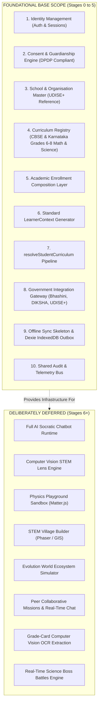
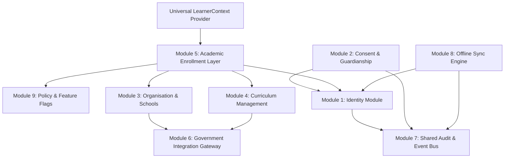
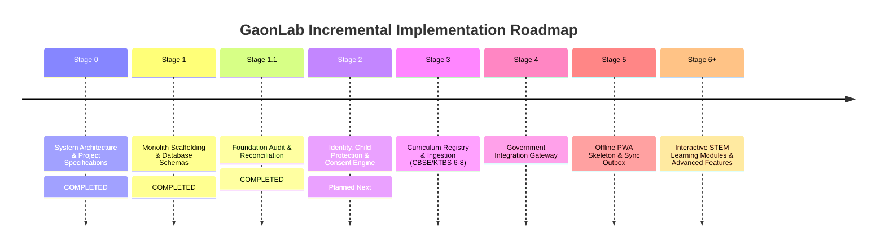

# GAONLAB — BASE SCOPE, ROADMAP & GOVERNANCE

> **Foundational Implementation Scope, Dependency Graphs, Development Stages, and Integration Maturity**  
> *Target Audience: Engineering Leads, Sprint Planners, QA Engineers, and System Architects*  
> *Version: 1.0 (Foundational Baseline)*  
> *Academic Year: 2026–27*

---

## 1. Exact Scope of the Foundational Implementation

The **Foundational Implementation** (Stages 0–5) establishes the core operating system of GaonLab. It deliberately avoids implementing all 26 product features at once, focusing instead on building a robust, secure, and extensible backbone.

### 1.1 In-Scope Deliverables
1. **Core Modular Monolith:** Node.js/Express with TypeScript, configured with strict domain boundaries and shared type definitions.
2. **Database Scaffolding (PostgreSQL 16 + Prisma):** Modular schema tables with soft cross-boundary references, indexing, and migration pipelines.
3. **Identity & Child Protection Service:** Minor account registration, password hashing (`Argon2id`), tokenized sessions, and account lifecycle states.
4. **Guardian Consent Engine:** Decoupled guardian verification flow via cryptographic tokens, bilingual SMS/IVR templates, and immutable DPDP audit logging.
5. **School & UDISE+ Master Reference:** Support for independent learners (zero school prerequisite) alongside optional school lookup via an 11-digit UDISE+ directory.
6. **Curriculum Engine (Academic Year 2026–27):** Verified textbook, chapter, and concept models for Grades 6, 7, and 8 in Mathematics and Science for:
   - **CBSE** (NCERT 2024–2026 editions: *Curiosity*, *Ganita Prakash*, etc.)
   - **Karnataka State Board** (KTBS/DSERT editions in English and Kannada)
7. **The Universal `LearnerContext` Engine:** Composition service generating the standard context object per authenticated request.
8. **Curriculum Resolver (`resolveStudentCurriculum`):** Deterministic resolution pipeline with caching and offline snapshot exports.
9. **Government Integration Gateway:** Provider-independent gateway with pluggable adapters supporting `LIVE`, `CACHED`, `MOCK`, and `OFF` modes for Bhashini ULCA, DIKSHA Sunbird, and UDISE+.
10. **Offline PWA Sync Foundation:** Workbox service worker caching strategy, Dexie.js IndexedDB client store, and idempotent sync outbox ingestion.

### 1.2 Deliberately Excluded from Base Implementation
To prevent premature complexity, the following capabilities are **explicitly excluded** from the foundational base and will be developed in dedicated subsequent stages:
- **No Complex LLM Orchestration:** No streaming AI agent loops or vector database clusters yet.
- **No Physics Engine / Gaming Sandboxes:** No Phaser canvas or Matter.js physics simulations in the base.
- **No Computer Vision Ingestion:** No camera-based STEM Lens or grade-card OCR parsing in the base.
- **No Peer-to-Peer Networking:** No WebRTC or WebSocket chat rooms between students.
- **No Heavy Media Streaming:** No custom video hosting; all media references link to verified DIKSHA/ePathshala assets.

---

## 2. Module Dependency Graph

The foundational architecture enforces a strict acyclic dependency structure:

---

## 3. Implementation Stages & Roadmap

GaonLab is developed through six sequential stages. Each stage is gated by strict technical acceptance criteria.

### Stage 0: Repository Context & Architecture Design
- **Objective:** Deep repository inspection, comprehensive product definition, modular architecture design, and alignment documentation.
- **Deliverables:** `PROJECT_CONTEXT.md`, `docs/PRODUCT_OVERVIEW.md`, `docs/BASE_ARCHITECTURE.md`, `docs/BASE_SCOPE_AND_ROADMAP.md`.
- **Status:** **COMPLETED**.

### Stage 1 & 1.1: Monolith Scaffolding, Database Schemas & Foundation Audit
- **Objective:** Establish executable modular monolith foundation, 33 PostgreSQL database models across 9 domains, 18 enums, Prisma migrations, provider-independent guardian verification contracts, and invariant test suites.
- **Deliverables:**
  - Monorepo structure with `@gaonlab/shared-types` and `@gaonlab/api` workspaces.
  - Exactly 33 relational models and 18 enums covering all 9 foundational domains in `prisma/schema.prisma`.
  - 2 migrations applied cleanly (`20261116190345_init` and `20261116192426_audit_refine_guardian_verification`).
  - Strict guardian verification decoupling: phone possession, adult verification, relationship verification, and minor account activation gating.
  - Zod environment configuration validation and structured JSON logger.
  - Global event bus (`DomainEventBus`) and automatic audit logging listener.
  - Operational endpoints: `GET /health` and `GET /ready` (confirming live DB latency).
  - 22 Vitest integration and domain invariant tests passing.
- **Status:** **COMPLETED**.

### Stage 2: Identity, Child Protection & Consent Engine *(Planned Next)*
- **Objective:** Implement minor account registration, guardian consent lifecycle, authentication, and session tokens.
- **Deliverables:**
  - Registration endpoint for minors with initial `REGISTERED_PENDING_CONSENT` state.
  - Guardian authorization token generation and multi-channel dispatch mock (SMS/IVR).
  - Web consent confirmation endpoint validating adult declaration and activating account.
  - Session issuing, token renewal, and `LearnerContext` hydration middleware.

### Stage 3: Curriculum Registry & Ingestion (2026–27)
- **Objective:** Build the curriculum catalog and verified data ingestion pipelines for CBSE and Karnataka State Board Grades 6–8.
- **Deliverables:**
  - Curriculum schema: Boards, frameworks, editions, textbooks, chapters, and atomic concept nodes.
  - Verified seed data for Academic Year 2026–27 (NCERT *Curiosity*, *Ganita Prakash*; KTBS Science & Math in English/Kannada).
  - Implementation of the central `resolveStudentCurriculum(learnerId)` pipeline.
  - Offline curriculum snapshot export endpoint (`/api/v1/academic/curriculum/snapshot`).

### Stage 4: Government Integration Gateway
- **Objective:** Implement the provider-independent gateway and resilient adapters for Indian public digital infrastructure.
- **Deliverables:**
  - Gateway manager with `LIVE`, `CACHED`, `MOCK`, and `OFF` runtime modes and circuit breakers.
  - **Bhashini ULCA Adapter:** Two-step pipeline (discovery + inference) for EN $\to$ HI and EN $\to$ KN translation.
  - **DIKSHA Sunbird Adapter:** Content hierarchy reader for energized textbook QR linkages.
  - **UDISE+ Directory Adapter:** 11-digit school code verification and master directory caching.

### Stage 5: Offline PWA Skeleton & Sync Outbox
- **Objective:** Implement client-side storage, background synchronization, and service worker offline caching.
- **Deliverables:**
  - React 18+ Vite client with Tailwind CSS and Workbox service worker configuration.
  - Dexie.js (IndexedDB) schema for `learnerContext`, `curriculum`, and `syncOutbox`.
  - Server-side idempotent sync endpoint (`/api/v1/sync/outbox-batch`) with event deduplication.
  - Network state listener and auto-sync worker.

### Stage 6+: Interactive STEM Learning Modules & Advanced Expansion
- **Objective:** Incrementally develop the remaining product features:
  - Stage 6A: Personal Resource Library & Contextual PDF Reader.
  - Stage 6B: Village STEM Learning & Lab Without Walls Guided Experiments.
  - Stage 6C: Formative Assessments, Concept-Health Knowledge Map & Socratic AI Tutor.
  - Stage 6D: Interactive Sandboxes (What If?, Physics Playground, STEM Village Builder).
  - Stage 6E: Opportunities Gateway, Inter-School Missions & Boss Battles.

---

## 4. Government Integration Maturity Matrix

GaonLab interacts with 11 distinct government educational capabilities. Each integration is assigned a precise status and operational boundary:

| # | Government Capability | Operational Role in GaonLab | Real Technical Capability | Operational Modes Supported | Implementation Maturity Category |
| :-: | :--- | :--- | :--- | :--- | :--- |
| **1** | **NDEAR** | Architectural alignment blueprint | Open API specifications, Federated Identity, interoperable building blocks | DESIGNED | **Designed for Integration** |
| **2** | **DIKSHA** | Energized textbook QR resolution & external resources | Sunbird Knowlg Content Hierarchy Read API (`/api/content/v1/hierarchy/*`) | `LIVE`, `CACHED`, `MOCK` | **Linked to Official External Resources** |
| **3** | **APAAR** | Optional student identity linkage | 12-digit student registry linked to DigiLocker / ABC | `MOCK`, `OFF` | **Requires Formal Approval / API Access** |
| **4** | **BHASHINI** | Multilingual translation & TTS (Hindi, Kannada) | ULCA pipeline inference API (`/services/inference/pipeline`) | `LIVE`, `CACHED`, `MOCK` | **Built & Linked to Official API** |
| **5** | **PARAKH** | Competency-based assessment framework | Assessment standards, Holistic Progress Card rubrics | CACHED | **Aligned Pedagogical Framework** |
| **6** | **UDISE+** | Master school directory & school code lookup | 11-digit school directory lookup | `CACHED`, `MOCK`, `LIVE` | **Built with Official Master Reference Data** |
| **7** | **KTBS** | Karnataka official state textbooks | Karnataka Textbook Society textbook repository | CACHED | **Built with Ingested Official Textbooks** |
| **8** | **DSERT** | Karnataka curriculum & learning outcomes | State curriculum guidelines & teacher manuals | CACHED | **Aligned Pedagogical Framework** |
| **9** | **KSEAB** | Karnataka assessment framework | State examination blueprints & competency rubrics | CACHED | **Aligned Pedagogical Framework** |
| **10** | **Karnataka SATS** | State student tracking synchronization | State student database (sts.karnataka.gov.in) | `MOCK`, `OFF` | **Requires Formal State Department MoU** |
| **11** | **Vidya Samiksha Kendra (VSK)** | Macro-level institutional reporting | Command-and-control state telemetry API | `MOCK`, `OFF` | **Designed for Future State Reporting** |

---

## 5. Technical Acceptance Criteria for Foundational Base

The foundational implementation is deemed complete only when all of the following criteria are validated:

1. **Independent Onboarding:** An independent minor student can register without entering a school ID, UDISE code, or APAAR ID.
2. **Guardian Consent Gating:** A minor account remains in `REGISTERED_PENDING_CONSENT` state until guardian verification is recorded via token; personal data processing endpoints reject unverified accounts.
3. **Determinism of `resolveStudentCurriculum`:** For any enrolled learner, calling `resolveStudentCurriculum(learnerId)` returns the exact board, grade, year, textbook edition, and chapter hierarchy in under 50ms (cached).
4. **Resilient Gateway Behavior:** When upstream government endpoints (Bhashini, DIKSHA) are unreachable or return HTTP 500/503, the gateway automatically falls back to `CACHED` or `MOCK` mode without throwing unhandled exceptions.
5. **Idempotent Sync Ingestion:** Sending the same sync outbox batch multiple times results in zero duplicate database records and returns successful acknowledgement.
6. **Zero Aadhaar Ingestion:** Under no circumstance does any schema, endpoint, or interface accept or store an Aadhaar number.
7. **Type-Safe Module Isolation:** No module imports another module's internal database models or private methods; all inter-module communication passes through public service contracts.

---

## 6. End-to-End Test Scenarios

### Test Scenario 1: Independent Rural Minor Signup with Guardian SMS
- **Context:** An independent Grade 7 student in rural Karnataka signs up on a mobile browser.
- **Steps:**
  1. Student submits registration form with age `12`, board `KARNATAKA_STATE_BOARD`, medium `kn`, and mother's phone number.
  2. Backend creates user with status `REGISTERED_PENDING_CONSENT` and dispatches a verification token.
  3. Student attempts to access the learning dashboard $\to$ System displays restricted view with pending guardian consent banner.
  4. Mother opens the verification link, reviews the plain-language Kannada consent summary, and confirms consent.
  5. Account status transitions to `ACTIVATED`.
  6. Student refreshes app $\to$ Full curriculum and learning features are unlocked.

### Test Scenario 2: Offline Curriculum Resolution and Caching
- **Context:** Student prepares for a week of offline study in a village with no cellular coverage.
- **Steps:**
  1. Student logs into PWA while connected to school Wi-Fi.
  2. PWA requests `/api/v1/academic/curriculum/active`.
  3. Backend resolves CBSE Grade 6 Science (*Curiosity*) and Math (*Ganita Prakash*) for Academic Year 2026–27.
  4. PWA writes the full curriculum hierarchy and `LearnerContext` to IndexedDB (`GaonLabLocalDB`).
  5. Device is switched to Airplane Mode (zero connectivity).
  6. User closes and reopens the app $\to$ PWA launches instantly, loads `LearnerContext` from IndexedDB, and renders the complete chapter tree without network requests.

### Test Scenario 3: Government Gateway Failover under Upstream Outage
- **Context:** Student requests a translation of a scientific term from English to Kannada while Bhashini servers are undergoing maintenance.
- **Steps:**
  1. Request arrives at `GovGateway.translate("capillary action", "en", "kn")`.
  2. Adapter initiates call to `dhruva-api.bhashini.gov.in` $\to$ Connection times out after 3 seconds.
  3. Circuit breaker trips $\to$ Adapter switches automatically to `CACHED` lookup in local dictionary.
  4. Local cache returns *"ಲೋಮನಾಳ ಕ್ರಿಯೆ (Lomanala Kriya)"* with metadata `{ source: "LOCAL_CACHE", fallback: true }`.
  5. UI displays the translated term seamlessly without an error popup.

---

## 7. Known Risks, Technical Debt & Unresolved Decisions

| Risk / Decision Point | Impact | Mitigation Strategy | Current Decision |
| :--- | :--- | :--- | :--- |
| **Offline Storage Limits on Low-End Phones** | Low-cost Android phones may have less than 500MB of free browser storage. | Enforce strict quota management; store text and vector diagrams locally; stream or defer large video assets. | Cache only chapter metadata, text notes, and low-res illustrations by default. |
| **Guardian Digital Literacy in Rural Belts** | Illiterate parents may struggle to interact with SMS web links. | Implement dual-path consent: SMS web link + Automated voice IVR call in local dialect with keypress confirmation. | Support SMS token link initially; add IVR and teacher-attested bulk consent in Stage 2. |
| **Textbook Syllabus Volatility (NEP 2020 Transition)** | NCERT and state boards are actively releasing new textbooks under NCF-SE 2023. | Model textbooks with strict edition years (`editionYear: 2024`, `editionYear: 2026`) and explicit verification flags. | Target Academic Year 2026–27 using verified NCERT/KTBS middle school textbooks. |
| **Government API Stability & Key Access** | Official APIs (Bhashini, DIKSHA) may throttle rate limits or alter schemas. | Strictly decouple core functionality behind the Government Integration Gateway with MOCK/CACHED modes. | Core application must have zero hard runtime dependencies on live government APIs. |
