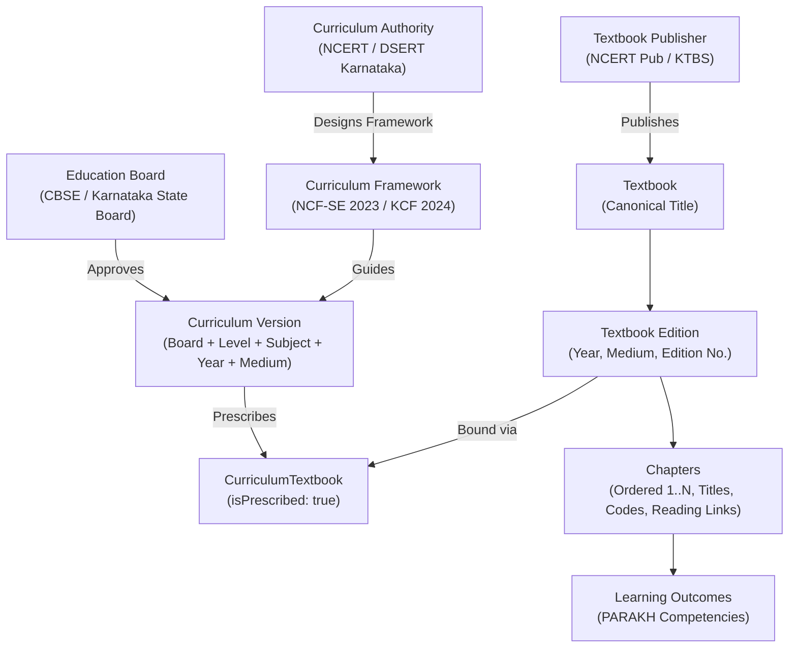

# GaonLab Curriculum Catalogue Reference & Ingestion Guide

> **Official Curriculum Mapping, Metadata Schemas, and Verification Guide**  
> *Target Academic Year: 2026–27*  
> *Scope: Middle School (Grades 6, 7, 8) — Mathematics & Integrated Science*  
> *Jurisdictions: CBSE (Central) & Karnataka State Board (State)*  

---

## 1. Domain Architecture & Authority Separation

GaonLab strictly preserves the institutional and constitutional boundaries of Indian educational bodies. Publishers, curriculum authorities, examining boards, and curriculum frameworks are modeled as distinct domain entities:



### Institutional Role Directory

| Entity Code | Name | Role Type | Jurisdiction | Official Portal |
| :--- | :--- | :--- | :--- | :--- |
| `CBSE` | Central Board of Secondary Education | Examining & Accrediting Board | Central / National | `https://cbse.gov.in` |
| `KARNATAKA_STATE_BOARD` | Karnataka School Examination and Assessment Board (KSEAB) | Examining & Accrediting Board | Karnataka State | `https://kseab.karnataka.gov.in` |
| `NCERT` | National Council of Educational Research and Training | National Curricular Body | National | `https://ncert.nic.in` |
| `DSERT_KARNATAKA` | Dept. of State Educational Research & Training Karnataka | State Curricular Body | Karnataka State | `https://dsert.karnataka.gov.in` |
| `NCERT_PUB` | NCERT Publication Division | Textbook Publisher | National | `https://ncert.nic.in/textbook.php` |
| `KTBS` | Karnataka Textbook Society | Textbook Publisher | Karnataka State | `https://textbooks.karnataka.gov.in/` |

---

## 2. Ingested Catalogue Inventory (Academic Year 2026–27)

A total of **18 curriculum manifests** across **12 unique canonical textbooks** and **261 chapters** have been verified and ingested into GaonLab:

```
Total Ingested Manifests:     18
Education Boards:             2 (CBSE, Karnataka State Board)
Curriculum Frameworks:        2 (NCF-SE 2023, KCF 2024)
Textbook Publishers:          2 (NCERT Publication Division, Karnataka Textbook Society)
Canonical Textbooks:          12
Textbook Editions:            18
Total Chapter Records:        261 (100% VERIFIED)
```

### 2.1 Track A: CBSE / NCERT Catalogue

| Grade | Subject | Medium | Canonical Title | Edition / Year | Chapter Count | Official Code / Link | Status |
| :--- | :--- | :--- | :--- | :--- | :--- | :--- | :--- |
| **Grade 6** | Science | English | *Curiosity - Science Grade 6* | Ed 1 (2024) | 12 | `fecu1` (`0-12`) | `VERIFIED` |
| **Grade 6** | Mathematics | English | *Ganita Prakash - Mathematics Grade 6* | Ed 1 (2024) | 10 | `fegp1` (`0-10`) | `VERIFIED` |
| **Grade 7** | Science | English | *Curiosity - Science Grade 7* | Ed 1 (2025) | 12 | `gecu1` (`0-12`) | `VERIFIED` |
| **Grade 7** | Mathematics | English | *Ganita Prakash - Mathematics Grade 7* | Ed 1 (2025) | 15 | `gegp1`/`gegp2` | `VERIFIED` |
| **Grade 8** | Science | English | *Curiosity - Science Grade 8* | Ed 1 (2025) | 13 | `hecu1` (`0-13`) | `VERIFIED` |
| **Grade 8** | Mathematics | English | *Mathematics - Grade 8* | Ed 1 (2024) | 13 | `hemh1` (`0-13`) | `VERIFIED` |

### 2.2 Track B: Karnataka State Board / KTBS Catalogue

| Grade | Subject | Medium | Canonical Title | Language Title | Chapter Count | Official Source | Status |
| :--- | :--- | :--- | :--- | :--- | :--- | :--- | :--- |
| **Grade 6** | Science | English | *Science Class 6 - KTBS* | *Science - Textbook for Class 6* | 16 | KTBS Portal | `VERIFIED` |
| **Grade 6** | Science | Kannada | *Science Class 6 - KTBS* | *ವಿಜ್ಞಾನ - 6ನೇ ತರಗತಿ ಪಠ್ಯಪುಸ್ತಕ* | 16 | KTBS Portal | `VERIFIED` |
| **Grade 6** | Mathematics | English | *Mathematics Class 6 - KTBS* | *Mathematics - Textbook for Class 6* | 12 | KTBS Portal | `VERIFIED` |
| **Grade 6** | Mathematics | Kannada | *Mathematics Class 6 - KTBS* | *ಗಣಿತ - 6ನೇ ತರಗತಿ ಪಠ್ಯಪುಸ್ತಕ* | 12 | KTBS Portal | `VERIFIED` |
| **Grade 7** | Science | English | *Science Class 7 - KTBS* | *Science - Textbook for Class 7* | 18 | KTBS Portal | `VERIFIED` |
| **Grade 7** | Science | Kannada | *Science Class 7 - KTBS* | *ವಿಜ್ಞಾನ - 7ನೇ ತರಗತಿ ಪಠ್ಯಪುಸ್ತಕ* | 18 | KTBS Portal | `VERIFIED` |
| **Grade 7** | Mathematics | English | *Mathematics Class 7 - KTBS* | *Mathematics - Textbook for Class 7* | 15 | KTBS Portal | `VERIFIED` |
| **Grade 7** | Mathematics | Kannada | *Mathematics Class 7 - KTBS* | *ಗಣಿತ - 7ನೇ ತರಗತಿ ಪಠ್ಯಪುಸ್ತಕ* | 15 | KTBS Portal | `VERIFIED` |
| **Grade 8** | Science | English | *Science Class 8 - KTBS* | *Science - Textbook for Class 8* | 18 | KTBS Portal | `VERIFIED` |
| **Grade 8** | Science | Kannada | *Science Class 8 - KTBS* | *ವಿಜ್ಞಾನ - 8ನೇ ತರಗತಿ ಪಠ್ಯಪುಸ್ತಕ* | 18 | KTBS Portal | `VERIFIED` |
| **Grade 8** | Mathematics | English | *Mathematics Class 8 - KTBS* | *Mathematics - Textbook for Class 8* | 14 | KTBS Portal | `VERIFIED` |
| **Grade 8** | Mathematics | Kannada | *Mathematics Class 8 - KTBS* | *ಗಣಿತ - 8ನೇ ತರಗತಿ ಪಠ್ಯಪುಸ್ತಕ* | 14 | KTBS Portal | `VERIFIED` |

---

## 3. Chapter Details by Textbook

### 3.1 CBSE Class 6
- **Curiosity (Science, 12 Chapters):**
  1. The Wonderful World of Science | 2. Diversity in the Living World | 3. Mindful Eating: A Path to a Healthy Body | 4. Exploring Magnets | 5. Measurement of Length and Motion | 6. Materials Around Us | 7. Temperature and its Measurement | 8. A Journey through States of Water | 9. Methods of Separation in Everyday Life | 10. Living Creatures: Exploring their Characteristics | 11. Nature's Treasures | 12. Beyond Earth
- **Ganita Prakash (Mathematics, 10 Chapters):**
  1. Patterns in Mathematics | 2. Lines and Angles | 3. Number Play | 4. Data Handling and Presentation | 5. Prime Time | 6. Perimeter and Area | 7. Fractions | 8. Playing with Constructions | 9. Symmetry | 10. The Other Side of Zero

### 3.2 CBSE Class 7
- **Curiosity (Science, 12 Chapters):**
  1. The Ever-Evolving World of Science | 2. Exploring Substances: Acidic, Basic, and Neutral | 3. Electricity: Circuits and their Components | 4. The World of Metals and Non-metals | 5. Changes Around Us: Physical and Chemical | 6. Adolescence: A Stage of Growth and Change | 7. Heat Transfer in Nature | 8. Measurement of Time and Motion | 9. Life Processes in Animals | 10. Life Processes in Plants | 11. Light: Shadows and Reflections | 12. Earth, Moon, and the Sun
- **Ganita Prakash (Mathematics, 15 Chapters):**
  1. Large Numbers Around Us | 2. Arithmetic Expressions | 3. A Peek Beyond the Point (Decimals) | 4. Expressions Using Letter-Numbers | 5. Parallel and Intersecting Lines | 6. Number Play | 7. A Tale of Three Intersecting Lines | 8. Working with Fractions | 9. Integers and Operations | 10. Comparing Quantities | 11. Rational Numbers | 12. Perimeter and Area | 13. Exponents and Powers | 14. Symmetry | 15. Visualising Solid Shapes

### 3.3 CBSE Class 8
- **Curiosity (Science, 13 Chapters):**
  1. Exploring the Investigative World of Science | 2. The Invisible Living World: Beyond Our Naked Eye | 3. Health: The Ultimate Treasure | 4. Electricity: Magnetic and Heating Effects | 5. Exploring Forces | 6. Pressure, Winds, Storms, and Cyclones | 7. Particulate Nature of Matter | 8. Nature of Matter: Elements, Compounds, and Mixtures | 9. The Amazing World of Solutes, Solvents, and Solutions | 10. Light: Mirrors and Lenses | 11. Keeping Time with the Skies | 12. How Nature Works in Harmony | 13. Our Home: Earth, a Unique Life-Sustaining Planet
- **Mathematics (Rationalised, 13 Chapters):**
  1. Rational Numbers | 2. Linear Equations in One Variable | 3. Understanding Quadrilaterals | 4. Data Handling | 5. Squares and Square Roots | 6. Cubes and Cube Roots | 7. Comparing Quantities | 8. Algebraic Expressions and Identities | 9. Mensuration | 10. Exponents and Powers | 11. Direct and Inverse Proportions | 12. Factorisation | 13. Introduction to Graphs

### 3.4 Karnataka State Board Class 6
- **Science (English & Kannada, 16 Chapters):**
  1. Food: Where Does It Come From? (ಆಹಾರ – ಇದು ಎಲ್ಲಿಂದ ದೊರಕುತ್ತದೆ?) | 2. Components of Food (ಆಹಾರದ ಘಟಕಗಳು) | 3. Fibre to Fabric (ಎಳೆಯಿಂದ ಬಟ್ಟೆ) | 4. Sorting Materials Into Groups (ಪದಾರ್ಥಗಳನ್ನು ಗುಂಪುಗಳಾಗಿ ವರ್ಗೀಕರಿಸುವುದು) | 5. Separation of Substances (ಪದಾರ್ಥಗಳನ್ನು ಬೇರ್ಪಡಿಸುವಿಕೆ) | 6. Changes Around Us (ನಮ್ಮ ಸುತ್ತಲಿನ ಬದಲಾವಣೆಗಳು) | 7. Getting to Know Plants (ಸಸ್ಯಗಳನ್ನು ತಿಳಿಯುವುದು) | 8. Body Movements (ದೇಹದ ಚಲನೆಗಳು) | 9. The Living Organisms (ಜೀವಿಗಳು – ಅವುಗಳ ಲಕ್ಷಣಗಳು ಮತ್ತು ಆವಾಸಸ್ಥಾನ) | 10. Motion and Measurement (ಚಲನೆ ಮತ್ತು ದೂರದ ಅಳತೆ) | 11. Light, Shadows and Reflections (ಬೆಳಕು – ಛಾಯೆಗಳು ಮತ್ತು ಪ್ರತಿಫಲನಗಳು) | 12. Electricity and Circuits (ವಿದ್ಯುಚ್ಛಕ್ತಿ ಮತ್ತು ಮಂಡಲಗಳು) | 13. Fun With Magnets (ಕಾಂತಗಳೊಂದಿಗೆ ತಮಾಷೆ) | 14. Water (ನೀರು) | 15. Air Around Us (ನಮ್ಮ ಸುತ್ತಲಿನ ಗಾಳಿ) | 16. Garbage In, Garbage Out (ಕಸ – ಒಳಗೆ ಮತ್ತು ಹೊರಗೆ)
- **Mathematics (English & Kannada, 12 Chapters):**
  1. Knowing Our Numbers (ನಮ್ಮ ಸಂಖ್ಯೆಗಳನ್ನು ತಿಳಿಯುವುದು) | 2. Whole Numbers (ಪೂರ್ಣ ಸಂಖ್ಯೆಗಳು) | 3. Playing With Numbers (ಸಂಖ್ಯೆಗಳೊಂದಿಗೆ ಆಟ) | 4. Basic Geometrical Ideas (ಮೂಲ ಜ್ಯಾಮಿತೀಯ ಕಲ್ಪನೆಗಳು) | 5. Understanding Elementary Shapes (ಪ್ರಾಥಮಿಕ ಆಕಾರಗಳು) | 6. Integers (ಪೂರ್ಣಾಂಕಗಳು) | 7. Fractions (ಭಿನ್ನರಾಶಿಗಳು) | 8. Decimals (ದಶಮಾಂಶಗಳು) | 9. Data Handling (ದತ್ತಾಂಶಗಳ ನಿರ್ವಹಣೆ) | 10. Mensuration (ಕ್ಷೇತ್ರಗಣಿತ) | 11. Algebra (ಬೀಜಗಣಿತ) | 12. Ratio and Proportion (ಅನುಪಾತ ಮತ್ತು ಸಮಾನುಪಾತ)

### 3.5 Karnataka State Board Class 7
- **Science (English & Kannada, 18 Chapters):**
  1. Nutrition in Plants (ಸಸ್ಯಗಳಲ್ಲಿ ಪೋಷಣೆ) | 2. Nutrition in Animals (ಪ್ರಾಣಿಗಳಲ್ಲಿ ಪೋಷಣೆ) | 3. Fibre to Fabric (ಎಳೆಯಿಂದ ಬಟ್ಟೆ) | 4. Heat (ಉಷ್ಣ) | 5. Acids, Bases and Salts (ಆಮ್ಲಗಳು, ಪ್ರತ್ಯಾಮ್ಲಗಳು ಮತ್ತು ಲವಣಗಳು) | 6. Physical and Chemical Changes (ಭೌತ ಮತ್ತು ರಾಸಾಯನಿಕ ಬದಲಾವಣೆಗಳು) | 7. Weather and Climate (ಹವಾಮಾನ ಮತ್ತು ವಾಯುಗುಣ) | 8. Winds and Storms (ಗಾಳಿ, ಬಿರುಗಾಳಿ ಮತ್ತು ಚಂಡಮಾರುತಗಳು) | 9. Soil (ಮಣ್ಣು) | 10. Respiration in Organisms (ಜೀವಿಗಳಲ್ಲಿ ಉಸಿರಾಟ) | 11. Transportation in Animals and Plants (ಸಾಗಾಣಿಕೆ) | 12. Reproduction in Plants (ಸಸ್ಯಗಳಲ್ಲಿ ಸಂತಾನೋತ್ಪತ್ತಿ) | 13. Motion and Time (ಚಲನೆ ಮತ್ತು ಕಾಲ) | 14. Electric Current and Effects (ವಿದ್ಯುತ್ ಪ್ರವಾಹ ಮತ್ತು ಪರಿಣಾಮಗಳು) | 15. Light (ಬೆಳಕು) | 16. Water: A Precious Resource (ನೀರು: ಅಮೂಲ್ಯ ಸಂಪನ್ಮೂಲ) | 17. Forests: Our Lifeline (ಅರಣ್ಯಗಳು: ನಮ್ಮ ಜೀವಸೆಲೆ) | 18. Wastewater Story (ತ್ಯಾಜ್ಯ ನೀರು ನಿರ್ವಹಣೆ)
- **Mathematics (English & Kannada, 15 Chapters):**
  1. Integers (ಪೂರ್ಣಾಂಕಗಳು) | 2. Fractions and Decimals (ಭಿನ್ನರಾಶಿಗಳು ಮತ್ತು ದಶಮಾಂಶಗಳು) | 3. Data Handling (ದತ್ತಾಂಶಗಳ ನಿರ್ವಹಣೆ) | 4. Simple Equations (ಸರಳ ಸಮೀಕರಣಗಳು) | 5. Lines and Angles (ರೇಖೆಗಳು ಮತ್ತು ಕೋನಗಳು) | 6. The Triangle and its Properties (ತ್ರಿಭುಜ ಮತ್ತು ಗುಣಗಳು) | 7. Congruence of Triangles (ತ್ರಿಭುಜಗಳ ಸರ್ವಸಮತೆ) | 8. Comparing Quantities (ಪರಿಮಾಣಗಳ ಹೋಲಿಕೆ) | 9. Rational Numbers (ಭಾಗಲಬ್ಧ ಸಂಖ್ಯೆಗಳು) | 10. Practical Geometry (ಪ್ರಾಯೋಗಿಕ ಜ್ಯಾಮಿತಿ) | 11. Perimeter and Area (ಸುತ್ತಳತೆ ಮತ್ತು ವಿಸ್ತೀರ್ಣ) | 12. Algebraic Expressions (ಬೀಜೋಕ್ತಿಗಳು) | 13. Exponents and Powers (ಘಾತಗಳು ಮತ್ತು ಘಾತಾಂಕಗಳು) | 14. Symmetry (ಸಮಮಿತಿ) | 15. Visualising Solid Shapes (ಘನಾಕೃತಿಗಳ ದೃಶ್ಯೀಕರಣ)

### 3.6 Karnataka State Board Class 8
- **Science (English & Kannada, 18 Chapters):**
  1. Crop Production and Management (ಬೆಳೆಗಳ ಉತ್ಪಾದನೆ ಮತ್ತು ನಿರ್ವಹಣೆ) | 2. Microorganisms (ಸೂಕ್ಷ್ಮಜೀವಿಗಳು: ಮಿತ್ರ ಮತ್ತು ಶತ್ರು) | 3. Synthetic Fibres and Plastics (ಸಂಶ್ಲೇಷಿತ ಎಳೆಗಳು ಮತ್ತು ಪ್ಲಾಸ್ಟಿಕ್‌ಗಳು) | 4. Materials: Metals and Non-Metals (ವಸ್ತುಗಳು: ಲೋಹಗಳು ಮತ್ತು ಅಲೋಹಗಳು) | 5. Coal and Petroleum (ಕಲ್ಲಿದ್ದಲು ಮತ್ತು ಪೆಟ್ರೋಲಿಯಂ) | 6. Combustion and Flame (ದಹನ ಮತ್ತು ಜ್ವಾಲೆ) | 7. Conservation of Plants and Animals (ಸಸ್ಯಗಳು ಮತ್ತು ಪ್ರಾಣಿಗಳ ಸಂರಕ್ಷಣೆ) | 8. Cell — Structure and Functions (ಕೋಶ - ರಚನೆ ಮತ್ತು ಕಾರ್ಯಗಳು) | 9. Reproduction in Animals (ಪ್ರಾಣಿಗಳಲ್ಲಿ ಪ್ರಜನನ) | 10. Reaching the Age of Adolescence (ಹದಿಹರೆಯದ ತಲುಪುವಿಕೆ) | 11. Force and Pressure (ಬಲ ಮತ್ತು ಒತ್ತಡ) | 12. Friction (ಘರ್ಷಣೆ) | 13. Sound (ಶಬ್ದ) | 14. Chemical Effects of Electric Current (ವಿದ್ಯುತ್ ಪ್ರವಾಹದ ರಾಸಾಯನಿಕ ಪರಿಣಾಮಗಳು) | 15. Some Natural Phenomena (ಕೆಲವು ಪ್ರಾಕೃತಿಕ ವಿಕೋಪಗಳು) | 16. Light (ಬೆಳಕು) | 17. Stars and the Solar System (ನಕ್ಷತ್ರಗಳು ಮತ್ತು ಸೌರವ್ಯೂಹ) | 18. Pollution of Air and Water (ಗಾಳಿ ಮತ್ತು ನೀರಿನ ಮಾಲಿನ್ಯ)
- **Mathematics (English & Kannada, 14 Chapters):**
  1. Playing with Numbers (ಸಂಖ್ಯೆಗಳೊಂದಿಗೆ ಆಟ) | 2. Algebraic Expressions (ಬೀಜೋಕ್ತಿಗಳು) | 3. Axioms, Postulates and Theorems (ಸ್ವಯಂಸಿದ್ಧಗಳು ಮತ್ತು ಪ್ರಮೇಯಗಳು) | 4. Factorisation (ಅಪವರ್ತಿಸುವಿಕೆ) | 5. Squares, Roots, Cubes and Roots (ವರ್ಗಗಳು ಮತ್ತು ಘನಗಳು) | 6. Theorems on Triangles (ತ್ರಿಭುಜಗಳ ಮೇಲಿನ ಪ್ರಮೇಯಗಳು) | 7. Rational Numbers (ಭಾಗಲಬ್ಧ ಸಂಖ್ಯೆಗಳು) | 8. Linear Equations in One Variable (ಒಂದು ಚರಾಕ್ಷರವುಳ್ಳ ರೇಖಾತ್ಮಕ ಸಮೀಕರಣಗಳು) | 9. Commercial Arithmetic (ವ್ಯವಹಾರ ಗಣಿತ) | 10. Exponents (ಘಾತಗಳು) | 11. Congruency of Triangles (ತ್ರಿಭುಜಗಳ ಸರ್ವಸಮತೆ) | 12. Construction of Triangles (ತ್ರಿಭುಜಗಳ ರಚನೆ) | 13. Statistics (ಸಂಖ್ಯಾಶಾಸ್ತ್ರ) | 14. Introduction to Graphs (ನಕ್ಷೆಗಳ ಪರಿಚಯ)

---

## 4. Operational Ingestion Tooling & CLI

Curriculum data is maintained in human-readable JSON files located at:
```
content/curriculum/
├── cbse/
│   └── 2026-27/
│       ├── grade-6/{mathematics.json, science.json}
│       ├── grade-7/{mathematics.json, science.json}
│       └── grade-8/{mathematics.json, science.json}
└── karnataka-state-board/
    └── 2026-27/
        ├── grade-6/{mathematics-english.json, mathematics-kannada.json, science-english.json, science-kannada.json}
        ├── grade-7/{...}
        └── grade-8/{...}
```

### CLI Execution

```bash
# Ingest with database write (strictly idempotent, safe to run repeatedly)
npm run db:seed:curriculum

# Dry-run validation mode (scans and validates JSON without writing)
npm run db:seed:curriculum -- --dry-run
```

---

## 5. Read-Only REST API Endpoints

All endpoints are mounted on the Express backend under `/api/v1/curriculum`:

### 5.1 `GET /api/v1/curriculum/boards`
Returns all education boards registered in the ecosystem.
```json
{
  "success": true,
  "count": 2,
  "data": [
    {
      "id": "CBSE",
      "code": "CBSE",
      "name": "Central Board of Secondary Education",
      "jurisdiction": "CENTRAL",
      "websiteUrl": "https://cbse.gov.in"
    },
    {
      "id": "KARNATAKA_STATE_BOARD",
      "code": "KARNATAKA_STATE_BOARD",
      "name": "Karnataka School Examination and Assessment Board",
      "jurisdiction": "STATE",
      "websiteUrl": "https://kseab.karnataka.gov.in"
    }
  ]
}
```

### 5.2 `GET /api/v1/curriculum/boards/:boardId/grades`
Returns the list of grades supported by the board.
```json
{
  "success": true,
  "boardId": "CBSE",
  "count": 3,
  "data": [
    { "id": "GRADE_6", "numericGrade": 6, "stage": "MIDDLE", "name": "Grade 6" },
    { "id": "GRADE_7", "numericGrade": 7, "stage": "MIDDLE", "name": "Grade 7" },
    { "id": "GRADE_8", "numericGrade": 8, "stage": "MIDDLE", "name": "Grade 8" }
  ]
}
```

### 5.3 `GET /api/v1/curriculum/grades/:gradeId/subjects?boardId=CBSE`
Returns subjects available for a given grade level.
```json
{
  "success": true,
  "gradeId": "GRADE_6",
  "boardId": "CBSE",
  "count": 2,
  "data": [
    { "id": "SCIENCE", "code": "SCIE", "name": "Science", "stemPillar": "SCIENCE" },
    { "id": "MATHEMATICS", "code": "MATH", "name": "Mathematics", "stemPillar": "MATHEMATICS" }
  ]
}
```

### 5.4 `GET /api/v1/curriculum/catalogue`
Queryable catalogue with query parameters: `boardId`, `grade`, `subjectId`, `academicYear`, `medium`, `status`.

### 5.5 `GET /api/v1/curriculum/textbooks/:textbookId`
Returns canonical textbook details, publishing body, and all language/year editions.

### 5.6 `GET /api/v1/curriculum/editions/:editionId/chapters`
Returns ordered chapter listings, official codes, page ranges, and direct reading links.

### 5.7 `GET /api/v1/curriculum/resolve/:learnerId`
Resolves the complete prescribed textbook and chapter curriculum for a student's active enrollment.

---

## 6. Copyright, Licensing & Public Resource Integrity

GaonLab enforces strict compliance with Indian copyright law and public textbook publisher terms:
- **No Unauthorized Republication:** GaonLab **does not host or redistribute full copyrighted PDF files** belonging to NCERT or KTBS.
- **Fair Use Referencing:** Chapter numbers, official titles, DIKSHA QR codes, and page ranges are indexed solely for educational alignment, search indexation, and pedagogical sequencing.
- **Deep Digital Linking:** Students and educators are routed directly to official government portals (`ncert.nic.in` and `textbooks.karnataka.gov.in`) for official digital textbook access.
