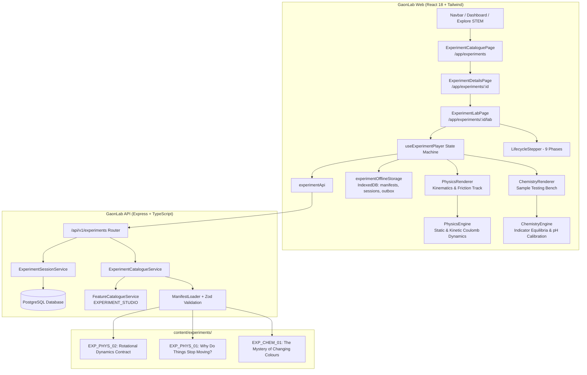

# GaonLab Experiment Studio — Architectural Specification & Implementation Manual

**Academic Year:** 2026–27  
**Status:** IMPLEMENTED & SCIENTIFICALLY VERIFIED (Stage 1 Corrections Applied)  
**Scope:** Reusable Experiment Studio Framework & Two Full Demonstrations (Chemistry & Physics) + Class 11 Advanced Contract  

---

## 1. Executive Summary & Product Vision

GaonLab Experiment Studio is a core experiential STEM laboratory module designed to transform passive theoretical rote learning into active scientific inquiry for rural middle and secondary school students. Unlike static video tutorials or simple quizzes, Experiment Studio lets learners formulate hypotheses, manipulate virtual apparatus, observe authentic physical interactions governed by authoritative scientific laws, and apply their findings to everyday village challenges.

### Core Architectural Invariants
1. **Modular Monolith Integration:** Built directly into the existing GaonLab backend and frontend workspaces without introducing standalone auth systems, separate student tables, or microservice fragmentation.
2. **Local-First & Offline Resilience:** Experiment manifests, session telemetry, and simulation engines run completely in-browser with native IndexedDB (`gaonlab_experiment_studio_db`) fallback.
3. **Authoritative Scientific Rulesets with Explicit Model Boundaries:**
   - **Chemistry:** Uses a deterministic **sample-testing model** with representative educational reference pH values under standardized laboratory conditions (25°C dilute baseline). Demonstrates qualitative indicator transitions (Turmeric, Red/Blue Litmus, Phenolphthalein, China Rose) without simulating arbitrary reagent mixtures.
   - **Physics:** Rigorous numerical integration of Newton's laws and Amontons-Coulomb friction, modeling both static friction threshold ($F_{s,\max} = \mu_s N$) and kinetic sliding friction ($F_k = \mu_k N$). Provides controlled initial velocity mode to prove mass-independence ($d = v_0^2 / (2\mu_k g)$).
4. **Pedagogical 7-Phase Inquiry Hierarchy (9 Concrete State-Machine States):**
   The learning design follows 7 core inquiry phases mapped to 9 state machine states:
   $$\text{MISSION} \longrightarrow \text{PREDICTION} \longrightarrow \text{EXPERIMENT} \longrightarrow \text{OBSERVATION} \longrightarrow \text{QUESTIONING} \longrightarrow \text{HINTS} \longrightarrow \text{EXPLANATION} \longrightarrow \text{APPLICATION} \longrightarrow \text{COMPLETED}$$
   - Conceptual Phase 5 (Investigate) maps to `QUESTIONING` + auxiliary scaffolding `HINTS`.
   - Conceptual Phase 6 (Understand) maps to `EXPLANATION`.
   - `COMPLETED` serves as the terminal state-machine persistence boundary.

---

## 2. System Architecture & Component Mapping



---

## 3. Authoritative Scientific Engines

### 3.1 Chemistry Engine (`ChemistryEngine.ts`)

#### A. Sample-Testing Model & Educational Limitations
- The simulation operates on a **sample-testing model**: students test known substance samples against calibrated indicators.
- **Representative Simulation Reference Values:** The pH values assigned to samples represent standardized dilute aqueous concentrations at 25°C ($K_w = 1.0 \times 10^{-14}$):
  - Lemon Juice: $\text{pH} = 2.2$ (Acidic, citric acid)
  - Commercial Vinegar: $\text{pH} = 2.8$ (Acidic, dilute acetic acid)
  - Pure Distilled Water: $\text{pH} = 7.0$ (Neutral)
  - Baking Soda Solution: $\text{pH} = 8.5$ (Weak base, sodium bicarbonate)
  - Soap Water: $\text{pH} = 9.5$ (Moderately alkaline, sodium carboxylate)
  - Lime Water: $\text{pH} = 11.5$ (Strongly alkaline, calcium hydroxide)
- *Model Limitation:* The bench does not calculate dynamic neutralization of arbitrary chemical combinations. Natural fruit juices and well waters vary in mineral and acid content.

#### B. Indicator Behaviors & Apparatus Distinction
- **Liquid Reagents vs. Paper Strips:**
  - Red Litmus & Blue Litmus are categorized as `PAPER_STRIP` indicators; testing is conducted by dipping paper strips into the sample.
  - Phenolphthalein, China Rose, and Turmeric are categorized as `LIQUID_REAGENT` indicators; testing is conducted by dispensing drops into the sample beaker via pipette.
- **Calibrated Color Transitions:**
  - **Turmeric (Curcumin):** Yellow in acid and neutral ($\text{pH} \le 7.5$), deep reddish-brown in alkaline solutions ($\text{pH} > 7.5$).
  - **Red Litmus:** Remains red in acid and neutral ($\text{pH} \le 7.0$), turns blue in alkali ($\text{pH} > 7.0$).
  - **Blue Litmus:** Turns red in acid ($\text{pH} < 7.0$), remains blue in neutral and alkali ($\text{pH} \ge 7.0$).
  - **Phenolphthalein (Transition 8.2–10.0):**
    - Colorless in acid and neutral ($\text{pH} \le 8.2$).
    - Delicate pale blush pink (`#FBCFE8`) in weakly alkaline samples ($\text{pH } 8.2\text{--}9.0$, e.g., Baking Soda $\text{pH } 8.5$) — avoids exaggerated vivid magenta.
    - Vivid magenta/pink (`#EC4899`) in strongly alkaline samples ($\text{pH} \ge 9.0$, e.g., Soap Water $\text{pH } 9.5$, Lime Water $\text{pH } 11.5$).
  - **China Rose (Hibiscus):** Dark magenta in acid ($\text{pH} < 6.0$), light pink in neutral ($6.0\text{--}8.0$), emerald green in alkali ($\text{pH} > 8.0$).

#### C. Agricultural Soil Liming Safety Distinction
- **Agricultural Limestone ($\text{CaCO}_3$, Calcium Carbonate):** The primary, safe buffering material for conventional agricultural liming. It dissolves slowly ($K_{sp} \approx 3.3 \times 10^{-9}$) and naturally buffers soil to $\text{pH } 6.5\text{--}7.2$ without scorching plant roots.
- **Slaked Lime ($\text{Ca(OH)}_2$, Calcium Hydroxide):** A strongly alkaline, caustic base ($\text{pH } 11.5\text{--}12.4$). While used in specialized agricultural cases for rapid neutralization, it requires agricultural extension oversight because over-application scorches living crop roots and can cause severe chemical burns to human skin/eyes. Children must never handle slaked lime unmonitored; all investigations remain virtual.

---

### 3.2 Physics Mechanics Engine (`PhysicsEngine.ts`)

#### A. Static vs. Kinetic Friction Model
- **Normal Force on Horizontal Plane:**
  $$N = m \cdot g \quad (g = 9.8\text{ m/s}^2)$$
- **Static Friction Threshold:**
  $$F_{s,\max} = \mu_s \cdot N = \mu_s \cdot m \cdot g$$
  - When horizontal applied force $F_{\text{push}} \le F_{s,\max}$, static friction exactly balances applied force ($f = F_{\text{push}}$), net force is zero, and the body **remains at rest** ($v = 0$).
- **Kinetic Sliding Friction:**
  $$F_k = \mu_k \cdot N = \mu_k \cdot m \cdot g$$
  - Once $F_{\text{push}} > F_{s,\max}$, static friction is overcome. During push impulse ($\Delta t = 0.35\text{ s}$), net acceleration is $a = \frac{F_{\text{push}} - F_k}{m}$, accelerating the body to launch velocity $v_0$.
  - Once unpowered coasting begins, kinetic friction opposes motion with deceleration $a_{\text{coast}} = -\mu_k g$.

#### B. Mass-Independence Investigation & Controlled Variables
- To investigate the Class 8 hypothesis (*"If you double the mass, what happens to stopping distance?"*), the workbench provides a **Controlled Initial Velocity ($v_0$) Mode**.
- **Controlled Variables:**
  1. Initial launch velocity $v_0$ is held strictly constant across trials (e.g., $4.0\text{ m/s}$).
  2. Surface kinetic friction coefficient $\mu_k$ is held strictly constant.
  3. The track is strictly horizontal ($N = mg$).
  4. Pushing impulse is completely removed before the measured coasting deceleration begins.

#### C. Derivation and Assumptions of Stopping Distance Equation
During unpowered horizontal coasting:
$$\sum F_x = -F_k = -\mu_k \cdot m \cdot g$$
By Newton's Second Law ($F = m \cdot a$):
$$m \cdot a = -\mu_k \cdot m \cdot g \implies a = -\mu_k \cdot g$$
*Crucial finding: Mass $m$ cancels out completely!*
Applying the kinematic equation $v^2 = v_0^2 + 2 a d$ with final velocity $v = 0$:
$$0 = v_0^2 - 2 \mu_k g d \implies d_{\text{stop}} = \frac{v_0^2}{2 \mu_k g}$$
- **Physical Assumptions:**
  - Rigid, flat horizontal track with constant normal load.
  - Coulomb friction model ($\mu_k$ independent of velocity over practical speeds).
  - Negligible aerodynamic drag ($v < 10\text{ m/s}$).

#### D. Calibrated Surface Friction Coefficients (Simulation Reference Values)
- Polished Ice: $\mu_k = 0.05, \mu_s = 0.08$
- Tempered Glass: $\mu_k = 0.15, \mu_s = 0.20$
- Polished Teak Wood: $\mu_k = 0.30, \mu_s = 0.40$
- Dense Turf Grass: $\mu_k = 0.55, \mu_s = 0.65$
- Coarse Sandpaper: $\mu_k = 0.70, \mu_s = 0.85$

---

## 4. Reusable Learning Lifecycle (7 Phases / 9 States)

| State Machine Phase | Student Action | Pedagogical Objective |
|---|---|---|
| **1. MISSION** | Reads contextual narrative and key terms | Contextualizes inquiry in relatable rural/everyday scenarios |
| **2. PREDICTION** | Formulates and locks an initial scientific hypothesis | Engages prior intuition under strictly controlled variables |
| **3. EXPERIMENT** | Manipulates bench controls (velocity, mass, surface, indicators) | Discovers empirical behavior under active scientific inquiry |
| **4. OBSERVATION** | Records trials and compares A/B runs | Develops data collection rigor and logs empirical measurements |
| **5. QUESTIONING** | Answers multiple-choice conceptual reasoning questions | Transforms raw observations into causal scientific explanations |
| **6. HINTS** | Progressively unlocks 3-tier scaffolding hints | Scaffolds learning without prematurely revealing answers |
| **7. EXPLANATION** | Reviews mathematical derivations and core principles | Solidifies formal curriculum definitions and scientific laws |
| **8. APPLICATION** | Solves authentic village scenario (liming, monsoon cart) | Transfers scientific reasoning to community problem-solving |
| **9. COMPLETED** | Writes reflection note and reviews session achievements | Synthesizes learning and persists report to student profile |

---

## 5. Database Schema & Prisma Models

Added to `apps/api/prisma/schema.prisma`:
- **`Experiment`**: Canonical metadata, curriculum mappings, simulation type, safety status, languages (`["en", "kn"]`).
- **`ExperimentVersion`**: Versioned declarative manifest JSON conforming to `ExperimentManifestSchema`.
- **`ExperimentSession`**: Active learner session state, stable `clientSessionId` (unique), current phase, locked hypothesis, recorded observations array, responses data, reflection note.
- **`ExperimentEvent`**: Idempotent audit and telemetry event log with `clientEventId` deduplication.
- **`ExperimentAsset`**: Associated assets and diagrams.

---

## 6. Offline Session Persistence & Reliable Synchronization (Stage 2)

```mermaid
flowchart TD
    subgraph Client["Browser Client (Offline or Online)"]
        Init[Start / Resume Lab] --> CheckIDB{Active session in\nIndexedDB?}
        CheckIDB -->|Yes: Reload Restoration| RestoreLocal[Restore State & Phase from Local Session]
        CheckIDB -->|No| GenUUID[Generate Stable Client UUID\nclientSessionId]
        
        GenUUID --> CheckNet{Online?}
        CheckNet -->|Yes| SvrStart[POST /api/v1/experiments/:id/sessions]
        CheckNet -->|No| LocalStart[Create Local Session Record in IDB]
        SvrStart --> SaveIDB[Save to IndexedDB: sessions store]
        LocalStart --> SaveIDB
        
        Action[Student Interactions:\nPredictions, Apparatus, Answers] --> QueueEvt[Queue in IDB: eventOutbox\nordered by timestamp]
        Action --> SnapState[Persist State Snapshot\nin sessions store]
        
        Trigger[Network Recovery / Visibility / Startup / Sync Button] --> FlushLock{Acquire Sync Mutex\nisSyncing?}
        FlushLock -->|Unlocked| ReadOutbox[Read Pending Events & Local Sessions]
        FlushLock -->|Locked| Skip[Skip Concurrent Run]
        
        ReadOutbox --> ReconcileSess[POST /api/v1/experiments/sessions/reconcile]
        ReconcileSess --> ReplayEvts[POST /sessions/:id/events in Chronological Order]
        ReplayEvts --> CompleteSess[POST /sessions/:id/complete if Completed]
        CompleteSess --> Purge[Purge Acknowledged Events & Update Sync Indicator]
    end

    subgraph Server["GaonLab Backend & PostgreSQL"]
        ReconcileSess --> SvrCheck{clientSessionId\nexists in DB?}
        SvrCheck -->|Yes| LearnerCheck{Learner ID\nmatches session?}
        LearnerCheck -->|Match| MergeState[Idempotent Update / State Merge]
        LearnerCheck -->|Mismatch| Reject403[Reject 403 Forbidden\nMulti-Learner Protection]
        SvrCheck -->|No| CreateSvr[Create ExperimentSession with clientSessionId]
        
        ReplayEvts --> DedupCheck{clientEventId\nalready in DB?}
        DedupCheck -->|Yes| ReturnDedup[Return 200 { deduplicated: true }]
        DedupCheck -->|No| InsertEvt[Insert Event & Update Session Snapshot]
    end
```

### 6.1 Architectural Guarantees
1. **Zero Data Loss on Reload/Crash:** In-progress experiments are continuously snapshotted to IndexedDB `sessions` store on every phase change, observation record, and reasoning answer. Reloading or navigating away instantly re-hydrates the active session.
2. **Stable Client UUID Identity:** Offline sessions are identified by a stable RFC4122 v4 UUID (`clientSessionId`). Backend endpoints for event submission, session retrieval, and completion support **dual-key resolution** (matching either canonical PostgreSQL primary key `id` OR `clientSessionId`).
3. **Database-Level Idempotency:** Session reconciliation endpoint `POST /api/v1/experiments/sessions/reconcile` safely handles retried or duplicate network requests without creating duplicate database rows.
4. **Chronological Event Delivery:** The IndexedDB `eventOutbox` stores events with high-resolution timestamps. The outbox flusher processes events in strict chronological order and purges records only after explicit HTTP 200 server acknowledgement.
5. **Multi-Learner Isolation:** On shared rural tablets and community devices, sessions are strictly isolated by `(learnerPersonId, experimentId)`. If an incoming reconciliation payload presents a mismatched `learnerPersonId`, the server immediately rejects the request with HTTP 403 Forbidden, protecting student portfolios against cross-account contamination.
6. **Reactive Sync Indicator UI:** The header surfaces real-time sync state (`Synced`, `Saved on this device`, `Waiting to sync`, `Synchronizing...`, `Needs attention`) with manual retry capability.

---

## 7. Verification & Automated Test Results

- **API Workspace (`@gaonlab/api`):** 12 test files, **111 passing tests** (100% pass rate).
  - Dedicated offline sync test suite: [`src/tests/experiment-sync.test.ts`](file:///home/utkarsh-singh-parihar/Projects/GaonLabs/apps/api/src/tests/experiment-sync.test.ts) (10 tests covering session reconciliation, idempotent updates, dual-key event ingestion, clientEventId deduplication, dual-key completion, and multi-learner isolation).
  - Dedicated science calculations test suite: [`src/tests/experiment-science.test.ts`](file:///home/utkarsh-singh-parihar/Projects/GaonLabs/apps/api/src/tests/experiment-science.test.ts) (16 tests covering static friction threshold, mass independence, subtle phenolphthalein transitions, and litmus rules).
  - Manifest validation and REST API endpoints: [`src/tests/experiment-studio.test.ts`](file:///home/utkarsh-singh-parihar/Projects/GaonLabs/apps/api/src/tests/experiment-studio.test.ts) (10 tests).
  - Curriculum catalogue, topics, reader, and identity suites: 75 tests.
- **Web Workspace (`@gaonlab/web`):** Built with **0 errors** via `tsc -b && vite build` (production bundle generated in 8.61s).
- **Visual Verifications (CDP Screenshots):**
  - `docs/screenshots/experiment-sync-lab.png`: Experiment Lab with real-time sync indicator (`Synced`).
  - `docs/screenshots/dashboard-experiment-card.png`: Dashboard showing feature cards.
  - `docs/screenshots/experiment-catalogue.png`: Catalogue with board, class, and pillar filters.
  - `docs/screenshots/experiment-chemistry-lab.png`: Interactive chemistry bench with live beaker color blend and digital reference pH probe.
  - `docs/screenshots/experiment-physics-lab.png`: Physics track with live scaled force vectors and dynamic $v(t)$ graph.
  - `docs/screenshots/experiment-learning-lifecycle.png`: Community application problem solving interface.
