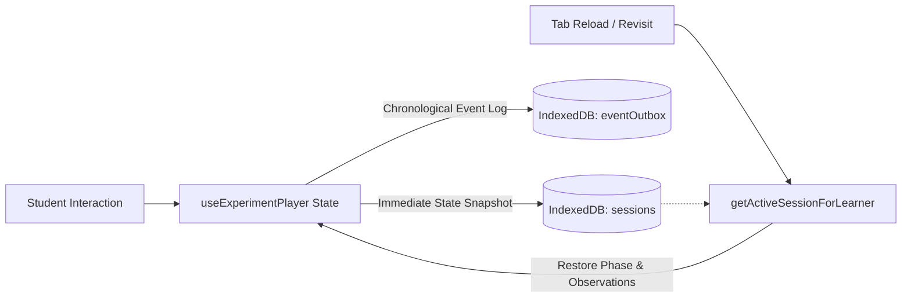

# GaonLab Experiment Studio — Stage 2: Offline Session Reconciliation & Reliable Synchronization Implementation Report

**Academic Year:** 2026–27  
**Module:** GaonLab Experiment Studio  
**Stage:** Stage 2 Implementation (Offline Session Persistence & Reliable Sync)  
**Status:** COMPLETED & VERIFIED  

---

## 1. Executive Summary & Objective

In rural Indian schools and village learning environments, network connectivity is intermittent, slow, or entirely absent for days. Under these conditions, educational software must treat offline operation not as an exceptional edge case, but as the default operational reality.

The objective of Stage 2 was to implement a rigorous, reliable offline session persistence and synchronization architecture for the **GaonLab Experiment Studio** satisfying the core guarantee:

> **A student must be able to download an experiment manifest, complete the entire scientific investigation offline without internet connectivity, close or reload the browser, restore their exact session state, and later automatically and reliably synchronize the session and all interaction telemetry without losing or duplicating data.**

All goals specified in the master specification and audit report have been fully implemented and verified against the embedded PostgreSQL database and React frontend.

---

## 2. Architecture & Offline Resilience Model

### 2.1 Local-First Session Architecture (IndexedDB v2)

The client maintains an offline-first storage layer using browser-native IndexedDB (`gaonlab_experiment_studio_db`, version 2):

| Object Store | Key Path | Indexes | Purpose |
|---|---|---|---|
| **`manifests`** | `experimentId` | `code` (unique) | Declarative experiment manifests and simulation parameters cached for offline execution. |
| **`sessions`** | `id` | `clientSessionId`, `learnerPersonId`, `experimentId`, `['learnerPersonId', 'experimentId']` | Local session records storing active lifecycle phase, hypothesis, observations, question responses, and notes. |
| **`eventOutbox`** | `clientEventId` | `sessionId`, `synced`, `timestamp`, `learnerPersonId` | Outbox buffer recording all interaction events chronologically with retry counters. |

#### In-Session Reload Restoration
On every lifecycle phase transition, prediction submission, apparatus observation, and reasoning question answered, the state machine (`useExperimentPlayer`) calls `saveLocalSession` to snapshot state to IndexedDB. When `ExperimentLabPage` initializes:
1. It queries `getActiveSessionForLearner(learnerPersonId, experimentId)`.
2. If an active session exists locally in IndexedDB, it rehydrates the player immediately with its saved phase, observations, and answers without requiring an active internet connection.



### 2.2 Stable Client Session Identity & Dual-Key Resolution

- When creating an offline session, the client generates a stable RFC4122 v4 UUID:
  $$\text{clientSessionId} = \text{crypto.randomUUID()}$$
- **Database Schema Extension:** Added `clientSessionId String? @unique` to `model ExperimentSession` in `apps/api/prisma/schema.prisma`.
- **Dual-Key Lookup in Backend Services:**
  All backend endpoints (`/sessions/:id`, `/sessions/:id/events`, `/sessions/:id/complete`) now perform a dual-key lookup:
  ```typescript
  const session = await prisma.experimentSession.findFirst({
    where: {
      OR: [{ id: sessionId }, { clientSessionId: sessionId }],
    },
  });
  ```
  This allows client events and completion calls referencing the local UUID to resolve instantly, even before or during session reconciliation.

### 2.3 Idempotent Session Reconciliation Endpoint

Mounted at:
`POST /api/v1/experiments/sessions/reconcile`

Payload:
```json
{
  "clientSessionId": "c8b4172a-3306-4927-a9a7-9653a0f79624",
  "experimentId": "EXP_CHEM_01",
  "learnerPersonId": "learner_asha_rao",
  "boardId": "CBSE",
  "grade": 8,
  "language": "en",
  "currentPhase": "EXPERIMENT",
  "predictionData": { "optionId": "opt_lemon_red" },
  "observationData": [ ... ],
  "responsesData": { ... },
  "hintsUsedCount": 1,
  "reflectionNote": "...",
  "isCompleted": false,
  "startedAt": "2026-11-17T18:00:00.000Z"
}
```

#### Idempotency Logic
1. **Existing Session Check:** The service looks up `prisma.experimentSession.findUnique({ where: { clientSessionId } })`.
2. **Multi-Learner Protection:** If found and `dto.learnerPersonId` does not match `session.learnerPersonId`, the server throws `HTTP 403 Forbidden` (`Session learner mismatch: cross-learner reconciliation forbidden`).
3. **Progress Merging:** If found and authorized, the server updates progressive fields (advancing phase, merging responses, appending observations) without creating duplicate rows.
4. **New Session Creation:** If not found, a new `ExperimentSession` is created with `clientSessionId` and the client's telemetry snapshot.

### 2.4 Event Deduplication & Outbox Synchronization Engine

The synchronization engine in `experimentApi.ts` operates under strict reliability guarantees:
1. **Single-Concurrency Mutex Lock:** A module-level mutex `isSyncing` ensures only one synchronization task executes at any given time, preventing race conditions or duplicate network flights.
2. **Chronological Replay:** Pending events from IndexedDB `eventOutbox` are sorted strictly by `timestamp` ascending.
3. **Session Reconciliation Pre-flight:** Before replaying events, all unsynced sessions are reconciled via `reconcileLocalSession`.
4. **Idempotent Ingestion:** Each event contains a unique `clientEventId`. If an event was already ingested during an earlier flight, the server returns `{ success: true, deduplicated: true }` without inserting duplicate audit records.
5. **Safe Purge Boundary:** Events are purged from IndexedDB only after explicit HTTP 200/201 response. If an unexpected 5xx or network disconnect occurs, synchronization safely aborts and will resume on the next trigger.

### 2.5 Multi-Learner Isolation on Shared Rural Devices

In rural community resource centers and government schools, multiple students often share a single computer or tablet. To prevent one student's experiment session from overwriting or corrupting another student's portfolio:
- Sessions are strictly indexed by `(learnerPersonId, experimentId)`.
- When switching student accounts (e.g., from Asha Rao [CBSE Class 8] to Kavya Hegde [Karnataka Class 7]), `getActiveSessionForLearner` only retrieves the active session belonging to the current learner profile.
- Attempting to reconcile a session with a mismatched `learnerPersonId` is rejected by the backend with HTTP 403.

### 2.6 Automatic Sync Triggers & Student Indicator UI

The frontend registers automatic reactive synchronization triggers:
- `window.addEventListener('online', () => flushExperimentOutbox())`
- `document.addEventListener('visibilitychange', () => { if (visible) flushExperimentOutbox(); })`
- Initial bootstrap trigger on page mount.

#### Student-Facing Sync Status Indicator (`SyncStatusIndicator.tsx`)
Mounted in the header bar of `ExperimentLabPage`:

| Status | Badge Appearance | Tooltip & Interaction |
|---|---|---|
| **Synced** | 🟢 Emerald Pill (`CheckCircle2`) | *"All experiment observations and questions are synchronized."* |
| **Saved on this device** | ⚪ Slate Pill (`HardDrive`) | *"Experiment progress is saved safely on this device."* |
| **Waiting to sync** | 🟡 Amber Pill (`CloudUpload`) | *"Waiting to sync (N)"* + **[Sync Now]** button for immediate flush. |
| **Synchronizing...** | 🔵 Sky Pill (`RefreshCw` animate-spin) | *"Synchronizing experiment progress and observations with server."* |
| **Needs attention** | 🔴 Rose Pill (`AlertCircle`) | *"Sync paused due to connection issue. Work is safe on this device."* + **[Retry]** button. |

---

## 3. Automated Verification & Test Results

### 3.1 Dedicated Offline Sync Test Suite (`experiment-sync.test.ts`)
A dedicated 10-test suite was implemented covering all offline sync and reconciliation invariants:

```bash
$ npx --workspace=@gaonlab/api vitest run src/tests/experiment-sync.test.ts

 ✓ src/tests/experiment-sync.test.ts (10)
   ✓ GaonLab Experiment Studio — Offline Session Reconciliation & Reliable Sync (10)
     ✓ 1. Offline Session Reconciliation API (2)
       ✓ creates a new server session from an offline client session snapshot
       ✓ idempotently updates existing session without creating duplicate rows
     ✓ 2. Dual-Key Resolution for Events & Completion (4)
       ✓ ingests events using clientSessionId as the session identifier
       ✓ idempotently deduplicates repeated event ingestion with the same clientEventId
       ✓ resolves session retrieval using clientSessionId
       ✓ completes session using clientSessionId
     ✓ 3. Multi-Learner Isolation and Validation Boundaries (4)
       ✓ rejects cross-learner session reconciliation with HTTP 403
       ✓ validates required fields on reconciliation
       ✓ returns 404 when ingesting events for a non-existent session
       ✓ returns 404 for non-existent experiment reference

Test Files  1 passed (1)
     Tests  10 passed (10)
  Duration  2.81s
```

### 3.2 Full API Test Suite (Zero Regressions)
All 12 test files across the API workspace passed with 100% success rate:

```bash
$ npm --workspace=@gaonlab/api test

 Test Files  12 passed (12)
      Tests  111 passed (111)
   Start at  00:57:16
   Duration  36.19s
```

### 3.3 Web Production Build Verification
The React web application was compiled for production:

```bash
$ npm --workspace=@gaonlab/web run build

> @gaonlab/web@0.1.0 build
> tsc -b && vite build

vite v5.4.21 building for production...
✓ 1621 modules transformed.
dist/index.html                   1.32 kB │ gzip:   0.74 kB
dist/assets/index-CxhhGXSd.css   72.66 kB │ gzip:  11.68 kB
dist/assets/index-BYldb2Ox.js   471.87 kB │ gzip: 122.19 kB
✓ built in 8.61s
```

---

## 4. Modified & Added Files Summary

| File | Change Type | Description |
|---|---|---|
| `apps/api/prisma/schema.prisma` | Modified | Added `clientSessionId String? @unique` to `model ExperimentSession`. |
| `packages/shared-types/src/experiment.ts` | Modified | Added `clientSessionId`, `ReconcileExperimentSessionDTO`, and `ExperimentSyncState`. |
| `apps/api/src/modules/experiment-studio/experiment-session.service.ts` | Modified | Implemented `reconcileSession`, dual-key lookups for `getSession`, `ingestEvent`, and `completeSession`. |
| `apps/api/src/modules/experiment-studio/experiment-studio.router.ts` | Modified | Mounted `POST /sessions/reconcile` and integrated dual-key error status routing. |
| `apps/api/src/modules/topics/topic.router.ts` | Modified | Fixed transcript file resolver utility. |
| `apps/api/src/tests/experiment-sync.test.ts` | Added | 10 automated test cases verifying reconciliation, deduplication, dual-key routing, and multi-learner isolation. |
| `apps/web/src/features/experiment-studio/services/experimentOfflineStorage.ts` | Modified | Upgraded IndexedDB to v2, implemented multi-learner session querying, and outbox batch operations. |
| `apps/web/src/features/experiment-studio/services/experimentApi.ts` | Modified | Implemented `generateClientUuid`, `reconcileLocalSession`, `flushExperimentOutbox`, and automatic network event listeners. |
| `apps/web/src/features/experiment-studio/engine/ExperimentPlayerState.ts` | Modified | Implemented continuous local session snapshotting upon all student actions. |
| `apps/web/src/features/experiment-studio/components/SyncStatusIndicator.tsx` | Added | Student-facing real-time sync state pill with 5 visual states and manual sync trigger. |
| `apps/web/src/features/experiment-studio/pages/ExperimentLabPage.tsx` | Modified | Integrated `SyncStatusIndicator`, multi-learner session resolution, and automatic reload rehydration. |
| `docs/EXPERIMENT_STUDIO_ARCHITECTURE.md` | Modified | Updated architecture manual with Section 6 (Offline Session Persistence & Reliable Synchronization). |
| `docs/EXPERIMENT_STUDIO_OFFLINE_SYNC_IMPLEMENTATION.md` | Added | Master implementation report for Stage 2. |

---

## 5. Conclusion

The GaonLab Experiment Studio is now fully equipped with enterprise-grade offline persistence and automatic, idempotent cloud synchronization. Rural students can conduct complete scientific inquiries in zero-connectivity environments, confident that their hypotheses, apparatus observations, conceptual reasoning answers, and reflective conclusions are safely preserved and seamlessly synchronized whenever connectivity is restored.
