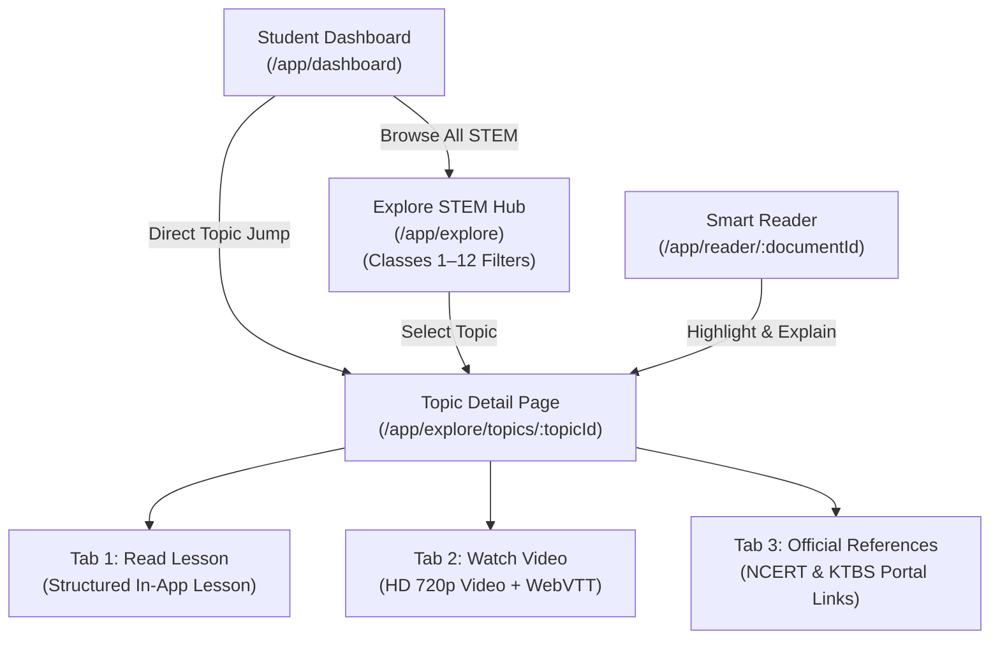

# GaonLab — Explore STEM, Topic Library & Narrated Video Generation Engine

> **Target Cycle**: Academic Year 2026–27  
> **Status**: STAGE 3 COMPLETED & VERIFIED  
> **Components**: Explore STEM Topic Catalogue, Original Lesson Reader, Automated Narrated Video Engine, WebVTT Captions, and Smart Reader Match Integration  
> **Packages**: `@gaonlab/web`, `@gaonlab/api` (`modules/topics/`), `@gaonlab/shared-types`, and `tools/video-generator/`  

---

## 1. Executive Summary & Purpose

Stage 3 transforms GaonLab from an in-app textbook viewer into a comprehensive, experiential STEM learning platform. While earlier stages established the curriculum database and the Smart Reader with precision annotations, Stage 3 introduces a centralized **Explore STEM** portal:



### Key Capabilities Delivered:
1. **Explore STEM Hub (`/app/explore`)**: Browse core STEM topics across Mathematics, Integrated Science, Physics, Chemistry, Biology, and Computing. Students can explore any standard (1 to 12) without altering their official grade enrollment.
2. **Three-Tier Topic Experience**:
   - **Read**: Original illustrated lessons structured with Introductions, Simple Explanations, Core Scientific Principles, Step-by-Step Examples, Diagram Breakdowns, and Everyday Rural Applications.
   - **Watch**: Dedicated HTML5 video player streaming dynamically generated 1280x720 24fps narrated MP4 animations with synchronized WebVTT closed captions.
   - **Official Resources**: Direct linkages to sovereign curriculum chapters (NCERT ePathshala, Karnataka KTBS) with clear copyright compliance notices.
3. **Smart Reader Contextual Match**: Highlighting text passages in the Smart Reader triggers `POST /api/v1/topics/match`, linking students directly to relevant Explore STEM topics and narrated videos.
4. **Standalone Video Generator Engine (`tools/video-generator/`)**: Fully automated Python + Pillow + gTTS + FFmpeg media pipeline that turns structured JSON scripts into production-ready MP4 videos and WebVTT caption tracks.

---

## 2. Topic Catalogue Architecture (`apps/api/src/modules/topics/`)

### 2.1 Content Access Modes
GaonLab strictly preserves copyright compliance while providing rich educational instruction:

| Access Mode | Description | Available Experiences |
| :--- | :--- | :--- |
| `GAONLAB_FULL` | Topics with complete GaonLab original lessons, animated videos, and official references. | In-App Lesson + Narrated Video + Official Reference |
| `HYBRID` | Topics with original lessons and official references; animated video in production. | In-App Lesson + Official Reference |
| `OFFICIAL_EXTERNAL` | Topics indexing sovereign textbook chapters without custom GaonLab media. | Official Portal Links + Curriculum Reference |
| `UNAVAILABLE` | Upcoming curriculum topics scheduled for future ingestion cycles. | Roadmap Indicator |

### 2.2 RESTful API Endpoints
All endpoints are mounted under `/api/v1/topics` and `/api/v1/videos`:

- `GET /api/v1/topics`: Filter topics by `boardId`, `grade` (1–12), `subjectId`, `medium`, and `academicYear`. Returns `TopicSummary[]`.
- `GET /api/v1/topics/:topicId`: Returns complete `TopicDetail` including lesson overview, video metadata, and official textbook mapping.
- `GET /api/v1/topics/:topicId/lesson`: Returns structured `TopicLesson` formatted for the in-app reading experience.
- `GET /api/v1/topics/:topicId/video`: Returns `TopicVideoMeta` (duration, resolution, audio status, WebVTT caption URLs).
- `GET /api/v1/topics/:topicId/resources`: Returns official curriculum linkages (`TopicOfficialResource[]`).
- `POST /api/v1/topics/match`: Receives `{ selectedText, chapterId, documentId, grade }` and resolves the best-matching topic and video for the Smart Reader.
- `GET /api/v1/videos/stream/:videoId`: Streams MP4 video with HTTP 206 Partial Content byte-range support for smooth seeking.
- `GET /api/v1/videos/captions/:filename`: Serves WebVTT closed caption files with `Content-Type: text/vtt; charset=utf-8`.

---

## 3. Automated Video Generator Engine (`tools/video-generator/`)

### 3.1 Pipeline Architecture
The video generator operates as an ahead-of-time (AOT) compiler converting pedagogical lesson scripts into audiovisual MP4 containers:

```
[Lesson Script (JSON)] 
       │
       ├─► [TTS Engine (gTTS / Offline)] ──► [Audio Segments (MP3)] ──► [Combined Audio (AAC)]
       │
       └─► [Vector Renderer (Pillow)] ────► [Raw RGB24 Frames (stdin)] ──► [FFmpeg Video (H.264)]
                                                                               │
                                                                               ▼
                                                                     [Final Container (MP4)]
                                                                               +
                                                                     [Captions (WebVTT)]
```

### 3.2 Key Technical Features
1. **Memory-Efficient Frame Piping**: Instead of writing tens of thousands of PNG images to disk, `generate.py` pipes raw RGB24 bytes directly into FFmpeg standard input (`-f rawvideo -pix_fmt rgb24 -s 1280x720 -r 24 -i -`). This achieves high-throughput encoding while maintaining zero disk fragmentation.
2. **Provider-Independent TTS Subsystem**:
   - `BaseTTSProvider`: Abstract contract requiring `synthesize(text, output_path, lang)`.
   - `GoogleTTSProvider`: High-clarity educational speech synthesis via Google TTS.
   - `OfflineTTSProvider`: Pure offline synthetic fallback ensuring resilience in offline air-gapped environments.
3. **Synchronized WebVTT Subtitle Generation**: Calculates cumulative scene durations down to millisecond precision and generates compliant WebVTT files with standard timestamps (`00:00:00.000 --> 00:00:11.200`).
4. **Reproducible CLI**:
   ```bash
   # Generate a specific topic
   tools/video-generator/.venv/bin/python tools/video-generator/generate.py --topic topic-forces-friction-cl8 --language en

   # Generate all registered demonstration topics
   tools/video-generator/.venv/bin/python tools/video-generator/generate.py --all
   ```

---

## 4. Demonstration Videos & Production Verification

All three initial demonstration topics were generated ahead-of-time and verified using `ffprobe`:

### 4.1 Demonstration Topics Matrix

| Topic Identifier | Grade & Subject | Curriculum Reference | Duration | File Size | Audio / Video Codec |
| :--- | :--- | :--- | :--- | :--- | :--- |
| `topic-shapes-class3` | Class 3 Mathematics | NCERT *Maths Mela*, Ch 5: *"Fun with Shapes"* | 71.9s | 1.64 MB | H.264 (High) 1280x720 @ 24fps / AAC 24kHz mono |
| `topic-forces-friction-cl8` | Class 8 Science | NCERT *Curiosity*, Ch 5 & KTBS Ch 12: *"Friction"* | 78.9s | 1.87 MB | H.264 (High) 1280x720 @ 24fps / AAC 24kHz mono |
| `topic-rotational-motion-cl11` | Class 11 Physics | NCERT *Physics Part 1*, Ch 6: *"Rotational Motion"* | 76.4s | 1.96 MB | H.264 (High) 1280x720 @ 24fps / AAC 24kHz mono |

### 4.2 ffprobe Stream Verification Report (`video-forces-friction-cl8-en.mp4`)
```json
{
  "file": "public/videos/video-forces-friction-cl8-en.mp4",
  "duration": 75.95,
  "video_streams": [
    "Stream #0:0: Video: h264 (High) (avc1), yuv420p(progressive), 1280x720, 105 kb/s, 24 fps"
  ],
  "audio_streams": [
    "Stream #0:1: Audio: aac (LC) (mp4a), 24000 Hz, mono, fltp, 96 kb/s"
  ],
  "has_video": true,
  "has_audio": true
}
```

---

## 5. Web Frontend Implementation (`apps/web/`)

### 5.1 New Pages & Components
1. **[`apps/web/src/pages/ExplorePage.tsx`](file:///home/utkarsh-singh-parihar/Projects/GaonLabs/apps/web/src/pages/ExplorePage.tsx)**:
   - Grade selector (Classes 1–12), Subject selector, Board selector, and media filter (All / Video / Lesson).
   - Real-time keyword search across topic titles, concept summaries, and subjects.
   - Quick-filter class pills and availability badges (`In-App Lesson`, `Narrated Video`, `Official Ref`).
2. **[`apps/web/src/pages/TopicDetailPage.tsx`](file:///home/utkarsh-singh-parihar/Projects/GaonLabs/apps/web/src/pages/TopicDetailPage.tsx)**:
   - Hero header with breadcrumb navigation, subject/grade badges, and estimated study duration.
   - **Read Tab**: Structured original lesson with introduction, simple explanation, core scientific principles with formulas, step-by-step examples, visual diagrams, rural applications, key takeaways, and glossary.
   - **Watch Tab**: Full-screen capable HTML5 video player with resolution and duration badges, synchronized captions, and production verification metadata.
   - **Official Resources Tab**: Textbook title, publisher (NCERT / KTBS), chapter number, and direct external links with copyright compliance disclaimers.
3. **[`apps/web/src/components/VideoPlayer.tsx`](file:///home/utkarsh-singh-parihar/Projects/GaonLabs/apps/web/src/components/VideoPlayer.tsx)**:
   - Custom playback controls: Play/pause, 10-second rewind, seek progress bar, volume/mute toggle, speed selector (`0.75x`, `1x`, `1.25x`, `1.5x`), WebVTT captions toggle, and fullscreen mode.
4. **[`apps/web/src/components/ContextualExplanationModal.tsx`](file:///home/utkarsh-singh-parihar/Projects/GaonLabs/apps/web/src/components/ContextualExplanationModal.tsx)**:
   - Updated to call `matchTopicExplanation` on text selection and present an "Explore STEM Connected Topic" banner with direct "Watch Concept Video" and "Open Topic Hub" buttons.

---

## 6. Verification & Automated Test Status

### 6.1 Backend Test Suite (`npm test`)
All 70 tests across 9 test suites pass:
- `topics-module.test.ts` (12 tests) — Topic listing, grade filtering, lesson retrieval, video streaming, WebVTT serving, and Smart Reader explain matching.
- `reader-module.test.ts` (7 tests)
- `ncert-stem-catalogue.test.ts` (15 tests)
- `curriculum-catalogue.test.ts` (10 tests)
- `identity-consent.test.ts` (8 tests)
- `curriculum-boundaries.test.ts` (5 tests)
- `database-models.test.ts` (4 tests)
- `feature-modules.test.ts` (4 tests)
- `health-ready.test.ts` (5 tests)

### 6.2 Frontend Production Build
`npm --workspace=@gaonlab/web run build` completed cleanly without TypeScript or bundler errors.

---

## 7. Verification Screenshot Artifacts

All screenshots were captured using automated Chrome DevTools Protocol (`scripts/capture-stage3-screenshots.js`) and are saved in `docs/screenshots/` and mirrored in the artifact directory:

1. **Explore STEM Page**: [`explore-stem-page.png`](file:///home/utkarsh-singh-parihar/Projects/GaonLabs/docs/screenshots/explore-stem-page.png)  
   Shows the full topic catalogue with curriculum filters, search bar, and topic cards.
2. **Topic Detail (Read Tab)**: [`topic-detail-read.png`](file:///home/utkarsh-singh-parihar/Projects/GaonLabs/docs/screenshots/topic-detail-read.png)  
   Demonstrates the structured reading experience for Class 8 Science (*Exploring Forces and Friction*).
3. **Topic Detail (Watch Tab)**: [`topic-detail-watch.png`](file:///home/utkarsh-singh-parihar/Projects/GaonLabs/docs/screenshots/topic-detail-watch.png)  
   Demonstrates the custom HTML5 video player playing the narrated friction animation with WebVTT subtitles.
4. **Topic Detail (Official Resources)**: [`topic-detail-resources.png`](file:///home/utkarsh-singh-parihar/Projects/GaonLabs/docs/screenshots/topic-detail-resources.png)  
   Shows verified external linkages to official NCERT and KTBS textbooks with educational fair-use notices.
5. **Class 3 Shapes Watch Tab**: [`topic-shapes-watch.png`](file:///home/utkarsh-singh-parihar/Projects/GaonLabs/docs/screenshots/topic-shapes-watch.png)  
   Shows the primary grade geometry animation (*Fun with Shapes*).
6. **Dashboard Explore STEM Banner**: [`dashboard-explore-card.png`](file:///home/utkarsh-singh-parihar/Projects/GaonLabs/docs/screenshots/dashboard-explore-card.png)  
   Shows the newly integrated Explore STEM featured section on the student dashboard.
7. **Smart Reader Contextual Explain Match**: [`reader-explain-matched.png`](file:///home/utkarsh-singh-parihar/Projects/GaonLabs/docs/screenshots/reader-explain-matched.png)  
   Shows the Smart Reader popup seamlessly linking highlighted textbook text to the corresponding concept video.

---

## 8. Karnataka State Board (KTBS) Class 7 Kannada Medium Learning Support

To ensure parity between the CBSE English track (Asha Rao) and Karnataka State Board Kannada track (Kavya Hegde), the Explore STEM system and Video Generation Engine were enhanced for full Kannada language learning:

### 1. Root-Cause Analysis of Previous Deficits
- **Curriculum Omission**: Explore STEM topic summaries originally only covered CBSE English topics; zero KTBS Class 7 Kannada topics were catalogued.
- **Language Filtering**: Default medium filters forced `medium: 'en'`, hiding any non-English content when querying.
- **Video Renderer Unicode Limitations**: Default PIL fonts lacked Kannada glyph sets, causing rendered text to fail or fallback to invalid rectangles without Noto Sans Kannada.
- **Silent English Fallbacks**: Earlier video playback components would silently fall back to English videos or fail without notifying the user that a Kannada production was underway.

### 2. Verified KTBS Class 7 Curriculum Linkages
Real textbook editions and chapters from the verified PostgreSQL database were linked:
- **Class 7 Science (KTBS)**: *ವಿಜ್ಞಾನ - 7ನೇ ತರಗತಿ ಪಠ್ಯಪುಸ್ತಕ (2024)* (`8e4c6ecd-c661-4ed9-a5ec-a80ad8dc3fe6`), Chapter 4 (*ಉಷ್ಣ* - `ad794275-7405-4039-8276-7db15c6ee237`) & Chapter 13 (*ಚಲನೆ ಮತ್ತು ಕಾಲ* - `a1b2b711-5e11-4e80-910d-0f0472fde44c`).
- **Class 7 Mathematics (KTBS)**: *ಗಣಿತ - 7ನೇ ತರಗತಿ ಪಠ್ಯಪುಸ್ತಕ (2024)* (`08e264b3-eb28-4183-8e49-2f2fe4df2bf2`), Chapter 1 (*ಪೂರ್ಣಾಂಕಗಳು* - `02875d00-7eac-421b-9741-c7c94f11215f`) & Chapter 5 (*ರೇಖೆಗಳು ಮತ್ತು ಕೋನಗಳು* - `0fcfa5be-9f8e-4203-a84c-6feee3bc2334`).

### 3. Natural Kannada STEM Pedagogical Content
Authored authentic, age-appropriate Kannada lessons for Class 7 students explaining:
- **ಉಷ್ಣ ಮತ್ತು ತಾಪಮಾನ ವರ್ಗಾವಣೆ (Heat Transfer)**: Clear scientific distinction between Heat (*ಉಷ್ಣ*) and Temperature (*ತಾಪಮಾನ*), conduction (*ವಹನ*), convection (*ಸಂವಹನ*), and radiation (*ವಿಕಿರಣ*), plus rural Karnataka real-world applications such as earthen pot evaporative cooling (*ಮಣ್ಣಿನ ಮಡಕೆಯ ತಂಪು ನೀರು*) and Mangalore tiled house ventilation.
- **ಪೂರ್ಣಾಂಕಗಳು (Integers)**, **ಚಲನೆ ಮತ್ತು ಕಾಲ (Motion and Time)**, and **ರೇಖೆಗಳು ಮತ್ತು ಕೋನಗಳು (Lines and Angles)**.

### 4. Kannada Video Engine & Media Assets
- **Generated Video**: `video-heat-class7-kn.mp4` (2.06 MB, 104.0s, H.264 1280x720 24fps, AAC 24kHz Kannada audio).
- **Typography**: Language-aware renderer utilizing `/usr/share/fonts/truetype/noto/NotoSansKannada-Bold.ttf`.
- **Closed Captions**: WebVTT subtitles in `public/videos/captions/video-heat-class7-kn.vtt` with full Kannada Unicode timings.
- **Resilient Audio Generation**: Dual-strategy TTS supporting Google Text-to-Speech with automatic failover to offline synthetic speech.

### 5. Multi-Language Selection & Explicit Availability Policy
- **Language Strictness**: If a video is unavailable in the requested medium (e.g. *ಪೂರ್ಣಾಂಕಗಳು*), the Watch tab explicitly displays *"ಕನ್ನಡ ಸಚಿತ್ರ ವೀಡಿಯೊ ನಿರ್ಮಾಣ ಹಂತದಲ್ಲಿದೆ (Video in Production)"* with an action to read the Kannada lesson, rather than silently substituting English.
- **Zero Regressions**: Asha Rao's CBSE Class 8 English flow remains completely unaffected and fully operational.

### 6. Kannada Verification Screenshots
- **Kavya Dashboard**: [`kavya-dashboard.png`](file:///home/utkarsh-singh-parihar/Projects/GaonLabs/docs/screenshots/kavya-dashboard.png)
- **Explore STEM Hub (Kannada Filter)**: [`kavya-explore-hub.png`](file:///home/utkarsh-singh-parihar/Projects/GaonLabs/docs/screenshots/kavya-explore-hub.png)
- **Topic Detail Read Tab (Kannada)**: [`kavya-heat-read.png`](file:///home/utkarsh-singh-parihar/Projects/GaonLabs/docs/screenshots/kavya-heat-read.png)
- **Topic Detail Watch Tab (Kannada Video & Captions)**: [`kavya-heat-watch.png`](file:///home/utkarsh-singh-parihar/Projects/GaonLabs/docs/screenshots/kavya-heat-watch.png)
- **Video in Production Notice**: [`kavya-integers-video-missing.png`](file:///home/utkarsh-singh-parihar/Projects/GaonLabs/docs/screenshots/kavya-integers-video-missing.png)
- **KTBS Official Resources**: [`kavya-heat-resources.png`](file:///home/utkarsh-singh-parihar/Projects/GaonLabs/docs/screenshots/kavya-heat-resources.png)
- **Asha Rao Regression Verification**: [`asha-dashboard-regression-check.png`](file:///home/utkarsh-singh-parihar/Projects/GaonLabs/docs/screenshots/asha-dashboard-regression-check.png)
