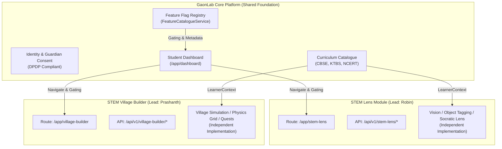

# GaonLab — Feature Module Integration & Dashboard Architecture

> **Architecture Reference & Integration Specification for Autonomous Feature Leads**  
> *Target Cycle: Academic Year 2026–27*  
> *Module Owners: Robin (STEM Lens) & Prashanth (STEM Village Builder)*  
> *Platform: GaonLab Core Modular Monolith*  

---

## 1. Executive Overview & Purpose

GaonLab is architected as an offline-first modular monolith that supports autonomous feature development. To maintain architectural integrity, avoid merge conflicts, and prevent accidental data leakage, specialized experiential modules are developed independently by designated engineering leads:

- **STEM Lens** is owned by **Robin**.
- **STEM Village Builder** is owned by **Prashanth**.

This document defines the **integration contracts, shared platform identifiers, backend routes, and frontend boundaries** established to connect these modules to the primary student dashboard without coupling their internal implementations.

---

## 2. Architectural Boundaries & Division of Responsibility



### Strict Non-Interference Rules
1. **No Redundant Student Identities**: Neither module may create its own student authentication, login system, or database table for accounts. All learner context is injected via the standard `LearnerContext`.
2. **No Redundant Curriculum Databases**: Neither module may invent a separate board or textbook database. Curriculum bindings must reference canonical GaonLab `boardId`, `curriculumVersionId`, and `chapterId`.
3. **Internal Logic Autonomy**:
   - Camera drivers, computer vision inference, and optical object tagging belong exclusively to **Robin**.
   - Virtual village graphics, tile mapping, energy/water balance simulations, and game loops belong exclusively to **Prashanth**.

---

## 3. Shared Platform Identifiers

Both modules must interact with the core ecosystem using these canonical identifiers:

| Identifier | Type | Format | Description |
| :--- | :--- | :--- | :--- |
| `learnerId` | UUID v4 | String | Canonical student ID from the `LearnerProfile` table. |
| `boardId` | Enum/Code | String | Educational board (`CBSE`, `KARNATAKA_STATE_BOARD`). |
| `curriculumVersionId` | UUID v4 | String | Specific academic year and medium binding for the grade. |
| `textbookEditionId` | UUID v4 | String | ID of the prescribed textbook edition. |
| `chapterId` | UUID v4 | String | ID of the specific chapter being explored or reinforced. |
| `conceptId` | String | String | Universal STEM concept identifier (e.g. `CONCEPT_HEAT_TRANSFER`). |
| `activityId` | String | String | Universal activity/mission identifier. |

---

## 4. Backend Module Foundations & Endpoints

### 4.1 Feature Registry API
- **Endpoint**: `GET /api/v1/features/catalogue`
- **Controller**: `FeatureCatalogueRouter`
- **Service**: `FeatureCatalogueService`
- **Output**: Returns dynamic registry of all dashboard-accessible platform modules, statuses (`REGISTERED`, `NOT_IMPLEMENTED`, `INTEGRATION_PENDING`, `ACTIVE`, `DISABLED`), feature flag gating, and ownership metadata.

```json
{
  "success": true,
  "data": {
    "features": [
      {
        "featureId": "STEM_LENS",
        "name": "STEM Lens",
        "frontendRoute": "/app/stem-lens",
        "status": "INTEGRATION_PENDING",
        "owner": "Robin",
        "supportedLearnerSegments": ["MIDDLE", "SECONDARY", "POST_SCHOOL"],
        "requiredPermissions": ["CAMERA_CAPTURE_OPTIONAL", "OFFLINE_CACHE_STORAGE"],
        "featureFlagKey": "STEM_LENS_ENABLED"
      },
      {
        "featureId": "VILLAGE_BUILDER",
        "name": "STEM Village Builder",
        "frontendRoute": "/app/village-builder",
        "status": "INTEGRATION_PENDING",
        "owner": "Prashanth",
        "supportedLearnerSegments": ["MIDDLE", "SECONDARY", "POST_SCHOOL"],
        "requiredPermissions": ["LOCAL_STORAGE_STATE", "OFFLINE_CACHE_STORAGE"],
        "featureFlagKey": "VILLAGE_BUILDER_ENABLED"
      }
    ],
    "totalRegistered": 2
  }
}
```

### 4.2 STEM Lens Foundation (Robin)
- **Directory**: `apps/api/src/modules/stem-lens/`
- **Public Contracts**: `stem-lens.contracts.ts`
- **Manifest**: `stem-lens.manifest.ts`
- **Service**: `StemLensService` (`IStemLensService`)
- **Status Endpoint**: `GET /api/v1/stem-lens/status`
- **Integration Contract Details**:
  - `StemLensCurriculumBinding`: Binds an optical session to a `curriculumVersionId`, `chapterId`, or `conceptId`.
  - `StemLensActivityEvent`: Emits structured telemetry when an object (e.g. *compost pit*, *well pulley*, *soil*) is tagged and analyzed.

### 4.3 STEM Village Builder Foundation (Prashanth)
- **Directory**: `apps/api/src/modules/village-builder/`
- **Public Contracts**: `village-builder.contracts.ts`
- **Manifest**: `village-builder.manifest.ts`
- **Service**: `VillageBuilderService` (`IVillageBuilderService`)
- **Status Endpoint**: `GET /api/v1/village-builder/status`
- **Integration Contract Details**:
  - `VillageBuilderGeographicBinding`: Associates a village simulation with a student's district, agro-climatic zone, or regional profile.
  - `VillageBuilderCurriculumBinding`: Binds infrastructure challenges (e.g. drip irrigation, solar water pump) to learning outcomes.
  - `VillageBuilderActivityEvent`: Emits telemetry for village construction and problem-solving actions.

---

## 5. Frontend Routes & Dashboard Presence

### 5.1 Established Routes
- `/app/dashboard`: Central student hub.
- `/app/stem-lens`: STEM Lens interface route (currently renders Robin's integration placeholder).
- `/app/village-builder`: STEM Village Builder interface route (currently renders Prashanth's integration placeholder).
- `/dashboard`: Aliased and redirected to `/app/dashboard`.

### 5.2 Dashboard Prominence & Design
The dashboard features an **"Explore STEM"** hero section prominently above textbooks and syllabus lists:
1. **STEM Lens Card**: Styled with indigo/violet gradients, camera icon, ownership badge (`Owned by Robin`), active status badge (`INTEGRATION_PENDING`), and direct action button navigating to `/app/stem-lens`.
2. **STEM Village Builder Card**: Styled with emerald/teal gradients, architecture icon, ownership badge (`Owned by Prashanth`), active status badge (`INTEGRATION_PENDING`), and direct action button navigating to `/app/village-builder`.

---

## 6. How Robin and Prashanth Will Connect Their Work

### For Robin (STEM Lens Implementation):
1. **Frontend**: Implement the interactive camera and inquiry UI under `apps/web/src/pages/StemLensPage.tsx` or as subcomponents in `apps/web/src/modules/stem-lens/`.
2. **Backend**: Add business endpoints (e.g., `POST /api/v1/stem-lens/analyze`, `POST /api/v1/stem-lens/sessions`) directly inside `apps/api/src/modules/stem-lens/stem-lens.router.ts`.
3. **Telemetry**: Emit `StemLensActivityEvent` payloads using the existing `SyncService` and `AuditEvent` infrastructure.

### For Prashanth (Village Builder Implementation):
1. **Frontend**: Implement the interactive village canvas and infrastructure quest UI under `apps/web/src/pages/VillageBuilderPage.tsx` or subcomponents in `apps/web/src/modules/village-builder/`.
2. **Backend**: Add village state persistence endpoints (e.g., `GET /api/v1/village-builder/state`, `POST /api/v1/village-builder/actions`) directly inside `apps/api/src/modules/village-builder/village-builder.router.ts`.
3. **Geography & Curriculum**: Leverage `VillageBuilderGeographicBinding` and `LearnerContext` to tailor village challenges to the learner's local district and grade level.
