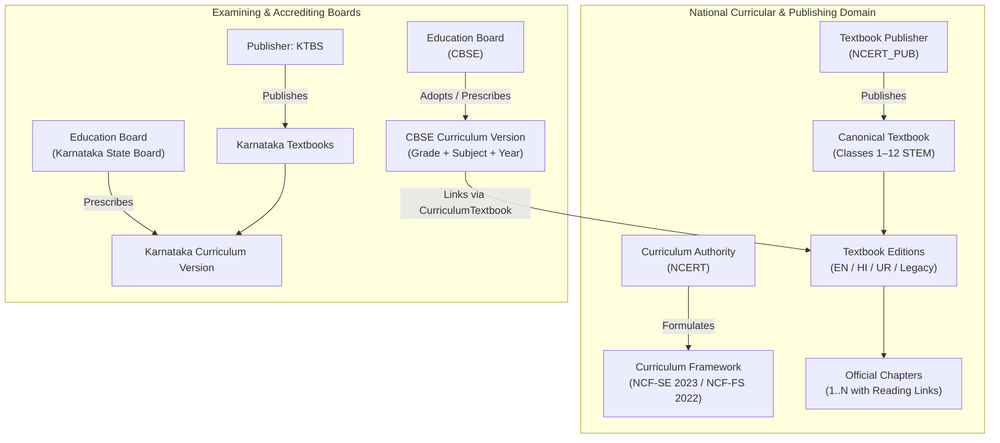

# GaonLab NCERT STEM Curriculum Catalogue (Classes 1–12)

> **Official National STEM Curriculum Reference, Catalogue Inventory, and Verification Directory**  
> *Target Academic Year: 2026–27*  
> *Scope: Classes 1 through 12 — Mathematics, Natural Sciences, Computing & Applied STEM*  
> *Curricular Authority: National Council of Educational Research and Training (NCERT)*  
> *Publisher: NCERT Publication Division (`NCERT_PUB`)*  
> *Framework Alignment: National Curriculum Framework for School Education (NCF-SE 2023) & Foundational Stage (NCF-FS 2022)*  

---

## 1. Domain Architecture & Authority Separation

GaonLab strictly preserves the institutional and constitutional boundaries of Indian educational bodies:

1. **NCERT is a national curriculum authority and textbook publisher**, NOT an education board. No artificial or fake `EducationBoard` is created in GaonLab.
2. **CBSE is an examining and accrediting board** that adopts and recommends verified NCERT textbooks as curriculum references.
3. **Karnataka State Board (KSEAB)** is an independent state board utilizing textbooks published by the **Karnataka Textbook Society (KTBS)** guided by **DSERT Karnataka**.
4. **National Reference Catalogue**: NCERT textbooks, editions, and chapters exist as a canonical national collection under `NCERT_PUB` in GaonLab, independent of board-specific adoption.

---

## 2. Executive Ingestion Summary

| Dimension | Count | Details |
| :--- | :--- | :--- |
| **Total Ingested Manifests** | **101** | 83 NCERT National Reference + 6 CBSE + 12 Karnataka State Board |
| **Education Boards** | **2** | `CBSE`, `KARNATAKA_STATE_BOARD` |
| **Curriculum Frameworks** | **3** | `NCF_SE_2023`, `KTBS_CURRICULUM_2024`, `NCF_2005` (Legacy Archival) |
| **Textbook Publishers** | **2** | `NCERT_PUB` (National), `KTBS` (Karnataka) |
| **Canonical Textbooks** | **57** | 51 NCERT STEM + 6 KTBS |
| **Textbook Editions** | **98** | English, Hindi, Urdu, Kannada, and Archival Editions |
| **Total Chapter Records** | **1,161** | Verified, Archived, and Pending records |
| ↳ **Verified Chapters** | **1,042** | Officially validated against active NCERT / KTBS catalogues |
| ↳ **Pending Verification** | **45** | NCF-SE Preview editions & CBSE Applied Mathematics references |
| ↳ **Archived Chapters** | **74** | Preserved historical NCF-2005 editions (Math-Magic, Looking Around) |
| **Board Versions Linked** | **18** | 6 CBSE (Grades 6–8) + 12 Karnataka State Board (Grades 6–8) |
| **Seeder Execution Failures** | **0** | Strictly idempotent, zero duplicates on re-run |

---

## 3. Class-by-Class STEM Coverage Matrix (Classes 1–12)

| Class / Grade | Curricular Stage | STEM Subjects Covered | Key Textbook Titles | Languages Available | Volumes | Chapter Count (Active EN) | Status |
| :--- | :--- | :--- | :--- | :--- | :--- | :--- | :--- |
| **Class 1** | Foundational | Mathematics | *Joyful Mathematics* / *आनंदमय गणित* / *Math-Magic (Archival)* | EN, HI, UR | 1 | 13 | `VERIFIED` |
| **Class 2** | Foundational | Mathematics | *Joyful Mathematics* / *आनंदमय गणित* / *Math-Magic (Archival)* | EN, HI, UR | 1 | 11 | `VERIFIED` |
| **Class 3** | Preparatory | Mathematics The World Around Us | *Maths Mela* / *गणित मेला* *Our Wondrous World* / *हमारी अद्भुत दुनिया* | EN, HI, UR | 1 1 | 14 12 | `VERIFIED` `VERIFIED` |
| **Class 4** | Preparatory | Mathematics The World Around Us | *Maths Mela* / *गणित मेला* *Our Wondrous World* / *हमारी अद्भुत दुनिया* | EN, HI | 1 1 | 14 10 | `VERIFIED` `VERIFIED` |
| **Class 5** | Preparatory | Mathematics The World Around Us | *Math-Magic 5* (Active) / *Maths Mela 5* (Preview) *Looking Around 5* / *आस पास 5* | EN, HI, UR | 1 1 | 14 22 | `VERIFIED` `VERIFIED` |
| **Class 6** | Middle | Mathematics Science | *Ganita Prakash 6* / *गणित प्रकाश 6* *Curiosity 6* / *जिज्ञासा 6* | EN, HI, UR | 1 1 | 10 12 | `VERIFIED` `VERIFIED` |
| **Class 7** | Middle | Mathematics Science | *Mathematics 7* (Active) / *Ganita Prakash 7* (Preview) *Science 7* / *विज्ञान 7* | EN, HI, UR | 1 1 | 13 13 | `VERIFIED` `VERIFIED` |
| **Class 8** | Middle | Mathematics Science | *Mathematics 8* (Active) / *Ganita Prakash 8* (Preview) *Science 8* / *विज्ञान 8* | EN, HI, UR | 1 1 | 13 13 | `VERIFIED` `VERIFIED` |
| **Class 9** | Secondary | Mathematics Science | *Mathematics 9* / *गणित 9* *Science 9* / *विज्ञान 9* | EN, HI, UR | 1 1 | 12 12 | `VERIFIED` `VERIFIED` |
| **Class 10** | Secondary | Mathematics Science | *Mathematics 10* / *गणित 10* *Science 10* / *विज्ञान 10* | EN, HI, UR | 1 1 | 14 13 | `VERIFIED` `VERIFIED` |
| **Class 11** | Higher Secondary | Mathematics Applied Mathematics Physics Chemistry Biology Computer Science Informatics Practices Biotechnology | *Mathematics 11* *Applied Mathematics 11* (CBSE Reference) *Physics Part I & II* *Chemistry Part I & II* *Biology 11* *Computer Science 11* *Informatics Practices 11* *Biotechnology 11* | EN, HI EN EN, HI EN, HI EN, HI EN EN EN | 1 1 2 2 1 1 1 1 | 14 8 14 (7+7) 9 (6+3) 19 11 8 12 | `VERIFIED` `PENDING_VERIFICATION` `VERIFIED` `VERIFIED` `VERIFIED` `VERIFIED` `VERIFIED` `VERIFIED` |
| **Class 12** | Higher Secondary | Mathematics Applied Mathematics Physics Chemistry Biology Computer Science Informatics Practices Biotechnology | *Mathematics Part I & II* *Applied Mathematics 12* (CBSE Reference) *Physics Part I & II* *Chemistry Part I & II* *Biology 12* *Computer Science 12* *Informatics Practices 12* *Biotechnology 12* | EN, HI EN EN, HI EN, HI EN, HI EN EN EN | 2 1 2 2 1 1 1 1 | 13 (6+7) 8 14 (8+6) 10 (5+5) 13 13 7 2 | `VERIFIED` `PENDING_VERIFICATION` `VERIFIED` `VERIFIED` `VERIFIED` `VERIFIED` `VERIFIED` `VERIFIED` |

---

## 4. Detailed Subject Analysis & Volume Mapping

### 4.1 Foundational Stage (Classes 1–2)
- **Pedagogical Standard:** In accordance with NCF-FS 2022 and NEP 2020, Classes 1 and 2 **do not prescribe a separate Science textbook**. Foundational environmental awareness is integrated into play, observation, and languages.
- **Mathematics:** *Joyful Mathematics* (English: `aejm1`, `bejm1`), *आनंदमय गणित* (Hindi: `ahjm1`, `bhjm1`), and Urdu editions are catalogued with 13 and 11 chapters respectively.
- **Archival Preservation:** The older *Math-Magic* series (Books 1 & 2) is retained with `ARCHIVED` status to ensure historical curriculum consistency.

### 4.2 Preparatory Stage (Classes 3–5)
- **Curricular Area:** Under NCF-SE 2023, environmental learning is formalized as *The World Around Us*.
- **Class 3:**
  - Mathematics: *Maths Mela* (`cemm1`, 14 chapters, English/Hindi/Urdu).
  - The World Around Us: *Our Wondrous World* (`ceww1`, 12 chapters, English/Hindi/Urdu).
  - Legacy: *Math-Magic 3* and *Looking Around 3* retained as `ARCHIVED`.
- **Class 4:**
  - Mathematics: *Maths Mela* (`demm1`, 14 chapters, English/Hindi).
  - The World Around Us: *Our Wondrous World* (`deww1`, 10 chapters, English/Hindi).
  - Legacy: *Math-Magic 4* and *Looking Around 4* retained as `ARCHIVED`.
- **Class 5:**
  - Mathematics: *Math-Magic 5* (`eemm1`, 14 chapters) is the currently active operational edition in schools; *Maths Mela 5* is catalogued with `PENDING_VERIFICATION` status for NCF-SE rollout.
  - EVS: *Looking Around 5* (`eela1`, 22 chapters, English/Hindi).

### 4.3 Middle Stage (Classes 6–8)
- **Class 6:**
  - Mathematics: *Ganita Prakash - Mathematics Grade 6* (`fegp1`, 10 chapters, English/Hindi/Urdu).
  - Integrated Science: *Curiosity - Science Grade 6* (`fecu1`, 12 chapters, English/Hindi/Urdu).
- **Class 7:**
  - Mathematics: Rationalised operational edition *Mathematics - Grade 7* (`gemh1`, 13 chapters, `VERIFIED`); *Ganita Prakash 7* preview modules catalogued with `PENDING_VERIFICATION`.
  - Science: *Science - Grade 7* (`gesc1`, 13 chapters, English/Hindi).
- **Class 8 (Grade 8 Reconciliation):**
  - Mathematics: As directed in Stage 2.1, Grade 8 Mathematics is verified against the current official operational catalogue: the 13-chapter rationalised edition *Mathematics - Grade 8* (`hemh1`) remains the active operational text (`VERIFIED`); *Ganita Prakash 8* preview modules (*A Square and a Cube*, *The Baudhāyana-Pythagoras Theorem*) are indexed as `PENDING_VERIFICATION`.
  - Science: *Science - Grade 8* (`hesc1`, 13 chapters, English/Hindi).

### 4.4 Secondary Stage (Classes 9–10)
- **Class 9:**
  - Mathematics: *Mathematics - Grade 9* (`iemh1`, 12 chapters, rationalised, English/Hindi).
  - Science: *Science - Grade 9* (`iesc1`, 12 chapters, rationalised, English/Hindi).
- **Class 10:**
  - Mathematics: *Mathematics - Grade 10* (`jemh1`, 14 chapters, rationalised without legacy Constructions, English/Hindi).
  - Science: *Science - Grade 10* (`jesc1`, 13 chapters, rationalised without legacy Periodic Classification, English/Hindi).

### 4.5 Higher Secondary Stage (Classes 11–12)
- **Multi-Volume Architecture:**
  - **Physics:**
    - Class 11: *Physics Part I* (`keph1`, Chapters 1–7) & *Physics Part II* (`keph2`, Chapters 8–14).
    - Class 12: *Physics Part I* (`leph1`, Chapters 1–8) & *Physics Part II* (`leph2`, Chapters 9–14).
  - **Chemistry:**
    - Class 11: *Chemistry Part I* (`kech1`, Chapters 1–6) & *Chemistry Part II* (`kech2`, Chapters 7–9).
    - Class 12: *Chemistry Part I* (`lech1`, Chapters 1–5) & *Chemistry Part II* (`lech2`, Chapters 6–10).
  - **Mathematics:**
    - Class 11: *Mathematics* (`kemh1`, 14 chapters).
    - Class 12: *Mathematics Part I* (`lemh1`, Chapters 1–6) & *Mathematics Part II* (`lemh2`, Chapters 7–13).
  - **Biology:**
    - Class 11: *Biology* (`kebo1`, 19 chapters).
    - Class 12: *Biology* (`lebo1`, 13 chapters).
  - **Computing & Applied Disciplines:**
    - *Computer Science:* Class 11 (`kecs1`, 11 chapters) & Class 12 (`lecs1`, 13 chapters).
    - *Informatics Practices:* Class 11 (`keip1`, 8 chapters) & Class 12 (`leip1`, 7 chapters).
    - *Biotechnology:* Class 11 (`kebt1`, 12 chapters) & Class 12 (`lebt1`, 2 core units / elective modules).
  - **Applied Mathematics (Curriculum Boundary Check):**
    - NCERT does **not** publish an official standalone textbook for Applied Mathematics.
    - Applied Mathematics (CBSE Subject Code 241) is governed by CBSE Academic Curriculum Study Material.
    - GaonLab indexes Class 11 and Class 12 Applied Mathematics syllabus modules marked `PENDING_VERIFICATION` under CBSE reference, preventing false attribution to NCERT Publishing.

---

## 5. API Access for the National Reference Catalogue

Three dedicated endpoints allow querying the NCERT National Reference Catalogue independently of board adoption:

### 1. `GET /api/v1/curriculum/publishers`
Returns all registered publishing houses (`NCERT_PUB`, `KTBS`).

### 2. `GET /api/v1/curriculum/national-catalogue`
Query NCERT textbooks and editions directly with optional filters:
- `?grade=11`
- `?subjectId=PHYSICS`
- `?medium=en`
- `?status=VERIFIED`

### 3. `GET /api/v1/curriculum/publishers/:publisherId/textbooks`
List textbooks published by an authority publisher:
- `GET /api/v1/curriculum/publishers/NCERT_PUB/textbooks?grade=6`

---

## 6. Verification and Copyright Invariants

1. **Digital Links Only:** GaonLab indexes chapter metadata, titles, printed page ranges, and official reading URLs resolving to `https://ncert.nic.in/textbook.php`.
2. **Zero PDF Re-hosting:** GaonLab does not mirror, cache, or distribute copyrighted NCERT PDF assets, adhering strictly to the NCERT copyright charter.
3. **Idempotent Ingestion:** The seeder engine deduplicates frameworks, authorities, publishers, levels, and subjects across all 101 manifest files.
