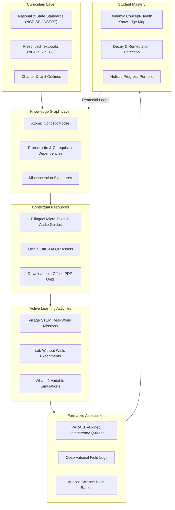
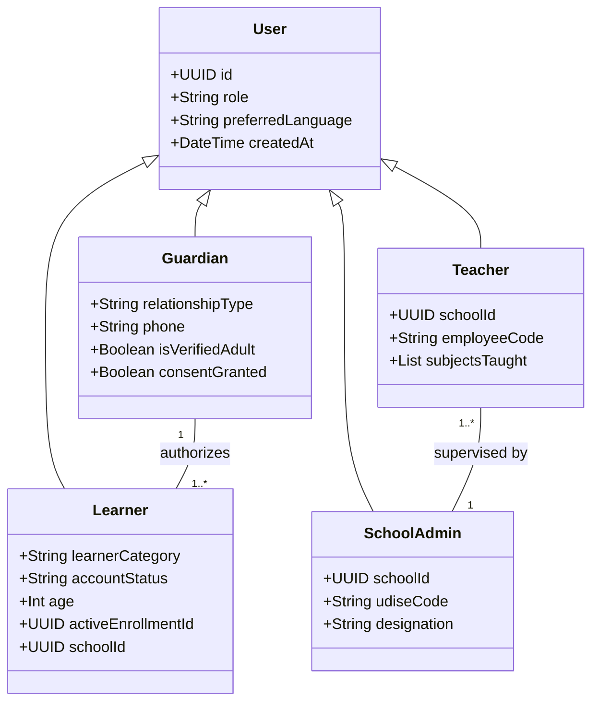
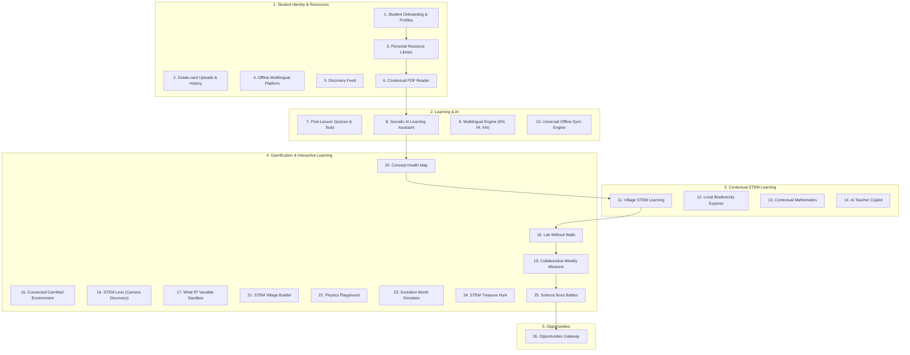
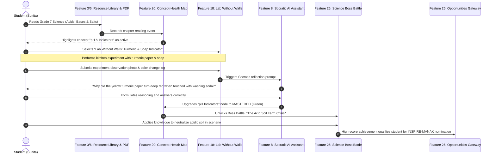
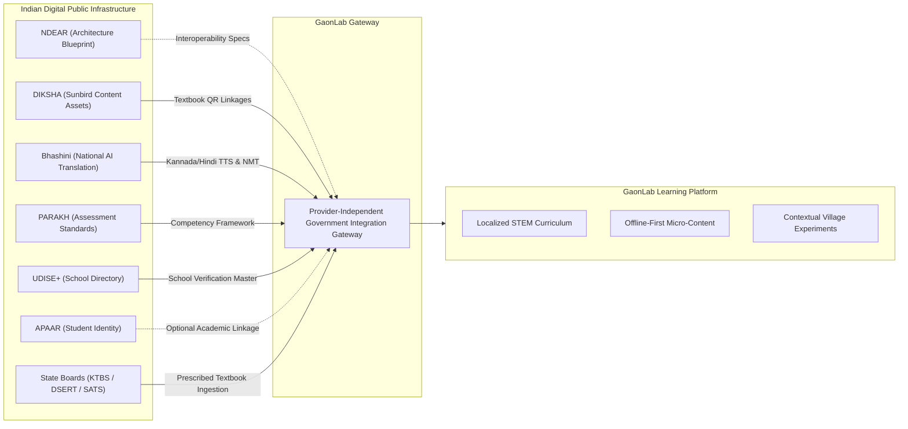
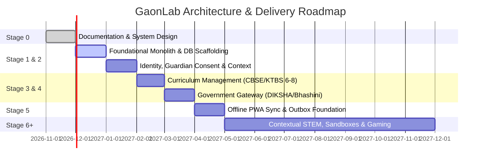

# GAONLAB — PRODUCT OVERVIEW & SPECIFICATION

> **Comprehensive Product Architecture, Feature Catalog, and Educational Philosophy**  
> *Target Audience: Product Managers, Engineers, Educational Designers, Evaluators, and Institutional Partners*  
> *Version: 1.0 (Academic Year 2026–27)*

---

## 1. Project Vision & The Core Problem

### 1.1 The Reality of Rural STEM Education in India
Across more than 600,000 villages in India, millions of middle and secondary school students experience science and mathematics primarily as an exercise in rote memorization. 

While the National Education Policy (NEP) 2020 and National Curriculum Framework for School Education (NCF-SE) 2023 emphasize experiential, inquiry-based, and discovery-oriented learning, the ground reality in rural schools presents severe structural hurdles:
1. **Absence of Functional Laboratories:** Most rural schools lack physical science laboratories, consumable chemicals, functional microscopes, or electronic testing equipment. Science experiments are rarely demonstrated and almost never touched by students.
2. **Abstract Textbook Syndrome:** Concepts such as Archimedes' principle, photosynthesis, mechanical advantage, or coordinate geometry are taught as abstract definitions and diagrams on blackboards, completely severed from the physical environment right outside the classroom window.
3. **Severe Connectivity and Hardware Constraints:** Rural households frequently share a single budget Android smartphone (often 2GB–3GB RAM) among multiple family members. Internet connectivity is intermittent, slow, or throttled by exhausted cellular data packs.
4. **Linguistic and Cultural Alienation:** Mainstream educational content is heavily skewed toward urban, English-medium paradigms, featuring examples like escalators, metro trains, and automated sprinklers that fail to resonate with a child living in an agricultural village.

### 1.2 Why Generic EdTech Platforms Fail Rural Learners
Conventional EdTech platforms replicate the lecture hall in digital form: they stream long video lectures, provide multiple-choice test banks, and attach generic AI chatbots that simply output direct answers to homework problems. This approach fails rural learners because:
- **Bandwidth Heavy:** Continuous high-definition video streaming is unsustainable on spotty 2G/4G connections.
- **Cognitively Passive:** Watching a video lecture induces passive consumption rather than scientific curiosity or tactile experimentation.
- **Superficial Gamification:** Rewarding points and flashy badges for clicking "Next" trivializes learning without cultivating deep conceptual mastery.
- **Extractive & Inaccessible:** Commercial platforms hide advanced features behind steep paywalls, demand high-end devices, and mandate continuous cloud connectivity.

### 1.3 The GaonLab Paradigm: The Village as a Living Laboratory
GaonLab inverts the traditional educational hierarchy. It posits that **a rural village is not an educational deficit—it is the richest, most dynamic scientific laboratory on earth.**

- A traditional bullock cart is an applied masterclass in torque, center of gravity, friction, and wheel-axle mechanical advantage.
- A village tube well or Persian wheel illustrates hydrostatic pressure, siphon mechanisms, and fluid dynamics.
- An agricultural field illustrates soil chemistry, microbial ecosystems, capillary action, and seasonal biological cycles.
- The village *mandi* (grain market) is a living arena for contextual arithmetic, percentage yields, moisture-loss ratios, and statistical trends.

GaonLab connects the formal prescribed curriculum directly to these everyday physical encounters, turning every student into an active scientific investigator.

---

## 2. The Central Educational Architecture

At the heart of GaonLab is a strict, unbroken pedagogical chain that ensures every interaction ties back to curriculum outcomes while driving deep personal understanding:

1. **Curriculum:** Grounded in official board textbooks (CBSE/NCERT and Karnataka State Board/KTBS) for Grades 6–8 Mathematics and Science.
2. **Concepts:** Chapters are decomposed into an atomic concept graph where each concept has identified prerequisite dependencies.
3. **Resources:** Curated, lightweight bilingual micro-content, verified DIKSHA references, and offline-stored textbook excerpts.
4. **Learning Activities:** Students validate concepts through physical experiments (*Lab Without Walls*), daily village observations (*Village STEM*), and virtual parameter testing (*What If?*).
5. **Assessment:** Evaluations measure applied competency (aligned with PARAKH standards) rather than factual regurgitation.
6. **Student Understanding:** The system maintains a real-time **Concept-Health Map** that tracks mastery, identifies misconceptions, and monitors knowledge decay over time.

---

## 3. Core Product Users & Stakeholder Personas

### 3.1 Detailed User Personas

#### Persona 1: Sunita Basavaraj (The Rural Middle School Learner)
- **Profile:** 12-year-old girl, Grade 7 student at a Government Higher Primary School in Belagavi District, Karnataka.
- **Access Environment:** Shares her father’s Android phone (Redmi 9A, 2GB RAM, cracked screen) for 45 minutes every evening. Home has intermittent electricity; mobile connectivity drops to 2G during monsoon rain.
- **Linguistic Context:** Speaks Kannada at home; studies in Kannada medium; finds technical English terms intimidating.
- **Aspirations:** Fascinated by plant diseases affecting her family's sugarcane crop; dreams of becoming an agricultural scientist.
- **GaonLab Experience:** Downloads the weekly Science module at her school's Wi-Fi hotspot; takes the phone to the field to run the "Soil & Capillary Action" experiment using old coconut shells and scrap cotton rags; reviews concepts in Kannada with offline audio prompts.

#### Persona 2: Ramesh Yadav (The Independent Inquisitive Learner)
- **Profile:** 13-year-old boy, Grade 8, living in a semi-urban town near Varanasi, Uttar Pradesh. Enrolled in a local private CBSE school with minimal lab facilities.
- **Access Environment:** Has personal access to an entry-level smartphone with 4G data.
- **Linguistic Context:** Hindi native, studying in English medium.
- **Aspirations:** Loves tinkering with broken bicycle pumps, electric switches, and small dynamos; wants to become a mechanical engineer.
- **GaonLab Experience:** Signs up independently without needing school provision; explores the *Physics Playground* sandbox to simulate gear ratios; completes *What If?* simulations on friction; tackles weekly *Science Boss Battles*.

#### Persona 3: Masterji Anand Kumar (The Dedicated Rural Science Teacher)
- **Profile:** 42-year-old science teacher handling Grades 6, 7, and 8 across three schools in a rural cluster.
- **Pain Points:** Burdened by administrative paperwork; lacks lab funds; struggles to keep 45 students engaged when textbook descriptions are dry.
- **GaonLab Experience:** Uses the *AI Teacher Copilot* on his phone to generate a low-cost lesson plan for teaching electricity using discarded pencil graphite and torch batteries; tracks which students have missing foundational prerequisites on the class *Concept-Health Map*.

#### Persona 4: Parvati Devi (The Concerned Rural Guardian)
- **Profile:** 36-year-old mother, smallholder farmer, limited formal literacy.
- **Pain Points:** Worried about phone addiction and inappropriate online content; skeptical of complicated digital registration processes; does not have an email address or digital payment method.
- **GaonLab Experience:** Receives a transparent, simple voice IVR or bilingual SMS consent request explaining GaonLab’s zero-ad, safe educational focus; approves Sunita’s account with a single phone confirmation; receives periodic verbal voice summaries of her daughter's achievements.

---

## 4. Complete 26-Feature Catalog & System Walkthrough

GaonLab’s complete architectural scope comprises 26 features. Below is the definitive specification for each feature.

### Pillar I: Student Identity and Resources
1. **Student Onboarding & Multi-Dimensional Profiling:**  
   Captures board (CBSE / Karnataka State Board), grade (6–8), medium of instruction, preferred interface language, subject interests (astronomy, robotics, agriculture), and future career dreams. Differentiates registration from activation and enforces guardian consent.
2. **Grade-Card Uploads & Academic Performance History:**  
   Allows learners to photograph or upload periodic institutional report cards. An on-device or edge OCR parser extracts subject marks and maps them against standard learning outcomes to establish baseline academic trajectories.
3. **Central Personal Resource Library:**  
   An offline-cached digital bookshelf storing official NCERT and KTBS textbooks, chapter summary notes, question banks, and worksheets. Supports delta downloads of individual chapters.
4. **Offline-First Multilingual STEM Platform:**  
   A zero-bandwidth architectural framework ensuring all navigation, cached textbooks, offline activities, and local simulations function seamlessly without cellular connectivity.
5. **Scientific Discovery Feed:**  
   A daily or weekly updated micro-magazine showcasing breakthroughs in Indian and global science, regional grassroots innovations (e.g., bicycle-powered seed sprayers), profiles of diverse researchers, and space mission milestones.
6. **Integrated Contextual PDF Reader:**  
   An embedded reader designed for official textbook PDFs. When a student highlights a confusing paragraph or formula, the reader provides an instant contextual popup containing a simplified bilingual summary, a micro-diagram, or an offline video clip explaining that exact concept.

### Pillar II: Learning and AI
7. **Post-Lesson Quizzes and Mastery Tests:**  
   Adaptive formative evaluations following each textbook chapter. Incorporates multiple question formats (assertion-reasoning, diagram labeling, multi-variable matching) aligned with the PARAKH competency framework.
8. **Socratic AI Learning Assistant:**  
   A conversational tutor programmed with strict pedagogical guardrails. If a student asks *"What is the formula for kinetic energy?"*, the assistant does not simply hand over $\frac{1}{2}mv^2$. Instead, it asks: *"What happened when you threw the heavier stone into the mud compared to the light pebble? What two properties caused the deeper crater?"* It guides through analogies, hints, and Socratic questioning.
9. **Multilingual Support (English, Hindi, Kannada):**  
   Comprehensive language localization across UI labels, audio narration, conceptual glossaries, and AI dialogues. Implemented using Bhashini ULCA standards.
10. **Universal Offline Operations & Background Sync:**  
    An intelligent client-side outbox queue. All quiz attempts, experiment logs, notes, and streak counters are committed locally to IndexedDB and automatically synchronized with server-side deduplication when connectivity is restored.

### Pillar III: Contextual STEM Learning
11. **Village STEM Learning:**  
    Curriculum-mapped modular learning units built around rural objects, tools, and practices. Topics include:
    - *The Physics of the Bullock Cart:* Friction, center of mass, lubrication of wooden axles.
    - *The Chemistry of Jaggery Making:* Crystallization, boiling point elevation, pH regulation with lime.
    - *The Biology of Composting:* Microbial decomposition, nitrogen-carbon ratios, thermal insulation.
12. **Local Biodiversity Exploration & Field Notebook:**  
    A guided observational tool for cataloging regional flora, fauna, medicinal plants, insects, and soil types. Students record leaf shapes, root structures, bird calls, and flowering seasons, contributing to a local biodiversity register.
13. **Contextual Mathematics:**  
    Replaces artificial textbook math problems with authentic rural scenarios:
    - Calculating the volume and storage duration of a cylindrical grain silo (*kothi*).
    - Determining the flow rate, kilowatt consumption, and water discharge of a solar water pump.
    - Calculating percentage crop loss due to moisture in the *mandi*.
14. **AI Assistant for School Teachers (Teacher Copilot):**  
    A dedicated workflow for rural school educators. Generates tailored 45-minute lesson plans using only locally available teaching aids, creates bilingual remedial worksheets for struggling students, and provides diagnostic summaries of class-wide concept gaps.

### Pillar IV: Gamification and Interactive Learning
15. **Connected Gamified Learning Environment:**  
    A non-intrusive progression system centered on genuine mastery. Learners earn *Curiosity Badges*, *Experimenter Ranks*, and *Problem-Solver Streaks* for validating physical experiments rather than merely clicking through screens.
16. **STEM Lens (Camera Concept Recognition):**  
    An on-device computer vision tool. A student points their camera at a bicycle gear, a leaf venation pattern, an electric meter, or a water pump, and the app overlays interactive annotations highlighting the underlying physics, biology, or geometry.
17. **What If? Interactive Variable Simulations:**  
    Lightweight simulation sandboxes where students alter physical variables and observe real-time consequences. Examples:
    - *What if gravity on earth was cut in half?* (Watch objects fall, pendulum periods change).
    - *What if soil nitrogen drops to zero?* (Observe simulated crop leaf chlorosis).
18. **Lab Without Walls:**  
    A curated repository of hands-on physical experiments constructed entirely using zero-cost, recycled, or kitchen materials:
    - Measuring lung volume using an inverted plastic jar in a bucket of water.
    - Testing soil pH using red cabbage extract as a natural indicator.
    - Constructing a pinhole camera using a scrap cardboard tea carton.
19. **Weekly Collaborative Inter-School Missions:**  
    Synchronized team challenges where students from different village schools collaborate virtually. Example: *The Clean Water Mission*—measuring and comparing groundwater hardness across ten villages using simple soap-lather tests, and plotting results on a shared regional map.
20. **Dynamic Concept-Health Knowledge Map:**  
    A visual, interactive knowledge graph representing the student’s mind. Concepts are color-coded:
    - **Green (Mastered):** Consistently applied in experiments and quizzes.
    - **Yellow (Fragile / Decaying):** Understood previously but showing memory decay; triggers timely micro-reviews.
    - **Red (Missing Prerequisite):** Identifies foundational concepts (e.g., fractions) that block current learning (e.g., ratios in chemistry).
21. **STEM Village Builder:**  
    A simulation game where students construct and sustainably upgrade a virtual Indian village. They manage real-world physical trade-offs: solar vs. grid power, rainwater harvesting reservoirs, bio-gas digesters, and crop rotation schedules based on authentic regional data.
22. **Physics Playground:**  
    A 2D rigid-body sandbox engine. Students construct mechanical contraptions using pulleys, gears, levers, ramps, pivots, and ropes to solve mechanical puzzles (e.g., lifting a 50kg bag of grain using mechanical advantage).
23. **Evolution World:**  
    An ecological simulator where students manage a virtual rural biosphere. They introduce seasonal shocks—such as chemical pesticide runoff, festival immersion pollution in local lakes, or severe drought—and observe natural selection, species collapse, or ecosystem recovery.
24. **STEM Treasure Hunt:**  
    Real-world physical scavenger hunts conducted in the schoolyard or village. Prompts direct students to find physical examples of acute angles, dicotyledonous leaves, concave surfaces, or thermal conductors, verifying findings through photo or measurement logs.
25. **Science Boss Battles:**  
    High-stakes, game-based culminating challenges at the end of each unit. To "defeat" a scenario (e.g., *The Village Water Crisis* or *The Crop Infestation Outbreak*), students must apply cumulative concepts from biology, chemistry, and mathematics across multi-stage decision trees.

### Pillar V: Opportunities
26. **Opportunities & Mentorship Gateway:**  
    A verified discovery and application bridge matching rural learners with legitimate national competitions, science fairs (e.g., INSPIRE-MANAK), government scholarships (NMMS, Kishore Vaigyanik), university mentorship programs, and vocational apprenticeships.

---

## 5. Ecosystem Interconnectivity: How the Features Interlock

The power of GaonLab lies in the deep synergy between its features. A single learning intent flows across multiple interconnected modules:

---

## 6. Alignment with India’s Digital Education Ecosystem

GaonLab is architected to operate symbiotically with the Indian national digital infrastructure established under the National Education Policy 2020:

### 6.1 Complementarity with Existing Initiatives
- **NDEAR (National Digital Education Architecture):** GaonLab implements NDEAR principles of unbundled micro-components, open API specifications, data privacy by design, and federated identity integration.
- **DIKSHA (Digital Infrastructure for Knowledge Sharing):** Rather than re-hosting gigabytes of duplicate video assets, GaonLab parses Energized Textbook (ETB) QR codes and links learners directly to verified public DIKSHA digital resources.
- **APAAR (Automated Permanent Academic Account Registry):** An APAAR ID is supported as an optional academic identifier. However, GaonLab **never** makes APAAR a prerequisite for registration or curriculum resolution, preserving open access for independent learners.
- **BHASHINI (National Language Translation Mission):** GaonLab utilizes Bhashini ULCA APIs for translating educational prompts, localizing glossaries, and delivering voice synthesis in regional languages (Kannada, Hindi).
- **PARAKH (National Assessment Centre):** Formative assessments and Boss Battle rubrics are aligned with PARAKH’s 360-degree Holistic Progress Card (HPC) guidelines.
- **UDISE+ (Unified District Information System for Education Plus):** GaonLab maintains an internal master directory of 11-digit UDISE+ school codes, enabling instant institutional lookup when students or teachers associate with a school.
- **KTBS & DSERT (Karnataka State Infrastructure):** Direct ingestion of KTBS-published textbooks and DSERT learning outcomes ensures complete fidelity for Karnataka State Board students.

---

## 7. What Distinguishes GaonLab from Conventional Platforms?

| Architectural Dimension | Conventional Commercial EdTech | Typical State LMS / Video Portal | **GaonLab** |
| :--- | :--- | :--- | :--- |
| **Core Pedagogy** | Video streaming + passive MCQs. | Static PDF downloads + video lectures. | **Inquiry-driven, tactile experimentation, Socratic guidance.** |
| **Real-World Context** | Urban, affluent, westernized examples. | Generic textbook abstractions. | **Village as a Living Laboratory: rural mechanics, agriculture, biodiversity.** |
| **Connectivity Requirement** | Continuous high-speed 4G broadband. | Requires active internet for streaming. | **100% Offline-First (PWA, IndexedDB, delta background sync).** |
| **Hardware Footprint** | Demands modern laptops or high-end tabs. | Heavy responsive web apps. | **Optimized for \$60 budget Android phones (2GB RAM, low storage).** |
| **Role of AI** | Generates direct homework answers. | None or simple rule-based FAQ bots. | **Socratic Copilot: never gives direct answers; guides via questions.** |
| **Child Privacy & Safety** | Heavy ad trackers, behavioral profiling. | Variable compliance. | **Strict DPDP 2023 compliance: no ads, no trackers, verifiable guardian consent.** |
| **Institutional Affiliation** | Closed proprietary subscription wall. | Mandatory government school enrollment. | **Universal: Supports independent, school-linked, and school-provisioned learners.** |
| **Public Infrastructure** | Attempts to replace public schooling. | State-siloed repository. | **Synergistic: Augments NDEAR, DIKSHA, KTBS, and Bhashini.** |

---

## 8. Initial Product Scope (Foundational Base) vs. Phased Expansion

To guarantee engineering excellence and rock-solid architectural stability, GaonLab is deployed through disciplined, progressive milestones.

### 8.1 Foundational Base Implementation (Current Priority)
The base implementation builds the unshakeable foundation upon which all 26 features will run:
- **Core Modular Monolith:** Node.js/Express/TypeScript backend with PostgreSQL schemas.
- **Identity & Guardian Consent Engine:** Minor registration, verifiable guardian tokens, session authentication.
- **Standard `LearnerContext` Engine:** Stateless, privacy-preserving learner context generation.
- **Curriculum Management Engine:** Ingestion and resolution of CBSE and Karnataka State Board Grades 6–8 Mathematics and Science for Academic Year 2026–27.
- **Government Integration Gateway:** Multi-mode adapter architecture (`LIVE`, `CACHED`, `MOCK`, `OFF`) supporting Bhashini, DIKSHA, and UDISE+.
- **Offline Sync Skeleton:** PWA Service Worker caching, Dexie.js client schemas, and server-side deduplication outbox.

### 8.2 Future Expansion Phases
- **Phase 2 (Learning Core):** Post-lesson quizzes, grade-card OCR history, Socratic AI assistant, personal resource library.
- **Phase 3 (Contextual STEM):** Village STEM learning modules, Lab Without Walls guided experiments, contextual math problem sets.
- **Phase 4 (Interactive Sandboxes & Competitions):** What If? variable simulations, Science Boss Battles, Teacher Copilot, Opportunities Gateway.
- **Phase 5 (Advanced Gaming & Computer Vision):** STEM Lens (vision AI), STEM Village Builder (Phaser/MapLibre), Physics Playground (Matter.js), Evolution World.
