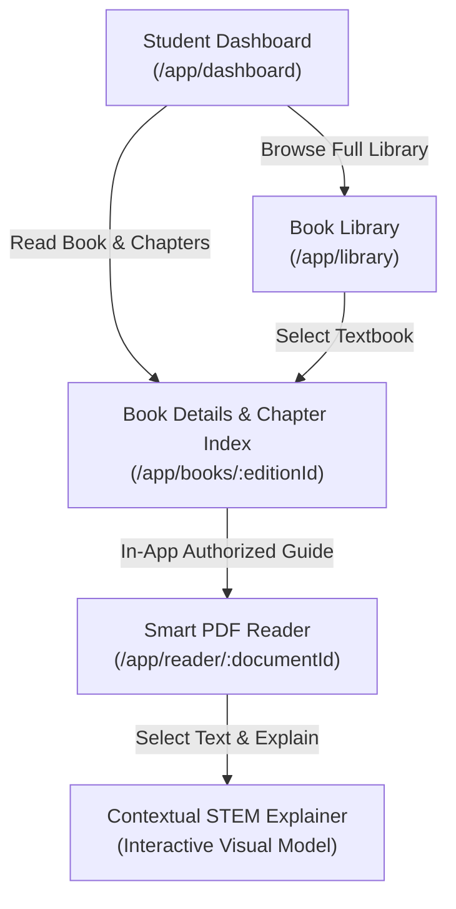
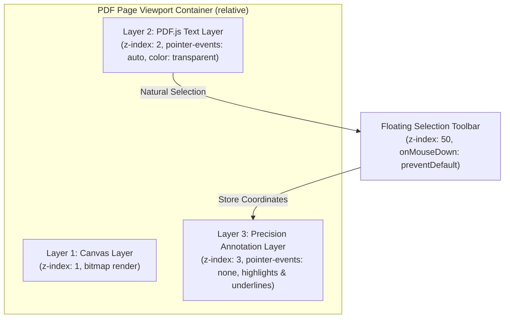

# GaonLab — Smart Reader Architectural Specification & Integration Guide

> **Target Cycle**: Academic Year 2026–27  
> **Status**: STAGE 2 COMPLETED & VERIFIED  
> **Component**: Integrated In-App Textbook & Chapter Reading Experience with Precision Annotations  
> **Package**: `@gaonlab/web` & `@gaonlab/api` (`modules/reader/`)  

---

## 1. Executive Summary & Purpose

In previous iterations, student navigation redirected to external official portals whenever a textbook was opened. The **GaonLab Smart Reader** transforms textbook discovery into a complete, in-app reading experience:



Students can browse comprehensive curriculum catalogues, review verified chapter sequences, read authorized visual learning guides, highlight passages, underline exact phrases, save persistent notes via IndexedDB, and launch grade-appropriate contextual STEM explanations without ever leaving GaonLab.

---

## 2. Document Access Modes & Copyright Enforcement

GaonLab strictly adheres to national education board guidelines (e.g. NCERT and KTBS notices prohibiting unapproved third-party hosting, scraping, or embedding of copyrighted textbooks).

Four canonical access modes are enforced across backend services and frontend interfaces:

| Access Mode | Description | Reader Experience | Fallback / Alternative |
| :--- | :--- | :--- | :--- |
| `IN_APP_AUTHORIZED` | Verified educational companion or licensed original material (e.g., GaonLab's *Forces and Friction* guide). | Opens directly in PDF.js canvas with highlights, underlines, and explainers. | N/A |
| `USER_LOCAL_ONLY` | PDF selected by the learner from their local device storage. | Rendered in-app via local `Blob/ObjectURL`. Never uploaded to server. | Personal student study files. |
| `OFFICIAL_EXTERNAL_ONLY` | Copyrighted NCERT / KTBS core textbook editions. | Metadata and chapter outlines indexed in GaonLab. Reading action links to official portal. | Accompanied by authorized GaonLab visual guides or local PDF option. |
| `UNAVAILABLE` | Curriculum records pending digitisation or verification. | Marked as pending in library. | Next cycle ingestion. |

### Strict Operational Principles:
1. **Zero Unapproved Scraping**: GaonLab never scrapes or mirrors raw NCERT/state board PDFs.
2. **Zero Unauthorized Proxying**: The backend never bypasses CORS or proxies copyrighted PDFs.
3. **Preserved Intellectual Property**: The sample Class 8 Science guide (*Forces and Friction — A Visual Learning Guide*) is original educational material authored by GaonLab and licensed under CC BY-NC 4.0.

---

## 3. Frontend Architecture (`apps/web/`)

### 3.1 Routing Matrix
- `/app/library`: Dedicated textbook library with multi-board filtering (CBSE, Karnataka State Board), grade selection (Classes 6–10), and medium toggling (`en`, `kn`, `hi`).
- `/app/books/:editionId`: Book overview displaying publisher, publication year, official portal links, copyright compliance notices, and ordered chapter outline.
- `/app/reader/:documentId`: In-app PDF reader powered by Mozilla PDF.js v3.11.174, featuring high-DPI canvas rendering, searchable text layer, and floating annotation toolbar.

### 3.2 PDF.js Integration & Layer Architecture
The reader utilizes an explicit three-layer visual model in [`apps/web/src/pages/ReaderPage.tsx`](file:///home/utkarsh-singh-parihar/Projects/GaonLabs/apps/web/src/pages/ReaderPage.tsx):



1. **Layer 1: Canvas (`z-index: 1`)**  
   HTML5 `<canvas>` element rendered via `page.render(renderContext)`. Displays vector glyphs, math symbols, and illustrations.
2. **Layer 2: Text Selection Overlay (`z-index: 2`, `pointer-events: auto`)**  
   Mozilla PDF.js native `renderTextLayer` container with `--scale-factor` synchronization. Character glyphs are rendered with `color: transparent !important`, `position: absolute`, and `white-space: pre`. Active text selections render a soft, native browser highlight (`rgba(59, 130, 246, 0.35)`).
3. **Layer 3: Precision Annotation Overlay (`z-index: 3`, `pointer-events: none`)**  
   Renders persistent highlights (`opacity: 0.42`, `mix-blend-mode: multiply`) and underlines (crisp 3px baseline rules).
4. **Floating Action Toolbar (`z-index: 50`)**  
   Clamped inside viewport bounds. Implements `onMouseDown={(e) => e.preventDefault()}` to preserve active selections while clicking toolbar buttons.

---

## 4. Stage 2 Root Causes & Precision Annotation Engine

### 4.1 Diagnosis of Rendering Defects

#### Defect 1: Visible Text Overlap / Large Faint Background Watermark
- **Root Cause**:
  1. In the initial implementation of `ReaderPage.tsx`, text spans were generated via a custom JavaScript loop without `position: absolute` or `color: transparent`. Spans flowed as unstyled black HTML text across ordinary canvas paragraphs.
  2. The sample PDF generator originally embedded large background banner shapes that distracted from reading paragraphs.
- **Resolution**:
  1. Bundled official Mozilla `pdf_viewer.min.css` in [`apps/web/public/pdfjs/pdf_viewer.min.css`](file:///home/utkarsh-singh-parihar/Projects/GaonLabs/apps/web/public/pdfjs/pdf_viewer.min.css) and linked it in `index.html`.
  2. Enforced strict CSS in [`apps/web/src/index.css`](file:///home/utkarsh-singh-parihar/Projects/GaonLabs/apps/web/src/index.css):
     ```css
     .pdf-text-layer :is(span, br), .textLayer :is(span, br) {
       color: transparent !important;
       position: absolute;
       white-space: pre;
       cursor: text;
       transform-origin: 0 0;
     }
     .pdf-text-layer ::selection, .textLayer ::selection {
       background: rgba(59, 130, 246, 0.35);
       color: transparent !important;
     }
     ```
  3. Integrated official `pdfjsLib.renderTextLayer` with automatic font transform scaling and scale-factor css variables.
  4. Regenerated clean sample document [`forces-and-friction-guide.pdf`](file:///home/utkarsh-singh-parihar/Projects/GaonLabs/apps/web/public/documents/forces-and-friction-guide.pdf) free of intrusive watermarks.

#### Defect 2: Imprecise Text Underlining & Zoom Misalignment
- **Root Cause**:
  1. Underline styling was attached to entire line block boundaries rather than substring client rectangles.
  2. Saved coordinates were raw viewport pixels. Zooming, resizing, or reloading displaced annotations relative to the canvas text.
- **Resolution**:
  1. Defined `NormalizedBoundingBox` in [`packages/shared-types/src/reader.ts`](file:///home/utkarsh-singh-parihar/Projects/GaonLabs/packages/shared-types/src/reader.ts):
     ```typescript
     export interface NormalizedBoundingBox {
       x: number;      // 0.0 to 1.0 (left / pageWidth)
       y: number;      // 0.0 to 1.0 (top / pageHeight)
       width: number;  // 0.0 to 1.0 (width / pageWidth)
       height: number; // 0.0 to 1.0 (height / pageHeight)
     }
     ```
  2. Extracted character bounding rects via `range.getClientRects()`, normalizing every box against `textLayer.getBoundingClientRect()`.
  3. For underlines, rendered a baseline element at `top: (norm.y + norm.height) * currentHeight - 2` with exact width `norm.width * currentWidth`. Single words (e.g. *"friction"*) and partial sentences (e.g. *"friction acts towards the left"*) underline only the targeted characters.
  4. When zoom level changes, `pageSize` triggers dynamic recalculation, restoring every annotation with pixel accuracy.

---

## 5. Learner Profile Isolation

Annotations are stored in browser IndexedDB (`gaonlab_smart_reader_db`) under object store `annotations` with compound index `learner_doc` (`['learnerId', 'documentId']`).

- **Asha Rao** (`asha.cbse@gaonlab.demo`, CBSE Class 8): Isolated study session.
- **Kavya Hegde** (`kavya.ktbs@gaonlab.demo`, Karnataka State Board Class 7): Isolated study session.
- Cross-profile leakage is completely prevented; switching student profiles immediately flushes and reloads the respective learner's annotations.

---

## 6. Verification & Automated Test Status

### 6.1 Test Suite Status
All 58 unit and integration tests across 8 test suites pass (`npm test`):
- `ncert-stem-catalogue.test.ts` (15 tests)
- `identity-consent.test.ts` (8 tests)
- `curriculum-boundaries.test.ts` (5 tests)
- `database-models.test.ts` (4 tests)
- `reader-module.test.ts` (7 tests)
- `feature-modules.test.ts` (4 tests)
- `health-ready.test.ts` (5 tests)
- `curriculum-catalogue.test.ts` (10 tests)

### 6.2 Browser CDP Verification
Automated test scripts verified Stage 2 functionality:
- `scripts/capture-stage2-screenshots.js`: Automated capture of all 5 scenarios via Chrome DevTools Protocol.
- `scripts/test-profile-isolation.js`: Verified IndexedDB profile segregation between Asha and Kavya.

---

## 7. Stage 2 Screenshot Artifacts

All screenshots are stored in `docs/screenshots/` and mirrored in the artifact directory:

1. **Clean PDF Page**: [`clean-pdf-page.png`](file:///home/utkarsh-singh-parihar/Projects/GaonLabs/docs/screenshots/clean-pdf-page.png)  
   Shows high-contrast, clean PDF canvas rendering without duplicate text or intrusive background banners.
2. **Single-Word Selection**: [`single-word-selection.png`](file:///home/utkarsh-singh-parihar/Projects/GaonLabs/docs/screenshots/single-word-selection.png)  
   Shows precise targeting of a single word (*"friction"*) with floating action toolbar.
3. **Partial-Sentence Underline**: [`partial-sentence-underline.png`](file:///home/utkarsh-singh-parihar/Projects/GaonLabs/docs/screenshots/partial-sentence-underline.png)  
   Underlines exact phrase (*"friction acts towards the left"*) without underlining neighbouring text.
4. **Multiline Selection**: [`multiline-selection.png`](file:///home/utkarsh-singh-parihar/Projects/GaonLabs/docs/screenshots/multiline-selection.png)  
   Highlights continuous text across lines cleanly.
5. **Zoomed Annotation Restoration**: [`zoomed-annotation-restoration.png`](file:///home/utkarsh-singh-parihar/Projects/GaonLabs/docs/screenshots/zoomed-annotation-restoration.png)  
   Demonstrates scale-invariant normalized coordinates maintaining exact character alignment under zoom.

---

## 8. Stage 3 Integration: Explore STEM & Narrated Video Explanations

In Stage 3, the Smart Reader's contextual explanation popup was deeply integrated into the **Explore STEM Topic & Video Engine**:

1. **Intelligent Selection Matching**: When a learner highlights a passage (e.g. *"friction opposes the relative motion"*) and clicks **Explain**, the reader queries `POST /api/v1/topics/match`.
2. **Explore STEM Topic Connection**: If a verified topic exists in the curriculum catalogue, the explainer modal surfaces a prominent **"Explore STEM Connected Topic"** banner.
3. **Integrated Video Access**: Learners can immediately launch the narrated animated video (`/app/explore/topics/:topicId?tab=watch`) with WebVTT subtitles, or open the comprehensive original lesson in the Explore STEM hub (`/app/explore/topics/:topicId`).
4. **Verified Screenshot Artifact**: [`reader-explain-matched.png`](file:///home/utkarsh-singh-parihar/Projects/GaonLabs/docs/screenshots/reader-explain-matched.png) demonstrates the Smart Reader popup seamlessly linking into the Class 8 Science Friction video.

